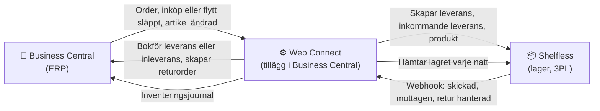
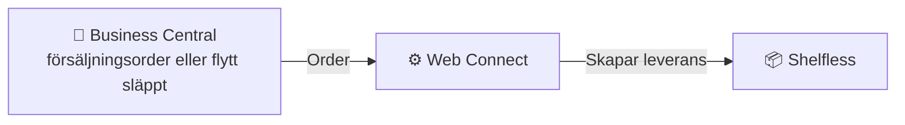
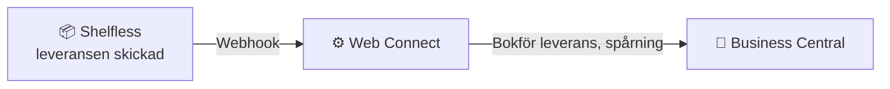
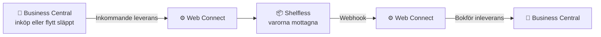
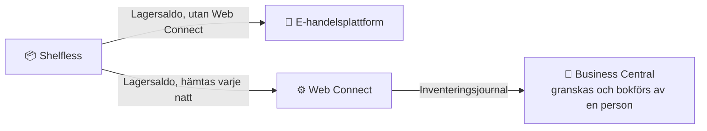
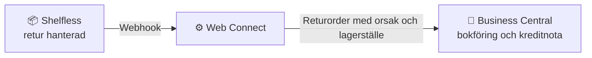
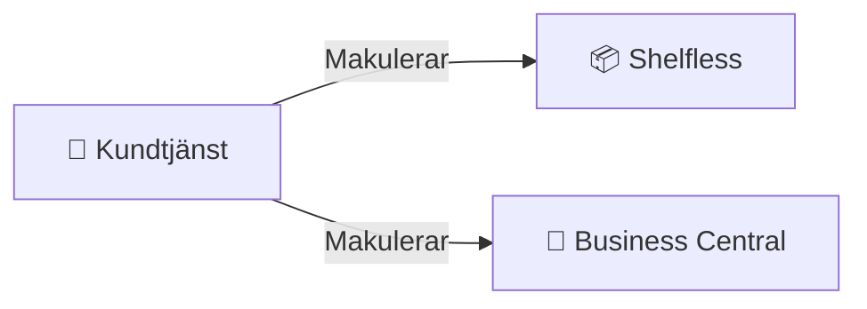

# Business Central och Shelfless: integration

Web Connect från CombineIT kopplar ihop Microsoft Dynamics 365 Business Central med Shelfless, ett tredjepartslager (3PL). Försäljningsorder, inköpsorder, flyttar och produkter skickas till Shelfless, och leveranser, inleveranser, returer och en nattlig inventering kommer tillbaka till Business Central. Alla mappningar och regler finns i ditt eget Business Central, där du själv kan se och ändra dem.

## I korthet

| | |
|---|---|
| **System** | Shelfless (lager, 3PL) |
| **Integrationsprodukt** | Web Connect för Microsoft Dynamics 365 Business Central |
| **Körs i** | Din egen Business Central-miljö, som ett tillägg. Order, inköp och produkter skickas till Shelfless när de släpps eller ändras. Leveranser, inleveranser och returer skickas av Shelfless som webhooks, som tas emot av en Azure-endpoint som skickar dem vidare till Web Connect. Inventeringen hämtas enligt schema i jobbkön i Business Central. All bearbetning och konfiguration finns kvar i Business Central. |
| **Konfigureras av** | Dig, i Business Central: mappningar, villkor, triggers och flöden. Du kan göra allt själv. Om du vill är CombineIT med i vilket steg som helst, som bollplank eller genom att göra jobbet. |
| **Koppling** | REST API med HTTP Basic Authentication, och webhooks från Shelfless |
| **Shelfless API** | [Shelfless DreamREST API](https://rest.dreamlogistics.se/swagger/index.html) |
| **Dataflöden** | 7: utgående leveranser, leveransbekräftelser, inkommande leveranser, inleveranser, produkter, returer och inventering |
| **Business Central-utgåvor** | Alla utgåvor, Essentials och Premium, även den senaste versionen |
| **Finns på** | [Web Connect på Microsoft AppSource](https://marketplace.microsoft.com/sv-se/product/PUBID.martitab1633951001710%7CAID.webconnect%7CPAPPID.9f3a7223-19db-4ac7-832f-cf8e4699186f?tab=Overview). Shelfless-integrationen ingår inte i appen Web Connect Ready Integrations. Den sätts upp som en konfiguration i Web Connect |

## Det här kan synkas

Web Connect har sju dataflöden mellan Business Central och Shelfless.

| Data | Riktning | Vad som händer |
|---|---|---|
| [Utgående leveranser](flows/outbound-delivery.md) | Business Central → Shelfless | En släppt försäljningsorder eller utgående flyttorder skapas som en leverans i Shelfless |
| [Leveransbekräftelser](flows/shipment-confirmation.md) | Shelfless → Business Central | När Shelfless har skickat bokförs leveransen i Business Central med spårningsnummer |
| [Inkommande leveranser](flows/inbound-delivery.md) | Business Central → Shelfless | En släppt inköpsorder eller inkommande flyttorder aviseras till Shelfless som en inkommande leverans |
| [Inleveranser](flows/goods-receipt.md) | Shelfless → Business Central | När Shelfless har tagit emot varorna bokförs inleveransen i Business Central med mottaget antal |
| [Produkter](flows/product-data.md) | Business Central → Shelfless | Nya och ändrade artiklar skapas eller uppdateras i Shelfless, med streckkod och tulldata. Varje artikelvariant blir en egen produkt |
| [Returer](flows/returns.md) | Shelfless → Business Central | När Shelfless har hanterat en kundretur skapas en returorder i Business Central |
| [Inventering](flows/stock-reconciliation.md) | Shelfless → Business Central | Varje natt hämtas lagret i Shelfless till en inventeringsjournal för granskning |

Utgående leveranser och leveransbekräftelser är kärnan i integrationen. De andra flödena väljs när integrationen sätts upp. Se [Välj upplägg](#choose-your-setup).

## Så fungerar det

Web Connect skickar en försäljningsorder, inköpsorder eller flyttorder till Shelfless när den släpps i Business Central, och produkter när en artikel skapas eller ett bevakat fält ändras. Shelfless anropar tillbaka med en webhook när en leverans har skickats, en inkommande leverans har tagits emot eller en retur har hanterats. Web Connect matchar webhooken mot dokumentet i Business Central via det externa id som den skickade, och bokför leveransen eller inleveransen eller skapar returordern. En gång per natt hämtar Web Connect lagret från Shelfless och skapar en inventeringsjournal. Varje meddelande loggas i Web Connect Entries och som ett [WMS-dokument](../../general/wms-documents.md), där det går att granska och skicka om.

## Välj upplägg

Varje flöde måste passa hur ditt företag arbetar: vilket system som äger datat, var personalen gör sitt jobb och vad redovisningen kräver. Därför bestäms flödena tillsammans när en ny integration sätts upp. Alternativen nedan är de som Web Connect-kunder använder i dag.

Shelfless används av en Web Connect-kund i dag. Inget alternativ är därför markerat som **vanligast**, eftersom det inte finns något att jämföra med. Alternativen beskriver hur den integrationen fungerar.

### Utgående leveranser

| Alternativ | Så fungerar det | När det passar |
|---|---|---|
| **Skickas när ordern släpps** | Försäljningsorder och utgående flyttorder skickas till Shelfless när de släpps i Business Central | Ordrarna hanteras i Business Central, till exempel efter att de importerats från e-handelsplattformen |

#### Utgående leveranser som skickas när ordern släpps

### Leveranser

| Alternativ | Så fungerar det | När det passar |
|---|---|---|
| **Webhook från Shelfless** | Shelfless skickar varje leverans som gått iväg. Web Connect bokför leveransen och sparar spårningsnumren. Skickade leveranser kan också hämtas från API:t, till exempel för att komma ikapp efter ett avbrott | Alltid, när utgående leveranser används |

#### Leveranser via webhook från Shelfless

### Inköp och inleveranser

| Alternativ | Så fungerar det | När det passar |
|---|---|---|
| **Aviseras från Business Central, tas emot via webhook** | Inköpsorder och inkommande flyttorder aviseras när de släpps. Shelfless skickar inleveransen när varorna tagits emot, och Web Connect bokför den | Inköpen görs i Business Central |

#### Inköp som aviseras från Business Central och tas emot via webhook

### Lagersaldo

| Alternativ | Så fungerar det | När det passar |
|---|---|---|
| **Direkt mellan Shelfless och e-handelsplattformen, räknas in i Business Central varje natt** | Shelfless skickar lagersaldo till e-handelsplattformen utan Business Central. Web Connect hämtar lagret från Shelfless varje natt och skapar en inventeringsjournal som någon granskar och bokför | Shelfless har redan en koppling till e-handelsplattformen, och lagerdifferenser måste kontrolleras innan de bokförs |

#### Lagersaldo direkt mellan Shelfless och e-handelsplattformen, räknas in i Business Central varje natt

### Returer

| Alternativ | Så fungerar det | När det passar |
|---|---|---|
| **Returorder skapas från webhooken** | När Shelfless har hanterat en retur skapar Web Connect en returorder i Business Central utifrån den bokförda försäljningsfakturan, med returorsak och lagerställe per rad. Bokföring, kreditnota och återbetalning görs i Business Central | Kundreturer tas emot av Shelfless |

#### Returer som skapas från webhooken

### Makuleringar

| Alternativ | Så fungerar det | När det passar |
|---|---|---|
| **Manuellt i varje system** | En order som skickats till Shelfless makuleras manuellt i Shelfless och i Business Central. Web Connect skickar ingen makulering till Shelfless | Det är det enda alternativet som används i dag |

#### Makulering manuellt i varje system

Plock, packning, bokning av transportör och lagerplatserna inne i lagret hanteras alltid i Shelfless.

## Det här behöver du

- Microsoft Dynamics 365 Business Central, valfri utgåva (Essentials eller Premium), även den senaste versionen
- Web Connect installerat från Microsoft AppSource, med en aktiverad Web Connect-licens
- Ditt godkännande av att Web Connect installeras och får agera i din Business Central-miljö
- En API-användare (användarnamn och lösenord) för Shelfless DreamREST API. Shelfless bestämmer hur API-användaren delas ut, så be Shelfless om en
- Webhooks inställda i Shelfless för skickade leveranser, mottagna inkommande leveranser och hanterade returer, som pekar på Web Connects endpoint. Shelfless registrerar webhookarna
- Ett lagerställe i Business Central för lagret hos Shelfless

## Så kommer du igång

1. Bestäm vilka flöden som ska användas och vilket alternativ som väljs för vart och ett, se [Välj upplägg](#choose-your-setup).
2. Installera Web Connect i Business Central, aktivera licensen och ge ditt godkännande. Shelfless-integrationen ingår inte i appen Ready Integrations, så den sätts upp som en konfiguration i Web Connect.
3. Spara API-användaren för Shelfless i Web Connects [Secret Value Storage](../../general/secret-value-storage.md) och sätt upp en testsajt och en produktionssajt.
4. Ställ in [Logistics Setup](../../general/logistics-setup.md) för Shelfless: lagerställe, vilka dokument som ska integreras, bokföring och journaler.
5. Gör valen i konfigurationen nedan.
6. Testa order, inköp, returer och inventeringen mot Shelfless innan ni går live.

## Konfigurera själv i Business Central

All konfiguration och logik i integrationen syns och går att ändra i Business Central. Det finns ingen extern integrationsplattform där logiken är dold. Azure-endpointen som tar emot webhooks skickar bara anropet vidare till Web Connect.

| Det här kan du ändra | Var i Web Connect | Exempel |
|---|---|---|
| Vilka dokument som går till Shelfless | [Logistics Setup](../../general/logistics-setup.md) | Skicka försäljningsorder, inköpsorder och flyttorder när de släpps |
| Bokföring av leveranser och inleveranser | [Logistics Setup](../../general/logistics-setup.md) | Bokför leveransen när Shelfless rapporterar leveransen som skickad, med arbetsdatumet som bokföringsdatum |
| Fältmappning på utgående dokument | [Outgoing Mapping](../../general/outgoing-mapping/README.md) och [Dynamic Flow Fields](../../general/dynamic-flow-fields.md) | Skicka nettopriset per enhet exklusive moms som artikelpris på orderraderna |
| Fältmappning på inkommande webhooks | [Incoming Data mapping](../../general/incoming-data/mapping.md) | Spara spårningsnumret och spårningslänken på leveransen |
| Vad som startar produktuppdateringar | [Outgoing Sync Triggers](../../general/outgoing-mapping/outgoing-sync-triggers.md) | Skicka artikeln när beskrivningen, statistiskt nummer, ursprungsland eller GTIN ändras |
| Vilka rader som behandlas | [Condition List](../../general/condition-list.md) | Hoppa över rader utan externt id, eller returrader som levererats tillbaka till kunden |
| Returorsaker och lagerställen | [WMS/Return Reason Codes](../../general/wms-return-reason-codes.md) | Mappa varje returorsak i Shelfless till en returorsakskod i Business Central |
| Bevakning och omsändning | [Entries](../../general/entries.md) och [WMS Documents](../../general/wms-documents.md) | Se varje order och webhook, och [skicka om ett meddelande](../../../../how-to/web-connect/resend-outgoing-message.md) |

## Val i konfigurationen

- **Dokument som ska integreras:** försäljningsorder, utgående och inkommande flyttorder och inköpsorder kan slås på eller av var för sig.
- **När de skickas:** dokument skickas till Shelfless när de släpps.
- **Bokföring:** om leveranser och inleveranser bokförs automatiskt, vilken status i Shelfless som räknas som skickad, och om bokföringsdatumet är arbetsdatumet.
- **Överleverans:** om Shelfless får rapportera mer än beställt på ett inköp, och med vilken tolerans.
- **Artikelpris på orderrader:** vilket värde som skickas som artikelpris, till exempel styckkostnad eller nettoförsäljningspriset per enhet exklusive moms, som Shelfless kan använda för tull.
- **Produktnummer:** artikelnumret, med variantkoden tillagd efter ett skiljetecken när varianter används. Varje artikelvariant blir en egen produkt i Shelfless.
- **Avsändarprofil och fraktservice:** vilken kod för fraktservice och vilken avsändarprofil som skickas. Avsändarprofilen kan lämnas tom så att Shelfless väljer den utifrån land och kundtyp.
- **Returorsaker och lagerställen:** vilken returorsakskod och vilket lagerställe i Business Central som varje returorsak och radstatus i Shelfless mappas till.
- **Inventering:** vilken journal inventeringen skrivs till, och om rader utan differens tas bort.
- **Felmejl:** en daglig sammanfattning av fel kan skickas till en lista med mottagare.

## Begränsningar

- **Makuleringar skickas inte till Shelfless.** En order som har skickats måste makuleras manuellt i Shelfless.
- **Order som skapats eller kopierats i Shelfless har inget externt id.** Web Connect kan falla tillbaka på orderreferensen på följesedeln, men rader utan externt id hoppas över. Skapa order i Business Central, inte i Shelfless.
- **Produkter som bara skapats i Shelfless räknas inte.** Inventeringen tar bara med produkter som kommit från Business Central.
- **Inventeringen bokförs inte automatiskt.** Inventeringsjournalen måste granskas och bokföras av en person.
- **Returorder skickas inte till Shelfless.** Returer registreras i Shelfless, och returordern skapas i Business Central efteråt.

## Vanliga frågor

### Går det att integrera Business Central med Shelfless?

Ja. Web Connect kopplar ihop Business Central med Shelfless via Shelfless DreamREST API. Försäljningsorder, utgående flyttar, inköpsorder, inkommande flyttar och produkter skickas till Shelfless, och leveranser, inleveranser, returer och en nattlig inventering kommer tillbaka till Business Central.

### Varför bokfördes inte en leverans från Shelfless i Business Central?

Web Connect hittar ordern i Business Central via det externa id som skickades med ordern. En leverans som skapats eller kopierats i Shelfless har inget sådant id. Web Connect kan då falla tillbaka på orderreferensen på följesedeln, men rader utan externt id hoppas över. Kontrollera leveransen i Web Connect Entries och WMS-dokumentet.

### Bokförs lagerdifferenser från Shelfless automatiskt?

Nej. Varje natt hämtar Web Connect lagret i Shelfless och skapar en inventeringsjournal i Business Central. Någon granskar och bokför journalen, så differenser bokförs aldrig utan kontroll.

### Kan vi makulera en order i Business Central efter att den skickats till Shelfless?

Inte via integrationen i dag. Makuleringen måste göras i Shelfless också. En begäran om makulering från Business Central till Shelfless ingår inte i standardupplägget.

### Går lagersaldot via Business Central till webbshoppen?

Det behöver det inte. Shelfless kan skicka lagersaldo direkt till e-handelsplattformen. Business Central får då den nattliga inventeringen från Shelfless, så att det egna lagret stämmer.

## Relaterat

- Flöden: [Utgående leveranser](flows/outbound-delivery.md) · [Leveransbekräftelser](flows/shipment-confirmation.md) · [Inkommande leveranser](flows/inbound-delivery.md) · [Inleveranser](flows/goods-receipt.md) · [Produktdata](flows/product-data.md) · [Returer](flows/returns.md) · [Inventering](flows/stock-reconciliation.md)
- Instruktioner: [Skicka om ett utgående meddelande](../../../../how-to/web-connect/resend-outgoing-message.md) · [WMS-dokumentet visar "Request not sent"](../../../../how-to/web-connect/wms-request-not-sent-error.md) · [Inget hämtas till Business Central](../../../../how-to/web-connect/nothing-downloads-to-business-central.md)
- [Allmän dokumentation för Web Connect](../../general/README.md)
- [Dokumentation för Shelfless DreamREST API](https://rest.dreamlogistics.se/swagger/index.html)

## Om Web Connect

Web Connect är en integrationsplattform för Microsoft Dynamics 365 Business Central, utvecklad av CombineIT. Den installeras i ditt eget Business Central och kopplar ihop det med e-handelsplattformar, lagersystem, kassasystem, returer, marknadsplatser och EDI. Varje flöde, mappning och regel konfigureras i Business Central, där du själv kan se och ändra det, utan specialkod för varje integration. [Web Connect på Microsoft AppSource](https://marketplace.microsoft.com/sv-se/product/PUBID.martitab1633951001710%7CAID.webconnect%7CPAPPID.9f3a7223-19db-4ac7-832f-cf8e4699186f?tab=Overview) · [Kontakta CombineIT](https://www.combineit.se/contact/)
