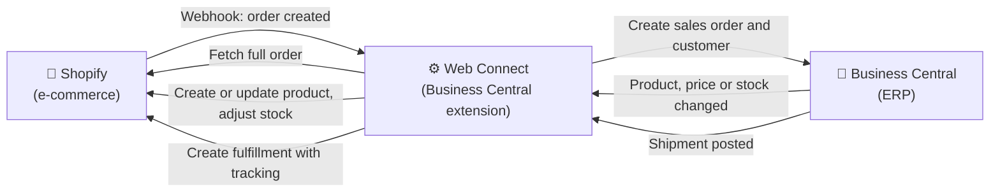
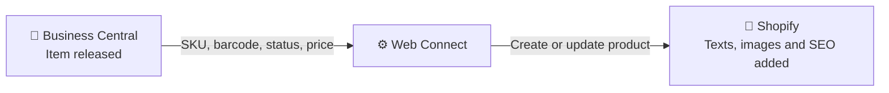
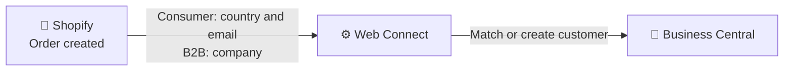

# Business Central and Shopify integration

Web Connect by CombineIT connects Microsoft Dynamics 365 Business Central with Shopify. Orders from the online store and from Shopify B2B are created as sales orders in Business Central, and products, prices, stock per location and shipments with tracking are sent back to Shopify. All mappings and rules live in your own Business Central, where you can see and change them yourself.

## At a glance

| | |
|---|---|
| **System** | Shopify (e-commerce for consumers and B2B) |
| **Integration product** | Web Connect for Microsoft Dynamics 365 Business Central |
| **Runs in** | Your own Business Central environment, as an extension. When an order is created, Shopify notifies Web Connect with a webhook. The webhook is received by an Azure endpoint that only passes it on to Web Connect, which then fetches the full order from Shopify. Changes in Business Central are sent to Shopify when they happen. All processing and configuration stays in Business Central. |
| **Configured by** | You, in Business Central: mappings, conditions, triggers and flows. You can do all of it yourself. If you want, CombineIT takes part in any step, as a sounding board or by doing the work. |
| **Connection** | Shopify GraphQL Admin API and Shopify webhooks |
| **Shopify API** | [Shopify GraphQL Admin API](https://shopify.dev/docs/api/admin-graphql) |
| **Data flows** | 4: orders (with customers), products and prices, stock and shipments |
| **Business Central editions** | Essentials and Premium |
| **Available from** | [Web Connect on Microsoft AppSource](https://marketplace.microsoft.com/sv-se/product/PUBID.martitab1633951001710%7CAID.webconnect%7CPAPPID.9f3a7223-19db-4ac7-832f-cf8e4699186f?tab=Overview). The Shopify integration is included in the Web Connect Ready Integrations app |

## What can be synchronized

Web Connect has four data flows between Business Central and Shopify.

| Data | Direction | What happens |
|---|---|---|
| Orders and customers | Shopify → Business Central | A sales order is created in Business Central. The customer is matched or created, with billing address on the customer and shipping address on the order |
| Products and prices | Business Central → Shopify | Products and variants are created or updated in Shopify with SKU, barcode, status and price |
| Stock | Business Central → Shopify | Available stock is sent per Shopify location |
| Shipments | Business Central → Shopify | A fulfillment with carrier and tracking number is created in Shopify when a shipment is posted. Partial shipments are supported |

The order flow is part of every integration. The other flows are chosen when the integration is set up.

## How it works

When an order is created in Shopify, a webhook tells Web Connect which order it is. Web Connect fetches the full order with a GraphQL query: lines, prices, discounts, taxes, shipping lines, transactions, addresses and, for B2B orders, the company. It identifies the customer, creates the sales order in Business Central and fetches the order's fulfillment orders from Shopify, so that shipments can later be reported line by line. When something changes in Business Central (a product is released, stock moves, a shipment is posted), an outgoing sync trigger in Web Connect sends the change to Shopify. Every message in both directions is logged in Web Connect Entries, where it can be inspected and resent.

## Choose your setup

Each flow has to fit how your business works: which system owns the data, where people do their work, and what the accounting needs. That is why the flows are decided together when a new integration is set up. The options below are the ones in use with Web Connect customers on Shopify today.

### Product data

| Option | How it works | When it fits |
|---|---|---|
| **Business Central sends the base data, Shopify is used for enrichment** | Business Central creates the product and keeps SKU, barcode, status and price up to date. Title and description are sent only when the product is created. Images, texts, collections and SEO are then maintained in Shopify | You want Business Central to own what affects orders and stock, and the web team to own what affects how products are presented |

#### Product data from Business Central with enrichment in Shopify

### Customers

| Option | How it works | When it fits |
|---|---|---|
| **Consumers matched on email, B2B companies on customer number** | A consumer order is matched to a customer by country and email address, and a new customer is created if there is no match. A B2B order is matched to the existing Business Central customer through the Shopify company | You sell both to consumers and to companies through Shopify B2B |

#### Customers matched per order type

Customer and shipping information on the order is always taken from Shopify.

## What you need

- Microsoft Dynamics 365 Business Central, Essentials or Premium
- Web Connect installed from Microsoft AppSource, with an activated Web Connect license
- The Web Connect Ready Integrations app installed in the same Business Central environment. The Shopify integration is included in it
- Your approval for Web Connect to be installed and to act in your Business Central environment
- A Shopify app for the store with access to the Admin API, and its credentials. Web Connect uses an access token and renews it automatically
- The Shopify locations that stock should be sent to

## Setting it up

1. Decide which flows to use and which option to choose for each, see [Choose your setup](#choose-your-setup).
2. Install Web Connect in Business Central, activate the license and give your approval.
3. Install the Web Connect Ready Integrations app in the same environment and activate the Shopify integration.
4. Create the app in Shopify and store its credentials in Web Connect [Secret Value Storage](../../general/secret-value-storage.md).
5. Fetch the Shopify locations into Web Connect and map them to Business Central locations.
6. Set up the configuration choices below, and the order webhook in Shopify.
7. Test the whole order flow in a Business Central sandbox against a Shopify development store before going live.

## Configure it yourself in Business Central

All configuration and logic in the integration is visible and editable in Business Central. There is no external integration platform where the logic is hidden. The Azure endpoint that receives webhooks only passes the call on to Web Connect.

| What you can change | Where in Web Connect | Example |
|---|---|---|
| Field mapping | [Incoming Data mapping](../../general/incoming-data/mapping.md) or [Outgoing Mapping](../../general/outgoing-mapping/README.md) | Map a Shopify order attribute or metafield to a field on the sales order |
| Conditions | [Condition List](../../general/condition-list.md) | Route B2B orders to different settings than consumer orders |
| Triggers | Outgoing Sync Triggers | Send stock when inventory changes |
| Monitoring | [Entries](../../general/entries.md) | See every message sent and received, and resend one |

## Configuration choices

- **Which items are sent to Shopify:** which items become products in Shopify, and whether they are published as draft or active.
- **Variants:** how Business Central items are grouped into one Shopify product with variants, and which option name and values they get.
- **Location mapping:** which Business Central locations make up the stock for each Shopify location.
- **Shipping method:** how the shipping line or metafields on the Shopify order set shipping method, shipping agent and service in Business Central, with the customer card as fallback.
- **Payment method:** how Shopify payment gateways map to payment methods in Business Central.
- **Order total check:** Web Connect can compare the order total in Business Central with the Shopify total, so that a mapping error stops the order instead of passing unnoticed.

## Limitations

- **Stock needs inventory tracking.** Shopify ignores stock for variants where tracking is off or the item is not active at the location.
- **Product texts are not updated from Business Central** after the product has been created. This is intentional, so that enrichment in Shopify is not overwritten.
- **Product enrichment stays in Shopify.** Images, collections and SEO are not sent from Business Central.

## Frequently asked questions

### Can Business Central be integrated with Shopify?

Yes. Web Connect connects Business Central with Shopify through the Shopify GraphQL Admin API. Orders are created as sales orders in Business Central, and products, prices, stock and shipments with tracking are sent to Shopify.

### Does the integration support Shopify B2B?

Yes. Orders placed by a Shopify B2B company are imported with the company, its location and the purchase order number. The company is matched to an existing customer in Business Central, so B2B and consumer orders can follow different rules.

### Will product texts we write in Shopify be overwritten?

No. Title and description are sent from Business Central only when a product is created. After that they are maintained in Shopify, together with images, collections and SEO. SKU, barcode, price and status are kept up to date from Business Central.

### Why does stock not update in Shopify?

Shopify only accepts stock for variants where inventory tracking is on and the item is active at the location. Web Connect turns tracking on when it creates the product. For products created in Shopify by hand, check that tracking is on and that the location is activated for the variant.

### Can we change what is sent between Business Central and Shopify ourselves?

Yes. Field mappings, conditions, triggers and which flows are active are configured in Web Connect inside your own Business Central. You can see and change them without asking a supplier to change an external platform.

## Related

- [Web Connect general documentation](../../general/README.md)
- [Business Central and Centra integration](../centra/overview.md)
- [Shopify GraphQL Admin API](https://shopify.dev/docs/api/admin-graphql)

## About Web Connect

Web Connect is an integration platform for Microsoft Dynamics 365 Business Central, developed by CombineIT. It is installed in your own Business Central and connects it with e-commerce platforms, warehouse systems, POS, returns, marketplaces and EDI. Every flow, mapping and rule is configured in Business Central, where you can see and change it yourself, without custom code for each integration. [Web Connect on Microsoft AppSource](https://marketplace.microsoft.com/sv-se/product/PUBID.martitab1633951001710%7CAID.webconnect%7CPAPPID.9f3a7223-19db-4ac7-832f-cf8e4699186f?tab=Overview) · [Contact CombineIT](https://www.combineit.se/contact/)
