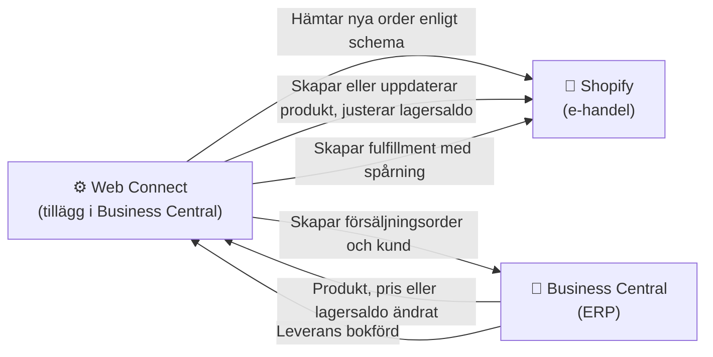
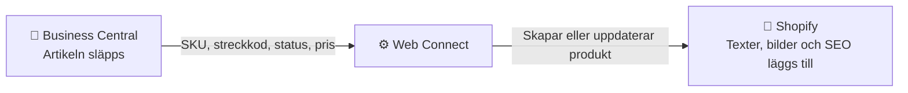
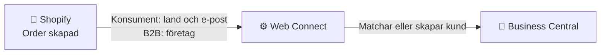

# Business Central och Shopify: integration

Web Connect från CombineIT kopplar Microsoft Dynamics 365 Business Central till Shopify. Order från webbshopen och från Shopify B2B skapas som försäljningsorder i Business Central, och produkter, priser, lagersaldo per lagerställe och leveranser med spårning skickas tillbaka till Shopify. Alla mappningar och regler finns i ditt eget Business Central, där du kan se och ändra dem själv.

## I korthet

| | |
|---|---|
| **System** | Shopify (e-handel för konsumenter och B2B) |
| **Integrationsprodukt** | Web Connect för Microsoft Dynamics 365 Business Central |
| **Körs i** | Din egen Business Central-miljö, som ett tillägg. Web Connect hämtar nya order från Shopify enligt schema i jobbkön i Business Central och skickar ändringar till Shopify när de sker. Ingen extern integrationsplattform är inblandad. |
| **Konfigureras av** | Dig, i Business Central: mappningar, villkor, triggers och flöden. Du kan göra allt själv. Om du vill är CombineIT med i vilket steg som helst, som bollplank eller genom att göra jobbet. |
| **Koppling** | Shopify GraphQL Admin API |
| **Shopifys API** | [Shopify GraphQL Admin API](https://shopify.dev/docs/api/admin-graphql) |
| **Dataflöden** | 4: order (med kunder), produkter och priser, lagersaldo och leveranser |
| **Business Central-utgåvor** | Essentials och Premium |
| **Finns på** | [Web Connect på Microsoft AppSource](https://marketplace.microsoft.com/sv-se/product/PUBID.martitab1633951001710%7CAID.webconnect%7CPAPPID.9f3a7223-19db-4ac7-832f-cf8e4699186f?tab=Overview). Shopify-integrationen ingår i appen Web Connect Ready Integrations |

## Det här kan synkas

Web Connect har fyra dataflöden mellan Business Central och Shopify.

| Data | Riktning | Vad som händer |
|---|---|---|
| Order och kunder | Shopify → Business Central | En försäljningsorder skapas i Business Central. Kunden matchas eller skapas, med faktureringsadressen på kunden och leveransadressen på ordern |
| Produkter och priser | Business Central → Shopify | Produkter och varianter skapas eller uppdateras i Shopify med SKU, streckkod, status och pris |
| Lagersaldo | Business Central → Shopify | Tillgängligt lagersaldo skickas per location i Shopify |
| Leveranser | Business Central → Shopify | En fulfillment med transportör och spårningsnummer skapas i Shopify när en leverans bokförs. Delleveranser stöds |

Orderflödet ingår i alla integrationer. De andra flödena väljs när integrationen sätts upp.

## Så fungerar det

Web Connect frågar Shopify efter nya order enligt schema, med en GraphQL-fråga. För varje order hämtas hela ordern: rader, priser, rabatter, skatter, fraktrader, transaktioner, adresser och, för B2B-order, företaget. Kunden identifieras, försäljningsordern skapas i Business Central och orderns fulfillment orders hämtas från Shopify, så att leveranserna senare kan rapporteras rad för rad. När något ändras i Business Central (en produkt släpps, lagersaldot rör sig, en leverans bokförs) skickar en utgående synktrigger i Web Connect ändringen till Shopify. Varje meddelande åt båda hållen loggas i Web Connect Entries, där det kan granskas och skickas igen.

## Välj upplägg

Varje flöde måste passa hur ert företag arbetar: vilket system som äger datan, var medarbetarna gör sitt jobb och vad bokföringen behöver. Därför bestäms flödena tillsammans när en ny integration sätts upp. Alternativen nedan är de som används hos kunder med Web Connect och Shopify i dag.

### Produktdata

| Alternativ | Så fungerar det | När det passar |
|---|---|---|
| **Business Central skickar grunddata, Shopify används för berikning** | Business Central skapar produkten och håller SKU, streckkod, status och pris uppdaterade. Titel och beskrivning skickas bara när produkten skapas. Bilder, texter, kollektioner och SEO underhålls sedan i Shopify | Du vill att Business Central ska äga det som påverkar order och lagersaldo, och att webbteamet ska äga det som påverkar hur produkterna presenteras |

#### Produktdata från Business Central med berikning i Shopify

### Kunder

| Alternativ | Så fungerar det | När det passar |
|---|---|---|
| **Konsumenter matchas på e-post, B2B-företag på kundnummer** | En konsumentorder matchas mot en kund på land och e-postadress, och en ny kund skapas om ingen matchar. En B2B-order matchas mot den befintliga kunden i Business Central via företaget i Shopify | Du säljer både till konsumenter och till företag via Shopify B2B |

#### Kunder matchas per ordertyp

Kund- och leveransuppgifterna på ordern hämtas alltid från Shopify.

## Det här behöver du

- Microsoft Dynamics 365 Business Central, Essentials eller Premium
- Web Connect installerat från Microsoft AppSource, med en aktiverad licens för Web Connect
- Appen Web Connect Ready Integrations installerad i samma Business Central-miljö. Shopify-integrationen ingår i den
- Ditt godkännande av att Web Connect installeras och agerar i din Business Central-miljö
- En Shopify-app för butiken med åtkomst till Admin API, och dess inloggningsuppgifter. Web Connect använder en åtkomsttoken och förnyar den automatiskt
- De locations i Shopify som lagersaldot ska skickas till

## Så kommer du igång

1. Bestäm vilka flöden ni ska använda och vilket alternativ ni väljer för vart och ett, se [Välj upplägg](#choose-your-setup).
2. Installera Web Connect i Business Central, aktivera licensen och ge ditt godkännande.
3. Installera appen Web Connect Ready Integrations i samma miljö och aktivera Shopify-integrationen.
4. Skapa appen i Shopify och spara dess inloggningsuppgifter i [Secret Value Storage](../../general/secret-value-storage.md) i Web Connect.
5. Hämta Shopifys locations till Web Connect och mappa dem mot lagerställen i Business Central.
6. Ställ in valen i konfigurationen nedan, och posten i jobbkön som hämtar order.
7. Testa hela orderflödet i en sandlåda i Business Central mot en utvecklingsbutik i Shopify innan ni går live.

## Konfigurera själv i Business Central

All konfiguration och logik i integrationen syns och går att ändra i Business Central. Det finns ingen extern integrationsplattform där logiken är gömd.

| Det här kan du ändra | Var i Web Connect | Exempel |
|---|---|---|
| Fältmappning | [Incoming Data mapping](../../general/incoming-data/mapping.md) eller [Outgoing Mapping](../../general/outgoing-mapping/README.md) | Mappa ett orderattribut eller metafält i Shopify till ett fält på försäljningsordern |
| Villkor | [Condition List](../../general/condition-list.md) | Styr B2B-order till andra inställningar än konsumentorder |
| Triggers | Outgoing Sync Triggers | Skicka lagersaldo när lagret ändras |
| Övervakning | [Entries](../../general/entries.md) | Se varje meddelande som skickats och tagits emot, och skicka ett igen |

## Val i konfigurationen

- **Vilka artiklar som skickas till Shopify:** vilka artiklar som blir produkter i Shopify, och om de publiceras som utkast eller aktiva.
- **Varianter:** hur artiklar i Business Central grupperas till en produkt med varianter i Shopify, och vilket alternativnamn och vilka värden de får.
- **Mappning av lagerställen:** vilka lagerställen i Business Central som utgör lagersaldot för varje location i Shopify.
- **Leveranssätt:** hur fraktraden eller metafälten på Shopify-ordern styr leveranssätt, speditör och tjänst i Business Central, med kundkortet som reserv.
- **Betalningsmetod:** hur betalningsgatewayer i Shopify mappas mot betalningsmetoder i Business Central.
- **Kontroll av ordersumma:** Web Connect kan jämföra ordersumman i Business Central med summan i Shopify, så att ett mappningsfel stoppar ordern i stället för att gå obemärkt förbi.

## Begränsningar

- **Lagersaldo kräver lagerspårning.** Shopify bortser från lagersaldot för varianter där spårningen är avslagen eller artikeln inte är aktiv på lagerstället.
- **Produkttexterna uppdateras inte från Business Central** efter att produkten har skapats. Det är medvetet, så att berikningen i Shopify inte skrivs över.
- **Berikningen av produkter stannar i Shopify.** Bilder, kollektioner och SEO skickas inte från Business Central.

## Vanliga frågor

### Går det att integrera Business Central med Shopify?

Ja. Web Connect kopplar Business Central till Shopify via Shopify GraphQL Admin API. Order skapas som försäljningsorder i Business Central, och produkter, priser, lagersaldo och leveranser med spårning skickas till Shopify.

### Stöder integrationen Shopify B2B?

Ja. Order som läggs av ett B2B-företag i Shopify importeras med företaget, dess location och inköpsordernumret. Företaget matchas mot en befintlig kund i Business Central, så att B2B-order och konsumentorder kan följa olika regler.

### Skrivs de produkttexter vi har skrivit i Shopify över?

Nej. Titel och beskrivning skickas från Business Central bara när en produkt skapas. Sedan underhålls de i Shopify, tillsammans med bilder, kollektioner och SEO. SKU, streckkod, pris och status hålls uppdaterade från Business Central.

### Varför uppdateras inte lagersaldot i Shopify?

Shopify tar bara emot lagersaldo för varianter där lagerspårningen är påslagen och artikeln är aktiv på lagerstället. Web Connect slår på spårningen när produkten skapas. För produkter som skapats för hand i Shopify: kontrollera att spårningen är påslagen och att lagerstället är aktiverat för varianten.

### Kan vi själva ändra vad som skickas mellan Business Central och Shopify?

Ja. Fältmappningar, villkor, triggers och vilka flöden som är aktiva konfigureras i Web Connect i ditt eget Business Central. Du kan se och ändra dem utan att be en leverantör ändra i en extern plattform.

## Relaterat

- [Allmän dokumentation för Web Connect](../../general/README.md)
- [Business Central och Centra: integration](../centra/overview.md)
- [Shopify GraphQL Admin API](https://shopify.dev/docs/api/admin-graphql)

## Om Web Connect

Web Connect är en integrationsplattform för Microsoft Dynamics 365 Business Central, utvecklad av CombineIT. Den installeras i ditt eget Business Central och kopplar det till e-handelsplattformar, lagersystem, kassasystem, returer, marknadsplatser och EDI. Varje flöde, mappning och regel konfigureras i Business Central, där du kan se och ändra det själv, utan specialkod för varje integration. [Web Connect på Microsoft AppSource](https://marketplace.microsoft.com/sv-se/product/PUBID.martitab1633951001710%7CAID.webconnect%7CPAPPID.9f3a7223-19db-4ac7-832f-cf8e4699186f?tab=Overview) · [Kontakta CombineIT](https://www.combineit.se/contact/)
