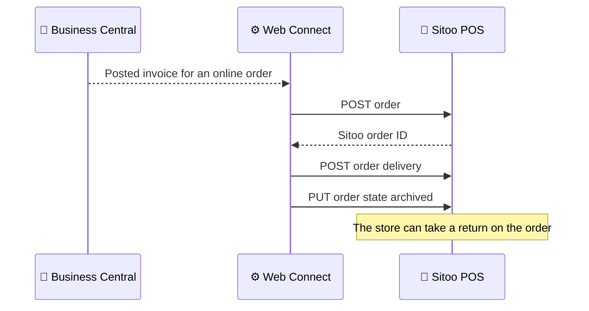

# Business Central to Sitoo POS: online orders for returns in store

Web Connect sends posted sales invoices for orders from the online store to Sitoo POS as orders. The order is then marked as delivered and archived in Sitoo, so a store can find the online order and take a return on it in the register.

| | |
|---|---|
| **Direction** | Business Central → Sitoo POS |
| **Trigger** | [ATT FYLLA I: what starts the send. The configurations in use have no outgoing sync trigger for these objects] |
| **Result** | A paid, delivered and archived order in Sitoo for each online invoice |
| **Part of** | [Business Central and Sitoo POS integration](../overview.md) |

## Step by step

1. An online order is invoiced in Business Central (Business Central).
2. Web Connect sends the posted invoice to Sitoo as a paid order, with the order number as external ID and the invoice lines as order items (Web Connect).
3. When the invoice has a Sitoo order ID, Web Connect registers a delivery of all lines on the order (Web Connect).
4. Web Connect archives the order in Sitoo (Web Connect).
5. A customer brings the goods to a store, and the store finds the order and takes the return (Sitoo POS).

## Data mapping

| Business Central field | Sitoo POS field | Note |
|---|---|---|
| Order No. of the invoice | `externalid` | The order number the invoice was made from |
| Invoice lines | `orderitems` | |
| Fixed values | `ordertypeid`, `paymentstateid`, `warehouseid` | Set in the mapping |
| Fixed value | `orderstate` | Sets the order as archived |

## Web Connect objects

| Object | Role |
|---|---|
| `SO_BORIS_INVOICE` | Sends the posted invoice as an order |
| `SO_BORIS_MARK_AS_DELIVERED` | Registers the delivery of all lines |
| `SO_BORIS_MARK_AS_ARCHIVED` | Archives the order |

## Error handling

| Situation | What happens | What to do |
|---|---|---|
| The invoice has no Sitoo order ID | The delivery is not sent | Check that the order was created in Sitoo, then [resend the message](../../../../../how-to/web-connect/resend-outgoing-message.md) |

## Frequently asked questions

### Which invoices are sent to Sitoo?

Posted sales invoices for orders that came from the online store. The filter is set on the object, for example on the source of the order.

## Related

- [Business Central and Sitoo POS integration](../overview.md)
- [Sales](sales-inbound.md)
