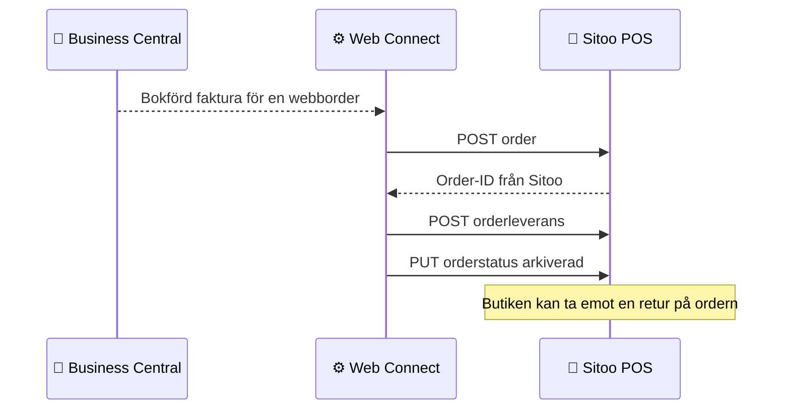

# Från Business Central till Sitoo POS: webborder för returer i butik

En butik kan bara ta emot en retur på ett köp som Sitoo POS känner till. Därför skickar Web Connect bokförda försäljningsfakturor för order från webbshopen till Sitoo som order. Ordern markeras sedan som levererad och arkiveras i Sitoo, så att butikspersonalen kan hitta webbordern och ta emot returen i kassan.

Flödet finns i Web Connect men är inte aktiverat hos någon kund än.

| | |
|---|---|
| **Riktning** | Business Central → Sitoo POS |
| **Startas av** | Väljs av dig i [Outgoing Sync Triggers](../../../general/outgoing-mapping/outgoing-sync-triggers.md), oftast när fakturan bokförs |
| **Resultat** | En betald, levererad och arkiverad order i Sitoo för varje webbfaktura |
| **Del av** | [Integrationen mellan Business Central och Sitoo POS](../overview.md) |

## Steg för steg

1. En webborder faktureras i Business Central (Business Central).
2. Web Connect skickar den bokförda fakturan till Sitoo som en betald order, med ordernumret som externt ID och fakturaraderna som orderrader (Web Connect).
3. När fakturan har ett order-ID från Sitoo registrerar Web Connect en leverans av alla rader på ordern (Web Connect).
4. Web Connect arkiverar ordern i Sitoo (Web Connect).
5. En kund tar med varorna till en butik, och butiken hittar ordern och tar emot returen (Sitoo POS).

## Mappning av data

| Fält i Business Central | Fält i Sitoo POS | Kommentar |
|---|---|---|
| Fakturans Order No. | `externalid` | Numret på ordern som fakturan skapades från |
| Fakturarader | `orderitems` | |
| Fasta värden | `ordertypeid`, `paymentstateid`, `warehouseid` | Anges i mappningen |
| Fast värde | `orderstate` | Sätter ordern som arkiverad |

## Objekt i Web Connect

| Objekt | Roll |
|---|---|
| `SO_BORIS_INVOICE` | Skickar den bokförda fakturan som en order |
| `SO_BORIS_MARK_AS_DELIVERED` | Registrerar leveransen av alla rader |
| `SO_BORIS_MARK_AS_ARCHIVED` | Arkiverar ordern |

## Felhantering

| Situation | Vad som händer | Vad du gör |
|---|---|---|
| Fakturan har inget order-ID från Sitoo | Leveransen skickas inte | Kontrollera att ordern skapades i Sitoo och [skicka sedan meddelandet igen](../../../../../how-to/web-connect/resend-outgoing-message.md) |

## Vanliga frågor

### Vilka fakturor skickas till Sitoo?

Bokförda försäljningsfakturor för order som kom från webbshopen. Filtret anges på objektet, till exempel på orderns källa.

### Används köp på webben och retur i butik i dag?

Flödet finns i Web Connect men är inte aktiverat hos någon kund än. Det slås på när en butik ska kunna ta emot returer på webbköp.

## Relaterat

- [Integrationen mellan Business Central och Sitoo POS](../overview.md)
- [Försäljning](sales-inbound.md)
