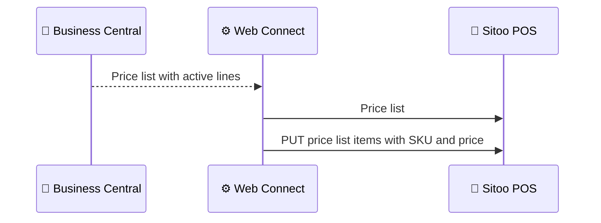

# Business Central to Sitoo POS: prices

Web Connect sends the price lists in Business Central to Sitoo POS as price lists, with name, description and currency. The active lines on each price list are sent as price list items with SKU and price, so the stores use the prices set in Business Central.

| | |
|---|---|
| **Direction** | Business Central → Sitoo POS |
| **Trigger** | Chosen by you in the [Outgoing Sync Triggers](../../../general/outgoing-mapping/outgoing-sync-triggers.md), often when a price is updated. Only active lines are sent |
| **Result** | Price lists and price list items in Sitoo |
| **Part of** | [Business Central and Sitoo POS integration](../overview.md) |

## Step by step

1. A price list is sent to Sitoo with its code, description and currency, and is set as active (Web Connect).
2. The active lines on the price list are sent as price list items, each with its SKU and price (Web Connect).
3. The products must already exist in Sitoo, see [Product data](product-data.md) (Sitoo POS).

## Data mapping

| Business Central field | Sitoo POS field | Note |
|---|---|---|
| Price list Code | `pricelistname` | |
| Price list Description | `pricelistdescription` | |
| Price list Currency Code | `currencycode` | The local currency is translated in the mapping |
| Price list line Product No. | `sku` | |
| Price list line Unit Price | `moneyprice` | |

## Web Connect objects

| Object | Role |
|---|---|
| `SO_PRICELIST` | Sends the price list |
| `SO_PRICELISTITEM` | Sends the active price list lines |

## Error handling

| Situation | What happens | What to do |
|---|---|---|
| The product does not exist in Sitoo | Sitoo rejects the price | Send the product first, then [resend the message](../../../../../how-to/web-connect/resend-outgoing-message.md) |

## Frequently asked questions

### Which price list lines are sent to Sitoo?

Only active price list lines. Draft and inactive lines are not sent.

## Related

- [Business Central and Sitoo POS integration](../overview.md)
- [Product data](product-data.md)
- [Item prices in Web Connect](../../../general/outgoing-mapping/item-price.md)
