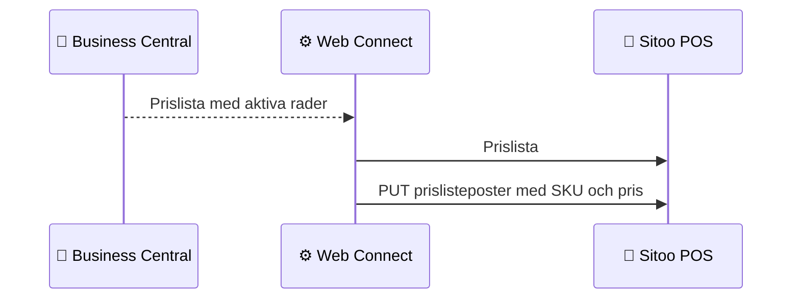

# Från Business Central till Sitoo POS: priser

Web Connect skickar prislistorna i Business Central till Sitoo POS som prislistor, med namn, beskrivning och valuta. De aktiva raderna på varje prislista skickas som prislisteposter med SKU och pris, så att butikerna använder priserna som satts i Business Central.

| | |
|---|---|
| **Riktning** | Business Central → Sitoo POS |
| **Startas av** | Väljs av dig i [Outgoing Sync Triggers](../../../general/outgoing-mapping/outgoing-sync-triggers.md), ofta när ett pris uppdateras. Bara aktiva rader skickas |
| **Resultat** | Prislistor och prislisteposter i Sitoo |
| **Del av** | [Integrationen mellan Business Central och Sitoo POS](../overview.md) |

## Steg för steg

1. En prislista skickas till Sitoo med kod, beskrivning och valuta, och sätts som aktiv (Web Connect).
2. De aktiva raderna på prislistan skickas som prislisteposter, var och en med SKU och pris (Web Connect).
3. Produkterna måste redan finnas i Sitoo, se [Artikeldata](product-data.md) (Sitoo POS).

## Mappning av data

| Fält i Business Central | Fält i Sitoo POS | Kommentar |
|---|---|---|
| Prislistans Code | `pricelistname` | |
| Prislistans Description | `pricelistdescription` | |
| Prislistans Currency Code | `currencycode` | Den lokala valutan översätts i mappningen |
| Prislisteradens Product No. | `sku` | |
| Prislisteradens Unit Price | `moneyprice` | |

## Objekt i Web Connect

| Objekt | Roll |
|---|---|
| `SO_PRICELIST` | Skickar prislistan |
| `SO_PRICELISTITEM` | Skickar de aktiva prislisteraderna |

## Felhantering

| Situation | Vad som händer | Vad du gör |
|---|---|---|
| Produkten finns inte i Sitoo | Sitoo avvisar priset | Skicka produkten först och [skicka sedan meddelandet igen](../../../../../how-to/web-connect/resend-outgoing-message.md) |

## Vanliga frågor

### Vilka prislisterader skickas till Sitoo?

Bara aktiva prislisterader. Rader som är utkast eller inaktiva skickas inte.

## Relaterat

- [Integrationen mellan Business Central och Sitoo POS](../overview.md)
- [Artikeldata](product-data.md)
- [Artikelpriser i Web Connect](../../../general/outgoing-mapping/item-price.md)
