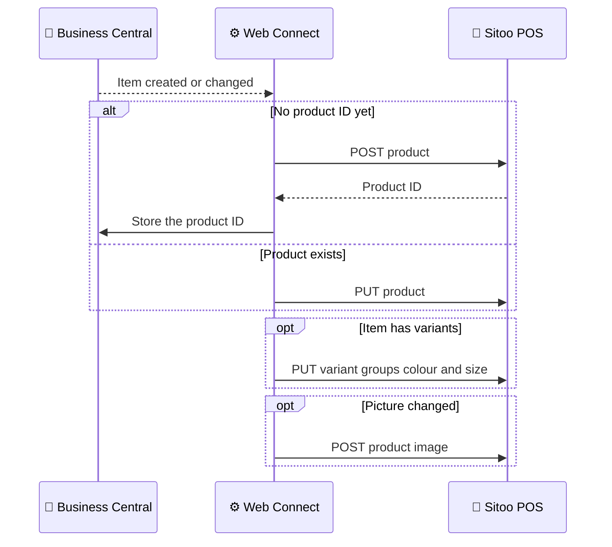

# Business Central to Sitoo POS: product data

Web Connect creates and updates products in Sitoo POS from the items in Business Central. Each item, or each item variant grouped by colour and size, becomes a product with title, price, barcodes, VAT group, category and manufacturer. Item categories, manufacturers and product images are sent with their own objects.

| | |
|---|---|
| **Direction** | Business Central → Sitoo POS |
| **Trigger** | A change to the item in Business Central, where an automatic trigger is set up. The image is sent when the picture on the item changes. [ATT FYLLA I: how product data is sent in setups without an automatic trigger] |
| **Result** | A product in Sitoo, with the Sitoo product ID stored on the item in Business Central |
| **Part of** | [Business Central and Sitoo POS integration](../overview.md) |

## Step by step

1. Item categories are sent as Sitoo categories, with their parent category, and manufacturers as Sitoo manufacturers (Web Connect).
2. An item is created or changed in Business Central (Business Central).
3. Web Connect sends the item, or each of its variants, as a product. A new product is created, and an existing product is updated with the Sitoo product ID (Web Connect).
4. Sitoo answers with the product ID, which Web Connect stores on the item (Web Connect).
5. With variants: when all variants have a product ID, Web Connect sends the variant groups for colour and size (Web Connect).
6. When the picture on the item changes, and the item has a product ID, the image is sent to the product (Web Connect).

## Data mapping

| Business Central field | Sitoo POS field | Note |
|---|---|---|
| No. (or the variant SKU) | `sku` | |
| Description | `title`, `descriptionshort` | |
| Unit Cost | `moneypricein` | |
| Unit Price | `moneypriceorg` | With variants, taken from the item |
| Base Unit of Measure | `unitlabel` | |
| VAT Prod. Posting Group | `vatid` | Translated to the Sitoo VAT group in Text Mapping |
| Item Category Code | `defaultcategoryid` | The Sitoo ID of the category |
| Manufacturer | `manufacturerid` | The Sitoo ID of the manufacturer |
| Item References of type barcode | `barcode`, `barcodealiases` | |
| Picture | Product image | Sent as a JPG file named after the item number |

Item category: code, description and sort order are sent, with the parent category when there is one.

## Web Connect objects

| Object | Role |
|---|---|
| `SO_PRODUCT` | Sends an item as a product |
| `SO_PRODUCT_FROM_VARIANT` | Sends an item variant as a product |
| `SO_PRODVARIANT` | Sends the variant groups colour and size for an item |
| `SO_BARCODE` | Barcodes from the item references |
| `SO_SO-CATEGORY` | Sends item categories as Sitoo categories |
| `SO_MANUFACTURERS` | Sends manufacturers |
| `SO_IMAGE` | Sends the product image |

## Error handling

| Situation | What happens | What to do |
|---|---|---|
| The VAT group has no mapping | The product gets the default VAT group in the mapping | Add the VAT group in [Text Mapping](../../../general/text-mapping.md) |
| The item has no product ID from Sitoo | The image is not sent | Send the product first |
| Not every variant has a product ID | The variant groups are not sent | Send the variants as products first |
| Sitoo rejects the product | The message is marked as failed in Entries | Check the error and [resend the message](../../../../../how-to/web-connect/resend-outgoing-message.md) |

## Frequently asked questions

### Can items with variants be sent to Sitoo?

Yes. Each item variant can be sent as a product in Sitoo, and the variants are then grouped under the item by colour and size.

## Related

- [Business Central and Sitoo POS integration](../overview.md)
- [Prices](prices.md)
- [Outgoing Sync Triggers](../../../general/outgoing-mapping/outgoing-sync-triggers.md)
