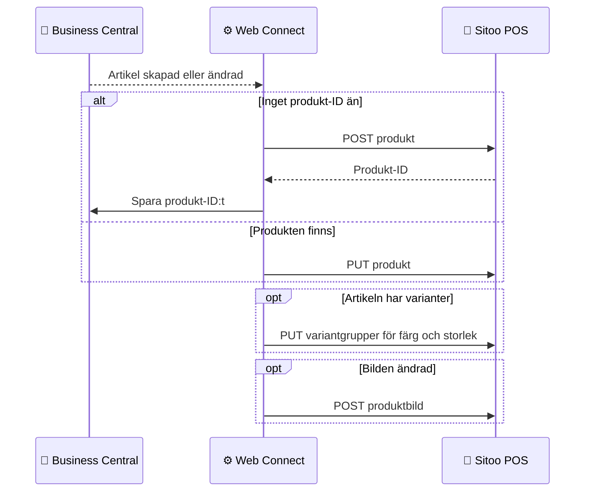

# Från Business Central till Sitoo POS: artikeldata

Web Connect skapar och uppdaterar produkter i Sitoo POS utifrån artiklarna i Business Central. Varje artikel, eller varje artikelvariant grupperad efter färg och storlek, blir en produkt med titel, pris, streckkoder, momsgrupp, kategori och tillverkare. Artikelkategorier, tillverkare och produktbilder skickas med egna objekt.

| | |
|---|---|
| **Riktning** | Business Central → Sitoo POS |
| **Startas av** | Väljs av dig i [Outgoing Sync Triggers](../../../general/outgoing-mapping/outgoing-sync-triggers.md), till exempel när artikeln, dess streckkoder eller dess pris ändras. Bilden skickas när bilden på artikeln ändras |
| **Resultat** | En produkt i Sitoo, där produkt-ID:t från Sitoo sparas på artikeln i Business Central |
| **Del av** | [Integrationen mellan Business Central och Sitoo POS](../overview.md) |

## Steg för steg

1. Artikelkategorier skickas som kategorier i Sitoo, med sin överordnade kategori, och tillverkare som tillverkare i Sitoo (Web Connect).
2. En artikel skapas eller ändras i Business Central (Business Central).
3. Web Connect skickar artikeln, eller var och en av dess varianter, som en produkt. En ny produkt skapas, och en befintlig produkt uppdateras med produkt-ID:t från Sitoo (Web Connect).
4. Sitoo svarar med produkt-ID:t, som Web Connect sparar på artikeln (Web Connect).
5. Med varianter: när alla varianter har ett produkt-ID skickar Web Connect variantgrupperna för färg och storlek (Web Connect).
6. När bilden på artikeln ändras, och artikeln har ett produkt-ID, skickas bilden till produkten (Web Connect).

## Mappning av data

| Fält i Business Central | Fält i Sitoo POS | Kommentar |
|---|---|---|
| No. (eller variantens SKU) | `sku` | |
| Description | `title`, `descriptionshort` | |
| Unit Cost | `moneypricein` | |
| Unit Price | `moneypriceorg` | Med varianter hämtas det från artikeln |
| Base Unit of Measure | `unitlabel` | |
| VAT Prod. Posting Group | `vatid` | Översätts till momsgruppen i Sitoo i Text Mapping |
| Item Category Code | `defaultcategoryid` | Kategorins ID i Sitoo |
| Manufacturer | `manufacturerid` | Tillverkarens ID i Sitoo |
| Item References av typen streckkod | `barcode`, `barcodealiases` | |
| Picture | Produktbild | Skickas som en JPG-fil med artikelnumret som namn |

Artikelkategori: kod, beskrivning och sorteringsordning skickas, med den överordnade kategorin när det finns en.

## Objekt i Web Connect

| Objekt | Roll |
|---|---|
| `SO_PRODUCT` | Skickar en artikel som produkt |
| `SO_PRODUCT_FROM_VARIANT` | Skickar en artikelvariant som produkt |
| `SO_PRODVARIANT` | Skickar variantgrupperna för färg och storlek för en artikel |
| `SO_BARCODE` | Streckkoder från artikelreferenserna |
| `SO_SO-CATEGORY` | Skickar artikelkategorier som kategorier i Sitoo |
| `SO_MANUFACTURERS` | Skickar tillverkare |
| `SO_IMAGE` | Skickar produktbilden |

## Felhantering

| Situation | Vad som händer | Vad du gör |
|---|---|---|
| Momsgruppen saknar mappning | Produkten får standardmomsgruppen i mappningen | Lägg till momsgruppen i [Text Mapping](../../../general/text-mapping.md) |
| Artikeln har inget produkt-ID från Sitoo | Bilden skickas inte | Skicka produkten först |
| Alla varianter har inte ett produkt-ID | Variantgrupperna skickas inte | Skicka varianterna som produkter först |
| Sitoo avvisar produkten | Meddelandet markeras som misslyckat i Entries | Kontrollera felet och [skicka meddelandet igen](../../../../../how-to/web-connect/resend-outgoing-message.md) |

## Vanliga frågor

### Går det att skicka artiklar med varianter till Sitoo?

Ja. Varje artikelvariant kan skickas som en produkt i Sitoo, och varianterna grupperas sedan under artikeln efter färg och storlek.

## Relaterat

- [Integrationen mellan Business Central och Sitoo POS](../overview.md)
- [Priser](prices.md)
- [Outgoing Sync Triggers](../../../general/outgoing-mapping/outgoing-sync-triggers.md)
