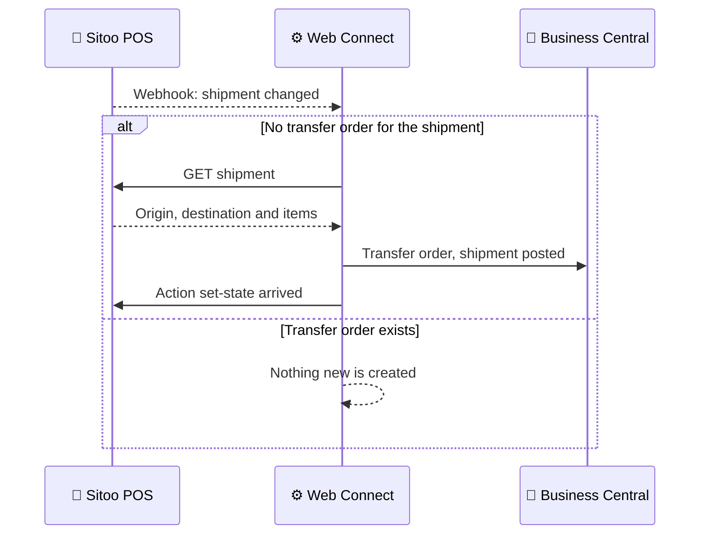

# Sitoo POS to Business Central: returns from stores

When a store creates a shipment in Sitoo POS, for example to send goods back to the central warehouse, Web Connect creates a transfer order in Business Central from the store location to the receiving location and posts the shipment from the store. The shipment in Sitoo is then set to arrived.

| | |
|---|---|
| **Direction** | Sitoo POS → Business Central |
| **Trigger** | Webhook from Sitoo when a shipment changes, and a schedule in Web Connect as a backup, every 30 to 120 minutes in the configurations that schedule it |
| **Result** | A transfer order with a posted shipment from the store location, and the shipment set to arrived in Sitoo |
| **Part of** | [Business Central and Sitoo POS integration](../overview.md) |

## Step by step

1. The store creates a shipment in Sitoo and adds the items (Sitoo POS).
2. Sitoo sends a webhook. If no transfer order exists for the shipment, Web Connect fetches it (Web Connect).
3. Web Connect creates a transfer order from the location for the origin warehouse to the location for the destination warehouse, with the Sitoo shipment ID as reference (Web Connect).
4. The lines get item, variant and quantity from the SKU, and the transfer shipment is posted (Business Central).
5. Web Connect sets the shipment to arrived in Sitoo (Web Connect).
6. The goods are received on the transfer order at the receiving location (Business Central).

## Data mapping

| Sitoo POS field | Business Central field | Note |
|---|---|---|
| `id` | No. of the transfer order, and the Sitoo shipment ID | Used to avoid duplicates |
| `info.origin_warehouse_id` | Transfer-from Code | Translated to a location |
| `info.destination_warehouse_id` | Transfer-to Code | Translated to a location |
| `items[].sku` | Item No., Variant Code | Looked up from the SKU |
| `items[].quantity` | Quantity | |
| `modified_at` | Date on the transfer order | |

## Web Connect objects

| Object | Role |
|---|---|
| `SO_SHIPMENT-WEBHOOK-DATA` | Starts the fetch when no transfer order exists for the shipment |
| `STS_GET_RETURN-FROM-STORE` | Fetches the shipment, creates the transfer order and posts the shipment |
| `STS_ITEMS6` | The transfer lines |
| `STS_SITOO_SETSTAGE_TRANSFER` | Sets the shipment to arrived in Sitoo |

## Error handling

| Situation | What happens | What to do |
|---|---|---|
| A Sitoo warehouse has no location in the mapping | The transfer order cannot be created | Add the warehouse in [Text Mapping](../../../general/text-mapping.md) and reprocess the shipment in [Entries](../../../general/entries.md) |
| The shipment cannot be posted, for example because of stock | The transfer order stays open | Fix the cause and post the shipment |

## Frequently asked questions

### Is a transfer order created twice if Sitoo sends the same shipment again?

No. The Sitoo shipment ID is stored on the transfer order, and the webhook only creates a transfer order when none exists for that shipment.

## Related

- [Business Central and Sitoo POS integration](../overview.md)
- [Store receipts](store-receipt.md)
- [Logistics Setup](../../../general/logistics-setup.md)
