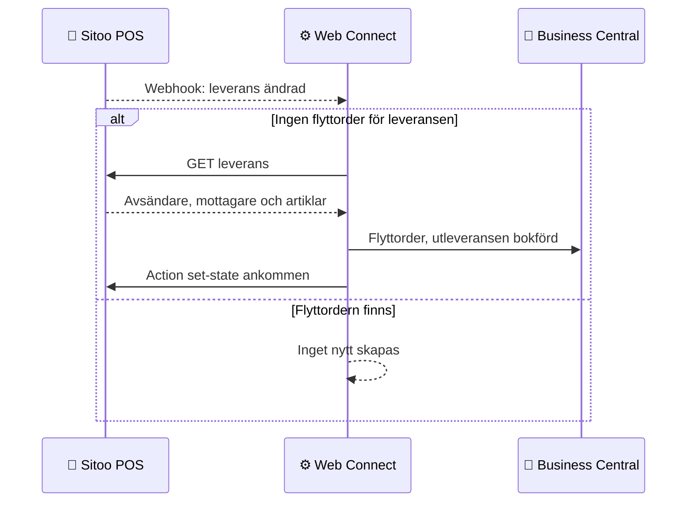

# Från Sitoo POS till Business Central: returer från butiker

När en butik skapar en leverans i Sitoo POS, till exempel för att skicka tillbaka varor till centrallagret, skapar Web Connect en flyttorder i Business Central från butikens lagerställe till det mottagande lagerstället och bokför utleveransen från butiken. Leveransen i Sitoo sätts sedan till ankommen.

| | |
|---|---|
| **Riktning** | Sitoo POS → Business Central |
| **Startas av** | Webhook från Sitoo när en leverans ändras, och ett schema i Web Connect som reserv, var 30:e till var 120:e minut i de konfigurationer som har schema |
| **Resultat** | En flyttorder med bokförd utleverans från butikens lagerställe, och leveransen satt till ankommen i Sitoo |
| **Del av** | [Integrationen mellan Business Central och Sitoo POS](../overview.md) |

## Steg för steg

1. Butiken skapar en leverans i Sitoo och lägger till artiklarna (Sitoo POS).
2. Sitoo skickar en webhook. Finns ingen flyttorder för leveransen hämtar Web Connect den (Web Connect).
3. Web Connect skapar en flyttorder från lagerstället för det avsändande lagret till lagerstället för det mottagande lagret, med leverans-ID:t från Sitoo som referens (Web Connect).
4. Raderna får artikel, variant och antal från SKU:n, och utleveransen på flyttordern bokförs (Business Central).
5. Web Connect sätter leveransen till ankommen i Sitoo (Web Connect).
6. Varorna tas emot på flyttordern på det mottagande lagerstället (Business Central).

## Mappning av data

| Fält i Sitoo POS | Fält i Business Central | Kommentar |
|---|---|---|
| `id` | No. på flyttordern, och leverans-ID:t från Sitoo | Används för att undvika dubbletter |
| `info.origin_warehouse_id` | Transfer-from Code | Översätts till ett lagerställe |
| `info.destination_warehouse_id` | Transfer-to Code | Översätts till ett lagerställe |
| `items[].sku` | Item No., Variant Code | Slås upp från SKU |
| `items[].quantity` | Quantity | |
| `modified_at` | Datum på flyttordern | |

## Objekt i Web Connect

| Objekt | Roll |
|---|---|
| `SO_SHIPMENT-WEBHOOK-DATA` | Startar hämtningen när det inte finns någon flyttorder för leveransen |
| `STS_GET_RETURN-FROM-STORE` | Hämtar leveransen, skapar flyttordern och bokför utleveransen |
| `STS_ITEMS6` | Raderna på flyttordern |
| `STS_SITOO_SETSTAGE_TRANSFER` | Sätter leveransen till ankommen i Sitoo |

## Felhantering

| Situation | Vad som händer | Vad du gör |
|---|---|---|
| Ett lager i Sitoo saknar lagerställe i mappningen | Flyttordern kan inte skapas | Lägg till lagret i [Text Mapping](../../../general/text-mapping.md) och bearbeta leveransen igen i [Entries](../../../general/entries.md) |
| Utleveransen kan inte bokföras, till exempel på grund av lagersaldot | Flyttordern förblir öppen | Åtgärda orsaken och bokför utleveransen |

## Vanliga frågor

### Skapas flyttordern två gånger om Sitoo skickar samma leverans igen?

Nej. Leverans-ID:t från Sitoo sparas på flyttordern, och webhooken skapar bara en flyttorder när det inte redan finns någon för leveransen.

## Relaterat

- [Integrationen mellan Business Central och Sitoo POS](../overview.md)
- [Inleveranser i butik](store-receipt.md)
- [Logistics Setup](../../../general/logistics-setup.md)
