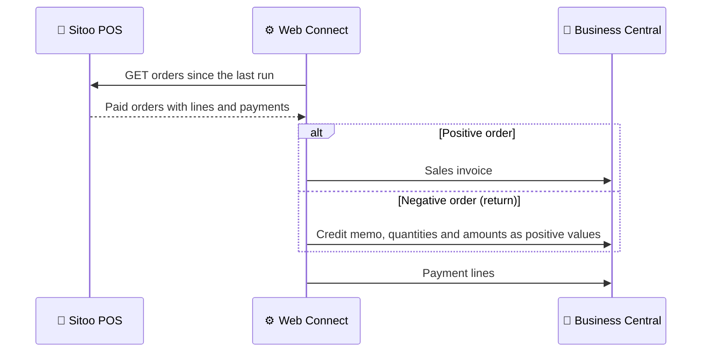

# Sitoo POS to Business Central: sales

Web Connect fetches new paid orders from Sitoo POS every few minutes. A sale becomes a sales invoice and a return becomes a credit memo in Business Central, on the customer for the store and the location for the Sitoo warehouse, with lines, discounts and payments. The Sitoo receipt ID is kept on the document.

| | |
|---|---|
| **Direction** | Sitoo POS → Business Central |
| **Trigger** | Schedule in Web Connect, every two to five minutes in the configurations in use |
| **Result** | A sales invoice or credit memo per Sitoo order, with payment lines |
| **Part of** | [Business Central and Sitoo POS integration](../overview.md) |

## Step by step

1. A sale or a return is completed and paid in a Sitoo store (Sitoo POS).
2. Web Connect asks Sitoo for paid orders created since the last run, filtered on order type and payment state, and sorted by order ID (Web Connect).
3. Orders with an ID that has already been fetched are skipped (Web Connect).
4. A positive order becomes a sales invoice and a negative order a credit memo (Web Connect).
5. The store decides the customer, the Sitoo warehouse decides the location, and each order line is matched to an item and variant by SKU (Web Connect).
6. Payments on the order are written as payment lines, with the Sitoo payment type translated to a payment method (Business Central).

## Data mapping

| Sitoo POS field | Business Central field | Note |
|---|---|---|
| `orderid` | No. | The last fetched order ID is stored, so the next run starts after it |
| `additionaldata.pos-receiptid` | External Document No. | The receipt ID from the register |
| `additionaldata.store-externalid` | Sell-to Customer No. | The store is translated to a customer |
| `warehouseid` | Location Code | The Sitoo warehouse is translated to a location |
| `orderdate` | Posting Date, Document Date | |
| `currencycode` | Currency Code | The local currency is left blank |
| `additionaldata.pos-staff-externalid` | Salesperson Code | Optional |
| `orderitems[].sku` | No., Variant Code | Looked up from the SKU |
| `orderitems[].quantity` | Quantity | Shown as positive on credit memos |
| `orderitems[].moneyoriginalprice` | Unit Price | Prices include VAT |
| `orderitems[].moneydiscount` | Line Discount Amount | Discount rows are added to the line discount |
| `orderitems[].additionaldata.reasoncode-return` | Return Reason Code | On returns |
| `payments[].reftype` | Payment method on the payment line | Translated in Text Mapping |
| `payments[].moneyamount` | Amount on the payment line | Negative on credit memos |

## Web Connect objects

| Object | Role |
|---|---|
| `SO_SITOO-ORDER` | Fetches paid orders and creates the sales header |
| `SO_ORDERITEMS` | The order lines, with discounts and return reasons |
| `SO_PAYMENTS` | The payments on the order |

## Error handling

| Situation | What happens | What to do |
|---|---|---|
| The store has no customer mapping | The document cannot be created | Add the store to the mapping and reprocess the order in [Entries](../../../general/entries.md) |
| The SKU is not found | The line cannot be created | Check the item and variant, then reprocess the order |
| A payment type has no mapping | The payment line gets no payment method | Add the payment type in [Text Mapping](../../../general/text-mapping.md) |
| Nothing comes in | No new orders are created | See [Nothing downloads to Business Central](../../../../../how-to/web-connect/nothing-downloads-to-business-central.md) |

## Frequently asked questions

### Which customer is used for sales from a Sitoo store?

Each Sitoo store is mapped to a customer in Business Central through the store's external ID. All receipts from that store are created on that customer.

## Related

- [Business Central and Sitoo POS integration](../overview.md)
- [Store orders delivered from the central warehouse](store-order-delivery.md)
- [Split cash payment per store](../../../../../how-to/web-connect/split-cash-payment-per-store.md)
