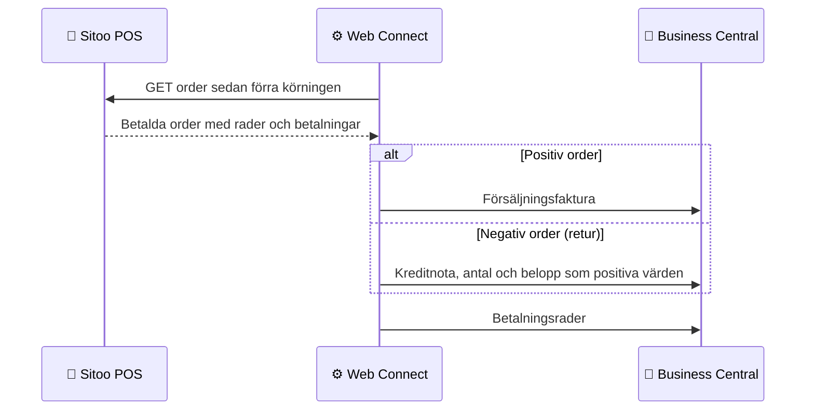

# Från Sitoo POS till Business Central: försäljning

Web Connect hämtar nya betalda order från Sitoo POS med några minuters mellanrum. En försäljning blir en försäljningsfaktura och en retur blir en kreditnota i Business Central, på butikens kund och på lagerstället för lagret i Sitoo, med rader, rabatter och betalningar. Kvitto-ID:t från Sitoo sparas på dokumentet.

| | |
|---|---|
| **Riktning** | Sitoo POS → Business Central |
| **Startas av** | Schema i Web Connect, var annan till var femte minut i de konfigurationer som används |
| **Resultat** | En försäljningsfaktura eller kreditnota per order i Sitoo, med betalningsrader |
| **Del av** | [Integrationen mellan Business Central och Sitoo POS](../overview.md) |

## Steg för steg

1. En försäljning eller retur slutförs och betalas i en butik i Sitoo (Sitoo POS).
2. Web Connect frågar Sitoo efter betalda order som skapats sedan förra körningen, filtrerade på ordertyp och betalstatus och sorterade på order-ID (Web Connect).
3. Order med ett ID som redan hämtats hoppas över (Web Connect).
4. En positiv order blir en försäljningsfaktura och en negativ order en kreditnota (Web Connect).
5. Butiken avgör kunden, lagret i Sitoo avgör lagerstället, och varje orderrad matchas mot en artikel och variant via SKU (Web Connect).
6. Betalningarna på ordern skrivs som betalningsrader, där betaltypen i Sitoo översätts till ett betalningssätt (Business Central).

## Mappning av data

| Fält i Sitoo POS | Fält i Business Central | Kommentar |
|---|---|---|
| `orderid` | No. | Det senast hämtade order-ID:t sparas, så att nästa körning börjar efter det |
| `additionaldata.pos-receiptid` | External Document No. | Kvitto-ID:t från kassan |
| `additionaldata.store-externalid` | Sell-to Customer No. | Butiken översätts till en kund |
| `warehouseid` | Location Code | Lagret i Sitoo översätts till ett lagerställe |
| `orderdate` | Posting Date, Document Date | |
| `currencycode` | Currency Code | Den lokala valutan lämnas tom |
| `additionaldata.pos-staff-externalid` | Salesperson Code | Valfritt |
| `orderitems[].sku` | No., Variant Code | Slås upp från SKU |
| `orderitems[].quantity` | Quantity | Visas som positivt på kreditnotor |
| `orderitems[].moneyoriginalprice` | Unit Price | Priserna är inklusive moms |
| `orderitems[].moneydiscount` | Line Discount Amount | Rabattrader läggs till radrabatten |
| `orderitems[].additionaldata.reasoncode-return` | Return Reason Code | På returer |
| `payments[].reftype` | Betalningssätt på betalningsraden | Översätts i Text Mapping |
| `payments[].moneyamount` | Belopp på betalningsraden | Negativt på kreditnotor |

## Objekt i Web Connect

| Objekt | Roll |
|---|---|
| `SO_SITOO-ORDER` | Hämtar betalda order och skapar försäljningshuvudet |
| `SO_ORDERITEMS` | Orderraderna, med rabatter och returorsaker |
| `SO_PAYMENTS` | Betalningarna på ordern |

## Felhantering

| Situation | Vad som händer | Vad du gör |
|---|---|---|
| Butiken saknar mappning till en kund | Dokumentet kan inte skapas | Lägg till butiken i mappningen och bearbeta ordern igen i [Entries](../../../general/entries.md) |
| SKU:n hittas inte | Raden kan inte skapas | Kontrollera artikeln och varianten och bearbeta sedan ordern igen |
| En betaltyp saknar mappning | Betalningsraden får inget betalningssätt | Lägg till betaltypen i [Text Mapping](../../../general/text-mapping.md) |
| Ingenting kommer in | Inga nya order skapas | Se [Ingenting hämtas till Business Central](../../../../../how-to/web-connect/nothing-downloads-to-business-central.md) |

## Vanliga frågor

### Vilken kund används för försäljningen från en butik i Sitoo?

Varje butik i Sitoo mappas till en kund i Business Central via butikens externa ID. Alla kvitton från butiken skapas på den kunden.

## Relaterat

- [Integrationen mellan Business Central och Sitoo POS](../overview.md)
- [Butiksorder som levereras från centrallagret](store-order-delivery.md)
- [Dela upp kontantbetalningar per butik](../../../../../how-to/web-connect/split-cash-payment-per-store.md)
