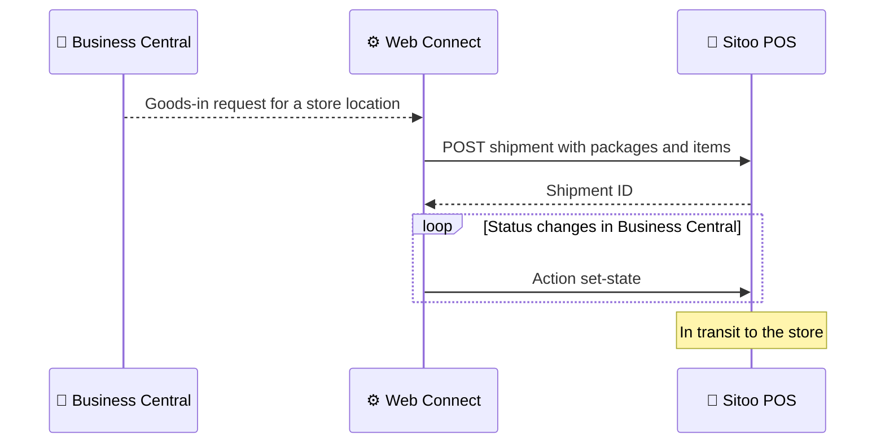

# Business Central to Sitoo POS: shipments to stores

When a transfer to a store has been shipped from the sending warehouse, Web Connect sends a warehouse document to the Sitoo Shipments API as an inbound shipment for the store's warehouse, with packages, items and quantities. The status of the shipment in Sitoo follows the status in Business Central, so the store sees it arrive and can receive it.

| | |
|---|---|
| **Direction** | Business Central → Sitoo POS |
| **Trigger** | The transfer to the store has been shipped from the sending warehouse, which creates a goods-in request for the store location in the [WMS documents](../../../general/wms-documents.md). The status is sent when the external status on the warehouse document changes |
| **Result** | An inbound shipment in Sitoo for the store's warehouse |
| **Part of** | [Business Central and Sitoo POS integration](../overview.md) |

## Step by step

1. A transfer to a store is shipped from the sending warehouse, and a goods-in request is created for the store location (Business Central).
2. Web Connect sends the warehouse document to the Sitoo Shipments API as a shipment, with the origin warehouse, the destination warehouse for the store, and the lines with SKU, barcode, name and quantity. Lines with zero quantity are left out (Web Connect).
3. As the status of the warehouse document changes, Web Connect moves the shipment in Sitoo through packed, transport ordered and ready for pickup to in transit (Web Connect).
4. The store sees the shipment on its way and receives it in Sitoo, see [Store receipts](store-receipt.md) (Sitoo POS).

## Data mapping

| Business Central field | Sitoo POS field | Note |
|---|---|---|
| Warehouse document number | `id`, `info.reference_number` | |
| Logistics code of the store location | `info.destination_warehouse_id` | Translated to the Sitoo warehouse in Text Mapping |
| Fixed value | `info.origin_warehouse_id`, `info.currency` | Set in the mapping |
| Item and variant on the line | `sku`, `barcode` | |
| Description on the line | `product_name` | |
| Quantity on the line | `quantity` | |
| Line number | `additional_data.bc_lineNo` | Used to match the receipt to the line |
| External status | `state` | Translated to the Sitoo shipment state |

## Web Connect objects

| Object | Role |
|---|---|
| `STS_INBOUND-SHIPMENT` | Sends the shipment to the Sitoo Shipments API |
| `STS_INFO`, `STS_PACKAGES`, `STS_ITEMS` | Shipment information, packages and lines |
| `STS_SITOO_SETSTAGE` | Sends the status change to Sitoo |

## Error handling

| Situation | What happens | What to do |
|---|---|---|
| The document is sent again after a change | Sitoo answers that the shipment already exists | Cancel the document to the warehouse and resend, see [WMS request not sent](../../../../../how-to/web-connect/wms-request-not-sent-error.md) |
| The store location has no Sitoo warehouse in the mapping | The shipment has no destination | Add the location in [Text Mapping](../../../general/text-mapping.md) |

## Frequently asked questions

### Can a shipment to a store be changed after it has been sent to Sitoo?

No. Sitoo does not allow a shipment to be updated once it is created. Cancel the warehouse document to Sitoo and send it again.

## Related

- [Business Central and Sitoo POS integration](../overview.md)
- [Store receipts](store-receipt.md)
- [Logistics Setup](../../../general/logistics-setup.md) · [WMS documents](../../../general/wms-documents.md)
