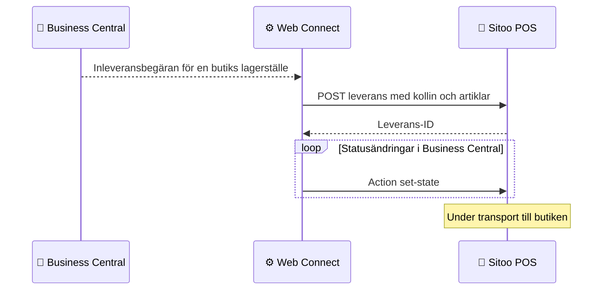

# Från Business Central till Sitoo POS: leveranser till butiker

När en flytt till en butik har levererats från det avsändande lagret skickar Web Connect ett WMS-dokument till Sitoo Shipments API som en inkommande leverans till butikens lager, med kollin, artiklar och antal. Leveransens status i Sitoo följer statusen i Business Central, så att butiken ser den komma och kan ta emot den.

| | |
|---|---|
| **Riktning** | Business Central → Sitoo POS |
| **Startas av** | Flytten till butiken har levererats från det avsändande lagret, vilket skapar en inleveransbegäran för butikens lagerställe i [WMS-dokumenten](../../../general/wms-documents.md). Statusen skickas när den externa statusen på WMS-dokumentet ändras |
| **Resultat** | En inkommande leverans i Sitoo till butikens lager |
| **Del av** | [Integrationen mellan Business Central och Sitoo POS](../overview.md) |

## Steg för steg

1. En flytt till en butik levereras från det avsändande lagret, och en inleveransbegäran skapas för butikens lagerställe (Business Central).
2. Web Connect skickar WMS-dokumentet till Sitoo Shipments API som en leverans, med avsändande lager, butikens mottagande lager och raderna med SKU, streckkod, namn och antal. Rader med antal noll tas inte med (Web Connect).
3. När WMS-dokumentets status ändras för Web Connect leveransen vidare i Sitoo, via packad, transport beställd och klar för upphämtning, fram till under transport (Web Connect).
4. Butiken ser att leveransen är på väg och tar emot den i Sitoo, se [Inleveranser i butik](store-receipt.md) (Sitoo POS).

## Mappning av data

| Fält i Business Central | Fält i Sitoo POS | Kommentar |
|---|---|---|
| WMS-dokumentets nummer | `id`, `info.reference_number` | |
| Logistikkod för butikens lagerställe | `info.destination_warehouse_id` | Översätts till lagret i Sitoo i Text Mapping |
| Fast värde | `info.origin_warehouse_id`, `info.currency` | Anges i mappningen |
| Artikel och variant på raden | `sku`, `barcode` | |
| Beskrivning på raden | `product_name` | |
| Antal på raden | `quantity` | |
| Radnummer | `additional_data.bc_lineNo` | Används för att matcha inleveransen mot raden |
| Extern status | `state` | Översätts till leveransstatusen i Sitoo |

## Objekt i Web Connect

| Objekt | Roll |
|---|---|
| `STS_INBOUND-SHIPMENT` | Skickar leveransen till Sitoo Shipments API |
| `STS_INFO`, `STS_PACKAGES`, `STS_ITEMS` | Leveransinformation, kollin och rader |
| `STS_SITOO_SETSTAGE` | Skickar statusändringen till Sitoo |

## Felhantering

| Situation | Vad som händer | Vad du gör |
|---|---|---|
| Dokumentet skickas igen efter en ändring | Sitoo svarar att leveransen redan finns | Makulera dokumentet mot lagret och skicka igen, se [WMS request not sent](../../../../../how-to/web-connect/wms-request-not-sent-error.md) |
| Butikens lagerställe saknar lager i Sitoo i mappningen | Leveransen får ingen mottagare | Lägg till lagerstället i [Text Mapping](../../../general/text-mapping.md) |

## Vanliga frågor

### Går det att ändra en leverans till en butik när den redan har skickats till Sitoo?

Nej. Sitoo tillåter inte att en leverans uppdateras när den väl är skapad. Makulera WMS-dokumentet mot Sitoo och skicka det igen.

## Relaterat

- [Integrationen mellan Business Central och Sitoo POS](../overview.md)
- [Inleveranser i butik](store-receipt.md)
- [Logistics Setup](../../../general/logistics-setup.md) · [WMS-dokument](../../../general/wms-documents.md)
