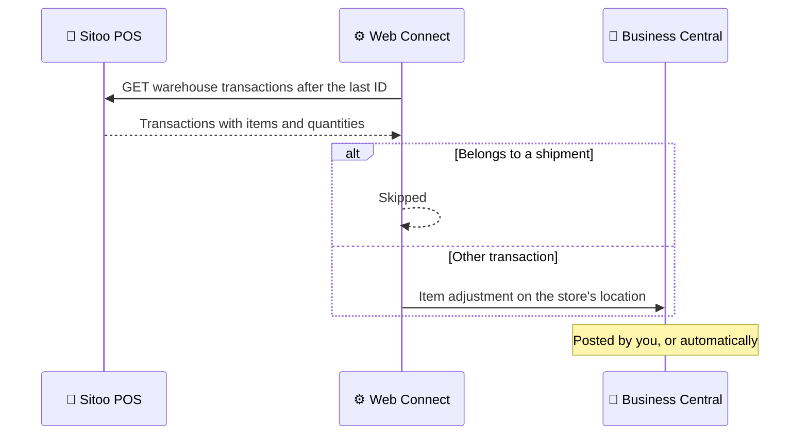

# Sitoo POS to Business Central: stock adjustments

Web Connect fetches new stock transactions from Sitoo POS on a schedule, of the transaction types chosen in the configuration. Transactions that belong to a shipment are skipped. Each transaction is written as an item adjustment on the store's location, and ends up in the adjustment item journal in Business Central.

| | |
|---|---|
| **Direction** | Sitoo POS → Business Central |
| **Trigger** | Schedule in Web Connect, set to your needs |
| **Result** | Item adjustment lines on the store's location, in the adjustment item journal set in the logistics setup |
| **Part of** | [Business Central and Sitoo POS integration](../overview.md) |

## Step by step

1. Stock is changed in a store in Sitoo (Sitoo POS).
2. Web Connect fetches stock transactions with an ID higher than the last one fetched, of the transaction types set in the request (Web Connect).
3. Transactions that belong to a shipment are skipped (Web Connect).
4. Each transaction becomes a warehouse document of the type item adjustment, on the logistics code for the Sitoo warehouse, with the item, variant and quantity per line (Web Connect).
5. The lines are written to the adjustment item journal, and posted if automatic posting is set in the [logistics setup](../../../general/logistics-setup.md) (Business Central).

## Data mapping

| Sitoo POS field | Business Central field | Note |
|---|---|---|
| `warehousetransactionid` | Reference on the warehouse document | The last ID is stored, so the next run starts after it |
| `warehouseid` | Logistics code | Translated from the Sitoo warehouse |
| `datecreated` | Date and time | |
| `items[].sku` | Item and variant | |
| `items[].decimalquantity` | Quantity | |

## Web Connect objects

| Object | Role |
|---|---|
| `SO_WAREHOUSETRANS` | Fetches stock transactions and creates the item adjustment |
| `SO_ITEMS` | The lines of each transaction |

## Error handling

| Situation | What happens | What to do |
|---|---|---|
| A Sitoo warehouse has no mapping | The transaction gets no logistics code | Add the warehouse in [Text Mapping](../../../general/text-mapping.md) |
| The item is not found | The journal line cannot be created | Check the item and variant, then reprocess the transaction in [Entries](../../../general/entries.md) |

## Frequently asked questions

### Are shipments counted twice as stock adjustments?

No. Stock transactions in Sitoo that belong to a shipment are skipped, since shipments come to Business Central through their own flows.

## Related

- [Business Central and Sitoo POS integration](../overview.md)
- [Stock balances](stock-balance.md)
- [Logistics Setup](../../../general/logistics-setup.md) · [WMS documents](../../../general/wms-documents.md)
