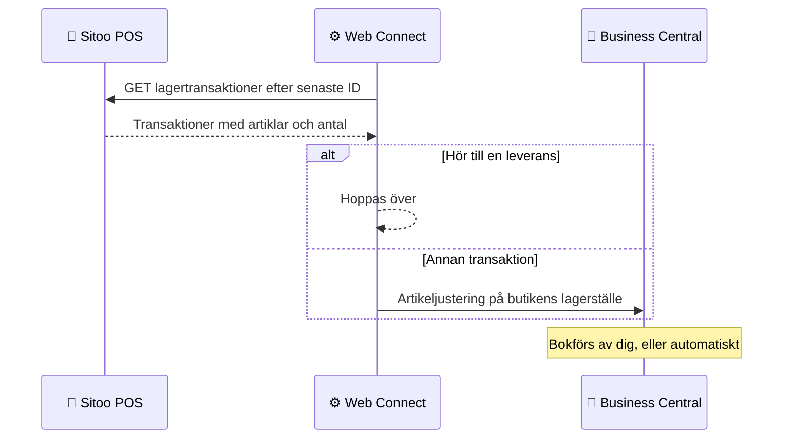

# Från Sitoo POS till Business Central: lagerjusteringar

Web Connect hämtar nya lagertransaktioner från Sitoo POS enligt schema, av de transaktionstyper som valts i konfigurationen. Transaktioner som hör till en leverans hoppas över. Varje transaktion skrivs som en artikeljustering på butikens lagerställe och hamnar i artikeljournalen för justeringar i Business Central.

| | |
|---|---|
| **Riktning** | Sitoo POS → Business Central |
| **Startas av** | Schema i Web Connect, efter dina behov |
| **Resultat** | Rader för artikeljustering på butikens lagerställe, i den artikeljournal för justeringar som anges i logistikinställningarna |
| **Del av** | [Integrationen mellan Business Central och Sitoo POS](../overview.md) |

## Steg för steg

1. Lagret ändras i en butik i Sitoo (Sitoo POS).
2. Web Connect hämtar lagertransaktioner med ett högre ID än det senast hämtade, av de transaktionstyper som anges i anropet (Web Connect).
3. Transaktioner som hör till en leverans hoppas över (Web Connect).
4. Varje transaktion blir ett WMS-dokument av typen artikeljustering, på logistikkoden för lagret i Sitoo, med artikel, variant och antal per rad (Web Connect).
5. Raderna skrivs till artikeljournalen för justeringar och bokförs om automatisk bokföring är inställd i [logistikinställningarna](../../../general/logistics-setup.md) (Business Central).

## Mappning av data

| Fält i Sitoo POS | Fält i Business Central | Kommentar |
|---|---|---|
| `warehousetransactionid` | Referens på WMS-dokumentet | Det senaste ID:t sparas, så att nästa körning börjar efter det |
| `warehouseid` | Logistikkod | Översätts från lagret i Sitoo |
| `datecreated` | Datum och tid | |
| `items[].sku` | Artikel och variant | |
| `items[].decimalquantity` | Antal | |

## Objekt i Web Connect

| Objekt | Roll |
|---|---|
| `SO_WAREHOUSETRANS` | Hämtar lagertransaktioner och skapar artikeljusteringen |
| `SO_ITEMS` | Raderna i varje transaktion |

## Felhantering

| Situation | Vad som händer | Vad du gör |
|---|---|---|
| Ett lager i Sitoo saknar mappning | Transaktionen får ingen logistikkod | Lägg till lagret i [Text Mapping](../../../general/text-mapping.md) |
| Artikeln hittas inte | Journalraden kan inte skapas | Kontrollera artikeln och varianten och bearbeta sedan transaktionen igen i [Entries](../../../general/entries.md) |

## Vanliga frågor

### Räknas leveranser dubbelt som lagerjusteringar?

Nej. Lagertransaktioner i Sitoo som hör till en leverans hoppas över, eftersom leveranser kommer till Business Central genom sina egna flöden.

## Relaterat

- [Integrationen mellan Business Central och Sitoo POS](../overview.md)
- [Lagersaldon](stock-balance.md)
- [Logistics Setup](../../../general/logistics-setup.md) · [WMS-dokument](../../../general/wms-documents.md)
