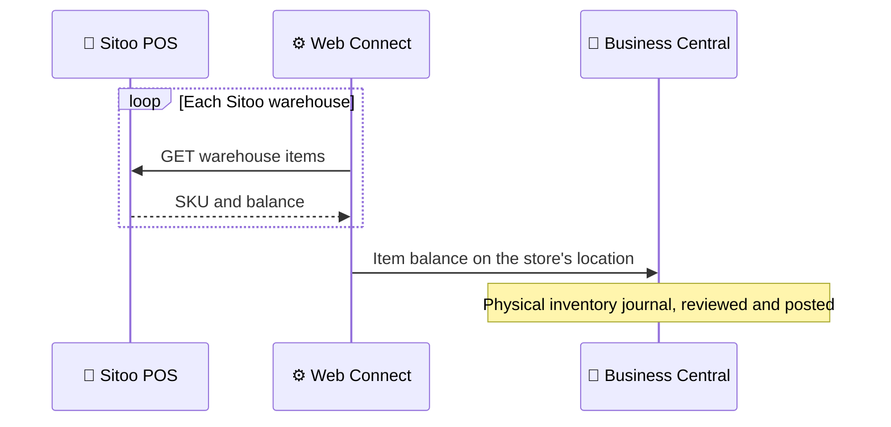

# Sitoo POS to Business Central: stock balances

Web Connect reads the stock balance per SKU for each store warehouse in Sitoo POS on a schedule. The balance becomes an item balance on the store's location, and ends up in the physical inventory journal in Business Central, where the difference against Business Central can be reviewed and posted.

| | |
|---|---|
| **Direction** | Sitoo POS → Business Central |
| **Trigger** | Schedule in Web Connect, every 60 minutes in the configurations in use, set to your needs |
| **Result** | Item balance lines on the store's location, in the physical inventory journal set in the logistics setup |
| **Part of** | [Business Central and Sitoo POS integration](../overview.md) |

## Step by step

1. Web Connect reads the warehouse items for each Sitoo warehouse, 200 per page (Web Connect).
2. The balance for each warehouse becomes a warehouse document of the type item balance, on the logistics code for the warehouse, with the current date and time (Web Connect).
3. Each SKU is matched to an item and variant, and the balance is put on the line (Web Connect).
4. The balances are put in the physical inventory journal, where you review and post the differences (Business Central).

## Data mapping

| Sitoo POS field | Business Central field | Note |
|---|---|---|
| Warehouse in the request | Logistics code | Translated from the Sitoo warehouse |
| `warehouseitemid` | Line reference | |
| `sku` | Item No., Variant Code | Looked up from the SKU |
| `decimaltotal` | Quantity | The balance in Sitoo |

## Web Connect objects

| Object | Role |
|---|---|
| `SO_WAREHOUSEITEMS` | Reads the balance per Sitoo warehouse |
| `SO_WAREHOUSEBALANCELINE` | The balance per SKU |

## Error handling

| Situation | What happens | What to do |
|---|---|---|
| The SKU is not found | The line gets no item | Check the item and variant in Business Central |
| The balance differs because a sale is not yet in Business Central | The journal shows a difference | Make sure sales are imported and posted before the journal is posted |

## Frequently asked questions

### Does the stock balance from Sitoo overwrite the stock in Business Central?

No. The balance is put in a physical inventory journal. Nothing changes the stock in Business Central until the journal is posted, by you or automatically if that is set in the logistics setup.

## Related

- [Business Central and Sitoo POS integration](../overview.md)
- [Stock adjustments](stock-adjustment.md)
- [Logistics Setup](../../../general/logistics-setup.md)
