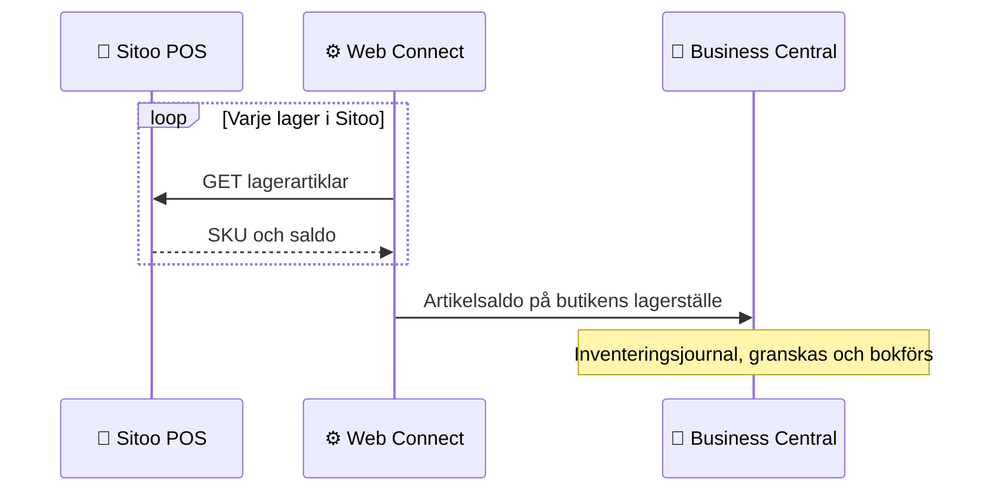

# Från Sitoo POS till Business Central: lagersaldon

Web Connect läser lagersaldot per SKU för varje butikslager i Sitoo POS enligt schema. Saldot blir ett artikelsaldo på butikens lagerställe och hamnar i inventeringsjournalen i Business Central, där skillnaden mot Business Central kan granskas och bokföras.

| | |
|---|---|
| **Riktning** | Sitoo POS → Business Central |
| **Startas av** | Schema i Web Connect, var 60:e minut i de konfigurationer som används, efter dina behov |
| **Resultat** | Rader med artikelsaldo på butikens lagerställe, i den inventeringsjournal som anges i logistikinställningarna |
| **Del av** | [Integrationen mellan Business Central och Sitoo POS](../overview.md) |

## Steg för steg

1. Web Connect läser lagerartiklarna för varje lager i Sitoo, 200 per sida (Web Connect).
2. Saldot för varje lager blir ett WMS-dokument av typen artikelsaldo, på lagrets logistikkod, med aktuellt datum och tid (Web Connect).
3. Varje SKU matchas mot en artikel och variant, och saldot läggs på raden (Web Connect).
4. Saldona läggs i inventeringsjournalen, där du granskar och bokför skillnaderna (Business Central).

## Mappning av data

| Fält i Sitoo POS | Fält i Business Central | Kommentar |
|---|---|---|
| Lagret i anropet | Logistikkod | Översätts från lagret i Sitoo |
| `warehouseitemid` | Radreferens | |
| `sku` | Item No., Variant Code | Slås upp från SKU |
| `decimaltotal` | Antal | Saldot i Sitoo |

## Objekt i Web Connect

| Objekt | Roll |
|---|---|
| `SO_WAREHOUSEITEMS` | Läser saldot per lager i Sitoo |
| `SO_WAREHOUSEBALANCELINE` | Saldot per SKU |

## Felhantering

| Situation | Vad som händer | Vad du gör |
|---|---|---|
| SKU:n hittas inte | Raden får ingen artikel | Kontrollera artikeln och varianten i Business Central |
| Saldot skiljer sig eftersom en försäljning ännu inte finns i Business Central | Journalen visar en skillnad | Se till att försäljningen är hämtad och bokförd innan journalen bokförs |

## Vanliga frågor

### Skriver lagersaldot från Sitoo över lagret i Business Central?

Nej. Saldot läggs i en inventeringsjournal. Lagret i Business Central ändras inte förrän journalen bokförs, av dig eller automatiskt om det är inställt i logistikinställningarna.

## Relaterat

- [Integrationen mellan Business Central och Sitoo POS](../overview.md)
- [Lagerjusteringar](stock-adjustment.md)
- [Logistics Setup](../../../general/logistics-setup.md)
