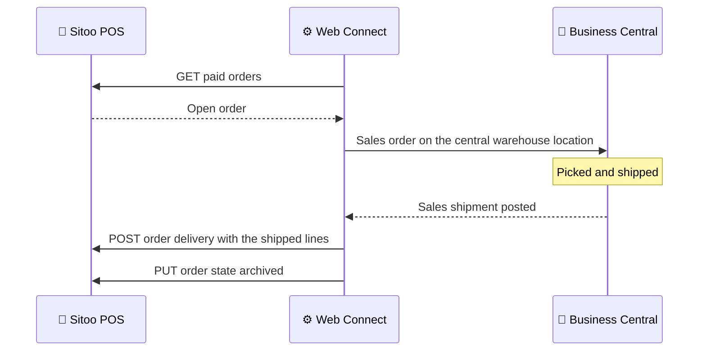

# Sitoo POS and Business Central: store orders delivered from the central warehouse

When a store in Sitoo POS takes an order that is not handed over in the store, Web Connect creates a sales order in Business Central on the central warehouse location. When the shipment is posted in Business Central, Web Connect registers the delivery on the order in Sitoo and archives it.

| | |
|---|---|
| **Direction** | Sitoo POS → Business Central, then Business Central → Sitoo POS |
| **Trigger** | The order is fetched with the [sales](sales-inbound.md) on a schedule. The delivery is sent when the sales shipment is posted |
| **Result** | A sales order in Business Central, and a delivered and archived order in Sitoo |
| **Part of** | [Business Central and Sitoo POS integration](../overview.md) |

## Step by step

1. The store takes a paid order in Sitoo that is still open, because the goods are not handed over (Sitoo POS).
2. Web Connect fetches the order with the other sales. An open positive order becomes a sales order on the central warehouse location, while handed over sales become invoices as usual (Web Connect).
3. Web Connect fetches the deliveries already registered on the order in Sitoo (Web Connect).
4. The order is picked and shipped, and the sales shipment is posted (Business Central).
5. When the shipment is posted, Web Connect sends the shipped lines to Sitoo as an order delivery (Web Connect).
6. Web Connect archives the order in Sitoo (Web Connect).

## Data mapping

| Business Central field | Sitoo POS field | Note |
|---|---|---|
| External ID of the order from Sitoo | Order in the URL | Only shipments for orders that came from Sitoo are sent |
| Shipment lines on the central warehouse location | `orderdeliveryitems` | The shipped quantity per order line |
| Fixed value | `warehouseid` | The Sitoo warehouse the delivery is made from, set in the mapping |
| Fixed value | `orderstateid` | Sets the order as archived |

The sales order itself is created as described in [Sales](sales-inbound.md).

## Web Connect objects

| Object | Role |
|---|---|
| `SO_SITOO-ORDER` | Fetches the order. Conditions decide invoice, credit memo or sales order |
| `SO_ORDERDELIVERIES` | Fetches the deliveries already registered on the order |
| `SO_DELIVER_EI_ORDER` | Sends the shipped lines to Sitoo when the shipment is posted |
| `SO_ARCHIVE_EI_ORDER` | Archives the order in Sitoo when the shipment is posted |

## Error handling

| Situation | What happens | What to do |
|---|---|---|
| Sitoo rejects the delivery | The message is marked as failed in Entries | Check the order in Sitoo and [resend the message](../../../../../how-to/web-connect/resend-outgoing-message.md) |
| The shipment is not for an order from Sitoo | Nothing is sent | No action needed |

## Frequently asked questions

### How does Sitoo know that a store order has been shipped?

When the sales shipment is posted in Business Central, Web Connect sends the shipped lines to Sitoo as an order delivery and then archives the order in Sitoo.

## Related

- [Business Central and Sitoo POS integration](../overview.md)
- [Sales](sales-inbound.md)
