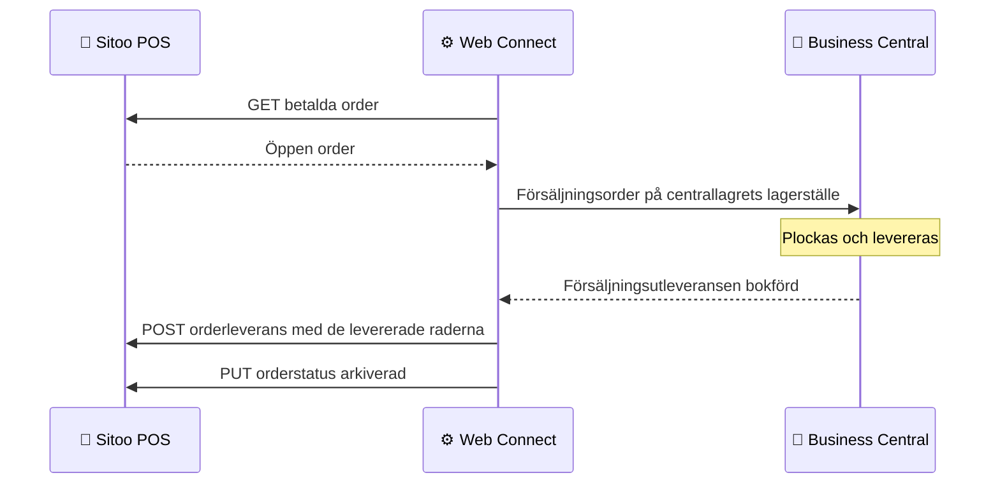

# Sitoo POS och Business Central: butiksorder som levereras från centrallagret

När en butik i Sitoo POS tar en order som inte lämnas ut i butiken skapar Web Connect en försäljningsorder i Business Central på centrallagrets lagerställe. När utleveransen bokförs i Business Central registrerar Web Connect leveransen på ordern i Sitoo och arkiverar den.

| | |
|---|---|
| **Riktning** | Sitoo POS → Business Central, sedan Business Central → Sitoo POS |
| **Startas av** | Ordern hämtas med [försäljningen](sales-inbound.md) enligt schema. Leveransen skickas när försäljningsutleveransen bokförs |
| **Resultat** | En försäljningsorder i Business Central, och en levererad och arkiverad order i Sitoo |
| **Del av** | [Integrationen mellan Business Central och Sitoo POS](../overview.md) |

## Steg för steg

1. Butiken tar en betald order i Sitoo som fortfarande är öppen, eftersom varorna inte har lämnats ut (Sitoo POS).
2. Web Connect hämtar ordern tillsammans med övrig försäljning. En öppen positiv order blir en försäljningsorder på centrallagrets lagerställe, medan försäljning som lämnats ut blir fakturor som vanligt (Web Connect).
3. Web Connect hämtar de leveranser som redan är registrerade på ordern i Sitoo (Web Connect).
4. Ordern plockas och levereras, och försäljningsutleveransen bokförs (Business Central).
5. När utleveransen bokförs skickar Web Connect de levererade raderna till Sitoo som en orderleverans (Web Connect).
6. Web Connect arkiverar ordern i Sitoo (Web Connect).

## Mappning av data

| Fält i Business Central | Fält i Sitoo POS | Kommentar |
|---|---|---|
| Externt ID för ordern från Sitoo | Ordern i URL:en | Bara utleveranser för order som kom från Sitoo skickas |
| Utleveransrader på centrallagrets lagerställe | `orderdeliveryitems` | Levererat antal per orderrad |
| Fast värde | `warehouseid` | Det lager i Sitoo som leveransen görs från, anges i mappningen |
| Fast värde | `orderstateid` | Sätter ordern som arkiverad |

Själva försäljningsordern skapas så som beskrivs i [Försäljning](sales-inbound.md).

## Objekt i Web Connect

| Objekt | Roll |
|---|---|
| `SO_SITOO-ORDER` | Hämtar ordern. Villkor avgör om det blir faktura, kreditnota eller försäljningsorder |
| `SO_ORDERDELIVERIES` | Hämtar de leveranser som redan är registrerade på ordern |
| `SO_DELIVER_EI_ORDER` | Skickar de levererade raderna till Sitoo när utleveransen bokförs |
| `SO_ARCHIVE_EI_ORDER` | Arkiverar ordern i Sitoo när utleveransen bokförs |

## Felhantering

| Situation | Vad som händer | Vad du gör |
|---|---|---|
| Sitoo avvisar leveransen | Meddelandet markeras som misslyckat i Entries | Kontrollera ordern i Sitoo och [skicka meddelandet igen](../../../../../how-to/web-connect/resend-outgoing-message.md) |
| Utleveransen gäller inte en order från Sitoo | Ingenting skickas | Du behöver inte göra något |

## Vanliga frågor

### Hur vet Sitoo att en butiksorder har levererats?

När försäljningsutleveransen bokförs i Business Central skickar Web Connect de levererade raderna till Sitoo som en orderleverans och arkiverar sedan ordern i Sitoo.

## Relaterat

- [Integrationen mellan Business Central och Sitoo POS](../overview.md)
- [Försäljning](sales-inbound.md)
