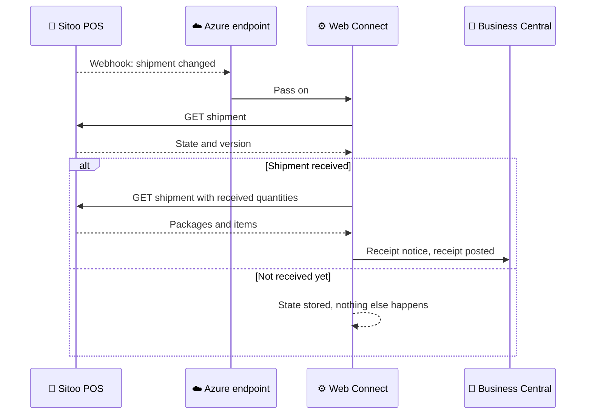

# Sitoo POS to Business Central: store receipts

When a store receives a shipment in Sitoo POS, Sitoo sends a webhook about the change. Web Connect fetches the shipment, and when it is received, creates a receipt notice with the received quantity per line on the warehouse document in Business Central. The receipt can then be posted automatically.

| | |
|---|---|
| **Direction** | Sitoo POS → Business Central |
| **Trigger** | Webhook from Sitoo when a shipment changes, received by an Azure endpoint that passes it on to Web Connect |
| **Result** | A receipt notice on the warehouse document, and a posted receipt if automatic posting is set in the logistics setup |
| **Part of** | [Business Central and Sitoo POS integration](../overview.md) |

## Step by step

1. The store receives the shipment in Sitoo and registers the received quantities (Sitoo POS).
2. Sitoo sends a webhook with the shipment ID, its state and its version. The Azure endpoint passes it on to Web Connect (Sitoo POS).
3. Web Connect fetches the shipment and stores its state (Web Connect).
4. When the state shows that the shipment is received, Web Connect fetches the shipment again for the goods-in request that is in transit, and creates a receipt notice with the received quantity per line (Web Connect).
5. The receipt is posted according to the [logistics setup](../../../general/logistics-setup.md) (Business Central).

## Data mapping

| Sitoo POS field | Business Central field | Note |
|---|---|---|
| `shipment_id` (webhook) | Shipment ID | Starts the fetch of the shipment |
| `state` | External status on the warehouse document | |
| `info.destination_warehouse_id` | Logistics code | Looked up from the Sitoo warehouse |
| `items[].sku` | Item on the line | |
| `items[].quantity_received` | Received quantity | |
| `items[].additional_data.bc_lineNo` | Line number | Matches the received line to the line that was sent |
| `modified_at` | Date and time on the receipt notice | |

## Web Connect objects

| Object | Role |
|---|---|
| `SO_WEBHOOK`, `SO_SHIPMENT-WEBHOOK-DATA` | Receive the webhook from Sitoo and start the fetch of the shipment |
| `STS_SHIPMENT` | Fetches the shipment and stores its state |
| `STS_GET_INBOUND_NOTICE` | Fetches a received shipment and creates the receipt notice |
| `STS_ITEMS2` | The received lines |

## Error handling

| Situation | What happens | What to do |
|---|---|---|
| The received quantity differs from the shipped quantity | The receipt is registered with the received quantity | Handle the difference with the transfer settings in the [logistics setup](../../../general/logistics-setup.md) |
| The receipt cannot be posted | The receipt notice stays on the warehouse document | Check the error on the WMS document, fix it and post again |
| No webhook arrives | The shipment is not fetched | Check the webhook in Sitoo and the [webhook setup](../../../general/webhooks.md) |

## Frequently asked questions

### How quickly does Business Central know that a store has received a shipment?

Sitoo sends a webhook when the shipment changes, so Web Connect fetches the shipment as soon as the webhook has been processed by the job queue.

## Related

- [Business Central and Sitoo POS integration](../overview.md)
- [Shipments to stores](shipment-to-store.md)
- [WMS documents](../../../general/wms-documents.md) · [Webhooks](../../../general/webhooks.md)
