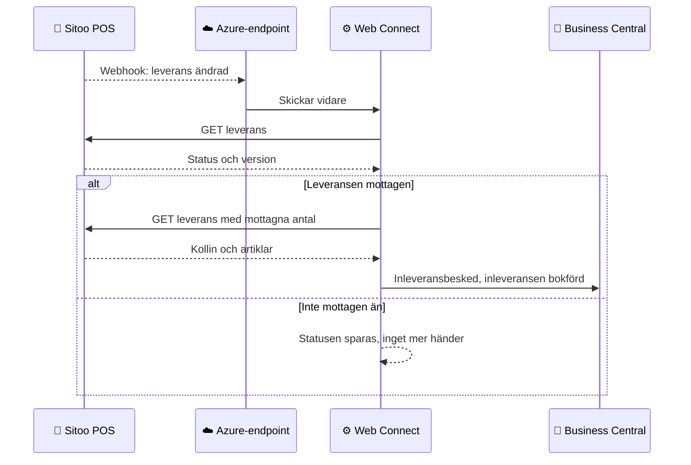

# Från Sitoo POS till Business Central: inleveranser i butik

När en butik tar emot en leverans i Sitoo POS skickar Sitoo en webhook om ändringen. Web Connect hämtar leveransen och skapar, när den är mottagen, ett inleveransbesked med mottaget antal per rad på WMS-dokumentet i Business Central. Inleveransen kan sedan bokföras automatiskt.

| | |
|---|---|
| **Riktning** | Sitoo POS → Business Central |
| **Startas av** | Webhook från Sitoo när en leverans ändras. En Azure-endpoint tar emot den och skickar den vidare till Web Connect |
| **Resultat** | Ett inleveransbesked på WMS-dokumentet, och en bokförd inleverans om automatisk bokföring är inställd i logistikinställningarna |
| **Del av** | [Integrationen mellan Business Central och Sitoo POS](../overview.md) |

## Steg för steg

1. Butiken tar emot leveransen i Sitoo och registrerar de mottagna antalen (Sitoo POS).
2. Sitoo skickar en webhook med leveransens ID, status och version. Azure-endpointen skickar den vidare till Web Connect (Sitoo POS).
3. Web Connect hämtar leveransen och sparar dess status (Web Connect).
4. När statusen visar att leveransen är mottagen hämtar Web Connect leveransen igen för den inleveransbegäran som är under transport, och skapar ett inleveransbesked med mottaget antal per rad (Web Connect).
5. Inleveransen bokförs enligt [logistikinställningarna](../../../general/logistics-setup.md) (Business Central).

## Mappning av data

| Fält i Sitoo POS | Fält i Business Central | Kommentar |
|---|---|---|
| `shipment_id` (webhook) | Leverans-ID | Startar hämtningen av leveransen |
| `state` | Extern status på WMS-dokumentet | |
| `info.destination_warehouse_id` | Logistikkod | Slås upp från lagret i Sitoo |
| `items[].sku` | Artikel på raden | |
| `items[].quantity_received` | Mottaget antal | |
| `items[].additional_data.bc_lineNo` | Radnummer | Matchar den mottagna raden mot raden som skickades |
| `modified_at` | Datum och tid på inleveransbeskedet | |

## Objekt i Web Connect

| Objekt | Roll |
|---|---|
| `SO_WEBHOOK`, `SO_SHIPMENT-WEBHOOK-DATA` | Tar emot webhooken från Sitoo och startar hämtningen av leveransen |
| `STS_SHIPMENT` | Hämtar leveransen och sparar dess status |
| `STS_GET_INBOUND_NOTICE` | Hämtar en mottagen leverans och skapar inleveransbeskedet |
| `STS_ITEMS2` | De mottagna raderna |

## Felhantering

| Situation | Vad som händer | Vad du gör |
|---|---|---|
| Mottaget antal skiljer sig från levererat antal | Inleveransen registreras med mottaget antal | Hantera skillnaden med inställningarna för flyttar i [logistikinställningarna](../../../general/logistics-setup.md) |
| Inleveransen kan inte bokföras | Inleveransbeskedet ligger kvar på WMS-dokumentet | Kontrollera felet på WMS-dokumentet, rätta det och bokför igen |
| Ingen webhook kommer | Leveransen hämtas inte | Kontrollera webhooken i Sitoo och [inställningarna för webhooks](../../../general/webhooks.md) |

## Vanliga frågor

### Hur snabbt vet Business Central att en butik har tagit emot en leverans?

Sitoo skickar en webhook när leveransen ändras, så Web Connect hämtar leveransen så snart jobbkön har bearbetat webhooken.

## Relaterat

- [Integrationen mellan Business Central och Sitoo POS](../overview.md)
- [Leveranser till butiker](shipment-to-store.md)
- [WMS-dokument](../../../general/wms-documents.md) · [Webhooks](../../../general/webhooks.md)
