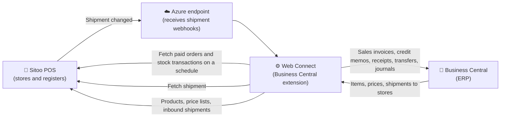
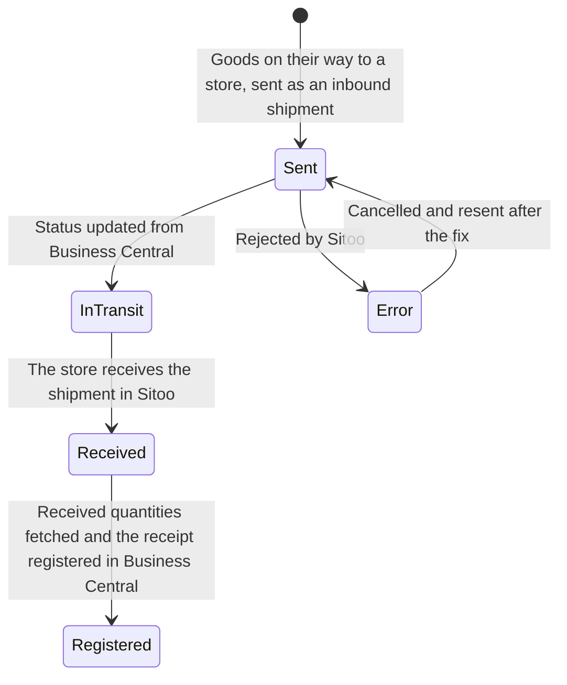
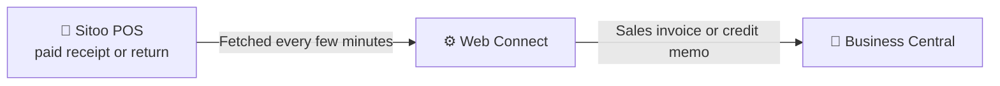
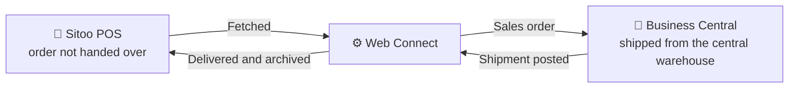
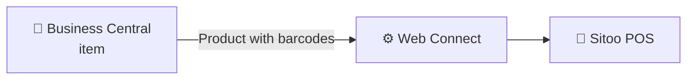
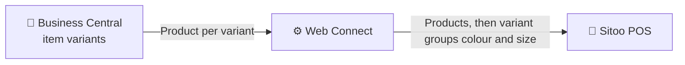
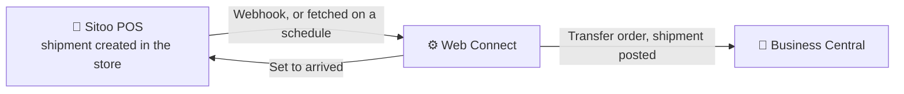
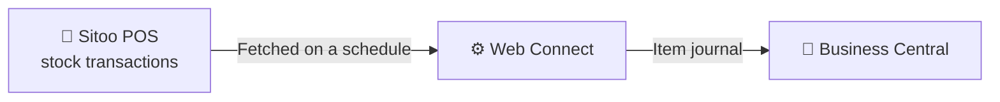
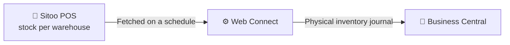
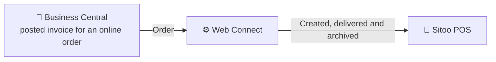

# Business Central and Sitoo POS integration

Web Connect by CombineIT connects Microsoft Dynamics 365 Business Central with Sitoo POS, the point of sale and store platform. Sales and returns from the stores become sales invoices and credit memos in Business Central, products and prices can be sent to Sitoo, and shipments to stores, returns from stores and stock changes move between the two systems. All mappings and rules live in your own Business Central, where you can see and change them yourself.

## At a glance

| | |
|---|---|
| **System** | Sitoo POS (point of sale and store platform) |
| **Integration product** | Web Connect for Microsoft Dynamics 365 Business Central |
| **Runs in** | Your own Business Central environment, as an extension. Web Connect fetches sales, stock transactions and stock balances from Sitoo on a schedule. Shipment events are pushed by Sitoo as webhooks: an Azure endpoint receives them and passes them on to Web Connect, which then fetches the shipment from Sitoo. All processing and configuration stays in Business Central. |
| **Configured by** | You, in Business Central: mappings, conditions, triggers and flows. You can do all of it yourself. If you want, CombineIT takes part in any step, as a sounding board or by doing the work. |
| **Connection** | REST API with JSON: the Sitoo REST API for sales, products, prices and stock, and the Sitoo Shipments API for shipments. Basic authentication. Webhooks for shipment events |
| **Sitoo API** | [Sitoo API reference](https://developer.sitoo.com/api-reference/overview) |
| **Data flows** | 10: sales, store orders delivered from the central warehouse, product data, prices, shipments to stores, store receipts, returns from stores, stock adjustments, stock balances and online orders for returns in store |
| **Business Central editions** | All editions, Essentials and Premium, including the latest version |
| **Available from** | [Web Connect on Microsoft AppSource](https://marketplace.microsoft.com/sv-se/product/PUBID.martitab1633951001710%7CAID.webconnect%7CPAPPID.9f3a7223-19db-4ac7-832f-cf8e4699186f?tab=Overview). [ATT FYLLA I: is the Sitoo POS integration part of the Web Connect Ready Integrations app, or set up as a configuration in Web Connect?] |

## What can be synchronized

Web Connect has ten data flows between Business Central and Sitoo POS.

| Data | Direction | What happens |
|---|---|---|
| [Sales](flows/sales-inbound.md) | Sitoo POS → Business Central | Paid receipts become sales invoices, and returns become credit memos, on the store's customer and location, with payments and discounts |
| [Store orders delivered from the central warehouse](flows/store-order-delivery.md) | Sitoo POS ↔ Business Central | An order placed in the store but not handed over becomes a sales order. When it is shipped from Business Central, the order is marked as delivered and archived in Sitoo |
| [Product data](flows/product-data.md) | Business Central → Sitoo POS | Items, or items with their variants, are created or updated as products with barcodes, VAT group, category, manufacturer and image |
| [Prices](flows/prices.md) | Business Central → Sitoo POS | Price lists and active price list lines are sent as Sitoo price lists |
| [Shipments to stores](flows/shipment-to-store.md) | Business Central → Sitoo POS | Goods on their way to a store are sent as an inbound shipment, so the store can receive them in Sitoo |
| [Store receipts](flows/store-receipt.md) | Sitoo POS → Business Central | When the store has received a shipment, the received quantities come back and the receipt is registered in Business Central |
| [Returns from stores](flows/returns-from-store.md) | Sitoo POS → Business Central | A shipment created in a store becomes a transfer order from the store location, and the shipment is posted |
| [Stock adjustments](flows/stock-adjustment.md) | Sitoo POS → Business Central | Stock transactions made in the stores are written to an item journal |
| [Stock balances](flows/stock-balance.md) | Sitoo POS → Business Central | The stock balance per store warehouse is read on a schedule and put in a physical inventory journal |
| [Online orders for returns in store](flows/online-orders-for-store-returns.md) | Business Central → Sitoo POS | Posted invoices for online orders are created as delivered orders in Sitoo, so the goods can be returned in a store |

Sales from the stores are part of every Sitoo POS integration. The other flows are chosen at setup, see [Choose your setup](#choose-your-setup).

## How it works

Sitoo POS holds the stores, the registers and the stock in each store warehouse. Web Connect asks the Sitoo REST API every few minutes for new paid orders and creates sales documents in Business Central. Each Sitoo warehouse is linked to a location in Business Central, and each store to a customer. Shipments to and from the stores use the Sitoo Shipments API and the [WMS documents](../../general/wms-documents.md) in Business Central, in the same way as a warehouse system. Sitoo tells Web Connect about changes to a shipment with a webhook, and Web Connect then fetches the shipment. Every message in both directions is logged in Web Connect [Entries](../../general/entries.md), where it can be inspected and resent.

### Shipment status between Business Central and Sitoo

## Choose your setup

Each flow has to fit how your business works: which system owns the data, where people do their work, and what the accounting needs. That is why the flows are decided together when a new integration is set up. The options below are the ones Web Connect customers use today. **Common setup** marks the option most Web Connect customers with Sitoo POS use. **Recommended** marks CombineIT's best practice, where there is one.

The options below come from the configurations of four Web Connect customers with Sitoo POS.

### Sales

| Option | How it works | When it fits |
|---|---|---|
| **Receipts as sales invoices and credit memos** (common setup) | Every paid order from Sitoo becomes a sales invoice. A negative order, a return, becomes a credit memo. The store decides the customer and the Sitoo warehouse decides the location | All sales are handed over in the store. All four customers use this |
| **Receipts plus store orders delivered from the central warehouse** | Handed over sales become invoices as above. An order placed in the store but not yet handed over becomes a sales order on the central warehouse location, and Sitoo is told when it has been shipped | The store sells goods it does not have on the shelf, and the central warehouse ships them. Two of four customers use this |

#### Sales as sales invoices and credit memos

#### Sales with store orders delivered from the central warehouse

### Product data

| Option | How it works | When it fits |
|---|---|---|
| **One product per item** | Each item is a product in Sitoo, with its barcodes as barcode aliases | Items without variants. Two of four customers are set up this way |
| **Products with variants** | Each item variant is a product in Sitoo, and the variants are grouped by colour and size under the item | Fashion and other assortments with variants. Two of four customers are set up this way |

[ATT FYLLA I: in three of four configurations product data has no automatic trigger. Confirm how product data is sent in those setups, for example manually from Business Central, or whether the products are maintained in Sitoo or another system. In the fourth, products are sent when the item, its barcodes or its web price changes.]

#### Product data as one product per item

#### Product data as products with variants

### Returns from stores

| Option | How it works | When it fits |
|---|---|---|
| **Transfer order created from the store's shipment** (common setup) | When a store creates a shipment in Sitoo, Web Connect creates a transfer order from the store location, posts the shipment from the store and sets the shipment to arrived in Sitoo. The transfer is then received at the receiving location in Business Central | Stores send goods back to the central warehouse. Three of four customers use this |

#### Returns from stores as transfer orders

### Stock from the stores

| Option | How it works | When it fits |
|---|---|---|
| **Stock transactions to an item journal** | Stock transactions made in Sitoo, of the types chosen in the configuration, are written to the adjustment item journal | Stock changes in the stores, beyond sales and shipments, should reach Business Central |
| **Stock balance to a physical inventory journal** | The stock balance per store warehouse is read on a schedule and put in a physical inventory journal | You want Business Central to be checked against the store stock in Sitoo |

Both options can be used together. Two of four customers fetch stock transactions, and three of four have the stock balance scheduled.

#### Stock transactions to an item journal

#### Stock balance to a physical inventory journal

### Online orders in the stores

| Option | How it works | When it fits |
|---|---|---|
| **Online invoices created as delivered orders in Sitoo** | Posted invoices for orders from the online store are created in Sitoo as orders, marked as delivered and archived, so a store can find the order and take a return | Customers buy online and return in a store. Two of four customers use this |

#### Online orders created in Sitoo for returns in store

Stores, registers, staff and the stock in each store warehouse are always maintained in Sitoo POS.

## What you need

- Microsoft Dynamics 365 Business Central, any edition (Essentials or Premium), including the latest version
- Web Connect installed from Microsoft AppSource, with an activated Web Connect license
- Your approval for Web Connect to be installed and to act in your Business Central environment
- API credentials for Sitoo, created in Sitoo
- Access to the Sitoo Shipments API, and a webhook in Sitoo for shipment events, if shipments to and from the stores are used
- A customer in Business Central for each store, and a location for each Sitoo warehouse
- Payment methods in Business Central for the payment types used in Sitoo
- An item journal batch for stock adjustments and a physical inventory journal batch for stock balances, if those flows are used

## Setting it up

1. Decide which flows to use and which option to choose for each, see [Choose your setup](#choose-your-setup).
2. Install Web Connect in Business Central, activate the license and give your approval.
3. Import the Sitoo POS configuration with the integration turned off.
4. Store the Sitoo API credentials in [Secret Value Storage](../../general/secret-value-storage.md).
5. Map each Sitoo store to a customer, each Sitoo warehouse to a location, the Sitoo payment types to payment methods and the VAT groups to Sitoo VAT groups.
6. Set up the shipment webhook in Sitoo and the [logistics setup](../../general/logistics-setup.md) for the store locations.
7. Set the date from which sales are fetched, and how often sales and stock are fetched.
8. Test sales, returns and shipments in a sandbox before production.

## Configure it yourself in Business Central

All configuration and logic in the integration is visible and editable in Business Central. There is no external integration platform where the logic is hidden. The Azure endpoint that receives webhooks only passes the call on to Web Connect.

| What you can change | Where in Web Connect | Example |
|---|---|---|
| Which store is which customer, and which warehouse is which location | [Text Mapping](../../general/text-mapping.md) | Add a new store and its warehouse before it opens |
| How payments are booked | [Text Mapping](../../general/text-mapping.md) | Translate a Sitoo payment type to a payment method, or [split cash per store](../../../../how-to/web-connect/split-cash-payment-per-store.md) |
| What becomes an invoice, a credit memo or an order | [Condition List](../../general/condition-list.md) | Make negative orders credit memos, and orders not handed over sales orders |
| Field mapping | [Incoming Data mapping](../../general/incoming-data/mapping.md) and [Outgoing Mapping](../../general/outgoing-mapping/README.md) | Put the Sitoo receipt ID in External Document No., or add a field to the product |
| Triggers | [Outgoing Sync Triggers](../../general/outgoing-mapping/outgoing-sync-triggers.md) | Send the product image when the picture on the item changes |
| How often data is fetched | [Objects](../../general/objects.md) | Fetch sales every two minutes and stock balances every hour |
| Which shipments and transfers are integrated | [Logistics Setup](../../general/logistics-setup.md) | Integrate transfer orders to the store locations, and post receipts automatically |
| Monitoring and resending | [Entries](../../general/entries.md) | See every receipt and shipment message, and [resend a message](../../../../how-to/web-connect/resend-outgoing-message.md) |

## Configuration choices

- **Stores and customers:** which customer in Business Central each Sitoo store sells to.
- **Warehouses and locations:** which location each Sitoo warehouse is, for sales, shipments, returns and stock.
- **Which orders are fetched:** sales are fetched from a start date, filtered on order type and payment state, and optionally on order state or warehouse.
- **Payment methods:** how each Sitoo payment type is translated, and whether orders paid with several payment types get their own payment method.
- **Salesperson:** whether the staff member on the receipt is set as salesperson.
- **Product structure:** one product per item, or one product per variant grouped by colour and size.
- **VAT groups:** how each VAT product posting group is translated to a Sitoo VAT group.
- **Price lists:** which price lists and which lines are sent.
- **Schedules:** how often sales, stock transactions, stock balances and returns from stores are fetched, set to your needs.
- **Stock transaction types:** which Sitoo transaction types are fetched as stock adjustments.
- **Shipments:** which Business Central documents create inbound shipments to the stores, and whether receipts are posted automatically.

## Limitations

- **Sales are fetched on a schedule.** Web Connect asks Sitoo for new paid orders every few minutes, so sales do not reach Business Central in real time.
- **Stock levels are not sent from Business Central to Sitoo.** None of the Sitoo configurations in use sends stock levels to Sitoo. The store stock lives in Sitoo and changes with sales, shipments and stock transactions there.
- **An inbound shipment cannot be updated in Sitoo once it is created.** If the document changes in Business Central, cancel it to Sitoo and send it again, see [WMS request not sent](../../../../how-to/web-connect/wms-request-not-sent-error.md).
- **Stock adjustments and stock balances are written to journals.** They change the stock in Business Central only when the journal is posted, unless automatic posting is set in the logistics setup.
- **Product images need the product in Sitoo first.** The image is only sent when the item already has a product ID from Sitoo.
- [ATT FYLLA I: are sales invoices and credit memos from Sitoo posted automatically, or posted by the user? The export does not show it.]

## Frequently asked questions

### Can Business Central be integrated with Sitoo POS?

Yes. Web Connect connects Business Central with Sitoo POS through the Sitoo REST API and the Sitoo Shipments API. Store sales and returns become sales invoices and credit memos in Business Central, products and prices can be sent to Sitoo, and shipments to stores, returns from stores and stock changes move between the systems.

### Does a sale in the store reduce stock in Business Central?

Yes. Each sale is created as a sales invoice on the location that belongs to the store's warehouse in Sitoo, so the stock on that location is reduced when the invoice is posted. A return in the store becomes a credit memo on the same location.

### Can goods sent from the central warehouse be received in the store in Sitoo?

Yes. Goods on their way to a store are sent to Sitoo as an inbound shipment. When the store has received the shipment in Sitoo, Web Connect fetches the received quantities and the receipt is registered in Business Central.

### Can a store send goods back to the central warehouse?

Yes. When a store creates a shipment in Sitoo, for example a return to the central warehouse, Web Connect creates a transfer order in Business Central from the store location to the receiving location and posts the shipment from the store.

## Related

- Flows: [Sales](flows/sales-inbound.md) · [Store orders delivered from the central warehouse](flows/store-order-delivery.md) · [Product data](flows/product-data.md) · [Prices](flows/prices.md) · [Shipments to stores](flows/shipment-to-store.md) · [Store receipts](flows/store-receipt.md) · [Returns from stores](flows/returns-from-store.md) · [Stock adjustments](flows/stock-adjustment.md) · [Stock balances](flows/stock-balance.md) · [Online orders for returns in store](flows/online-orders-for-store-returns.md)
- How-to: [Split cash payment per store](../../../../how-to/web-connect/split-cash-payment-per-store.md) · [WMS request not sent](../../../../how-to/web-connect/wms-request-not-sent-error.md) · [Resend an outgoing message](../../../../how-to/web-connect/resend-outgoing-message.md) · [Nothing downloads to Business Central](../../../../how-to/web-connect/nothing-downloads-to-business-central.md)
- Web Connect: [Logistics Setup](../../general/logistics-setup.md) · [WMS documents](../../general/wms-documents.md) · [Webhooks](../../general/webhooks.md) · [Secret Value Storage](../../general/secret-value-storage.md)
- [Web Connect general documentation](../../general/README.md)
- [Sitoo developer documentation](https://developer.sitoo.com/api-reference/overview)

## About Web Connect

Web Connect is an integration platform for Microsoft Dynamics 365 Business Central, developed by CombineIT. It is installed in your own Business Central and connects it with e-commerce platforms, warehouse systems, POS, returns, marketplaces and EDI. Every flow, mapping and rule is configured in Business Central, where you can see and change it yourself, without custom code for each integration. [Web Connect on Microsoft AppSource](https://marketplace.microsoft.com/sv-se/product/PUBID.martitab1633951001710%7CAID.webconnect%7CPAPPID.9f3a7223-19db-4ac7-832f-cf8e4699186f?tab=Overview) · [Contact CombineIT](https://www.combineit.se/contact/)
