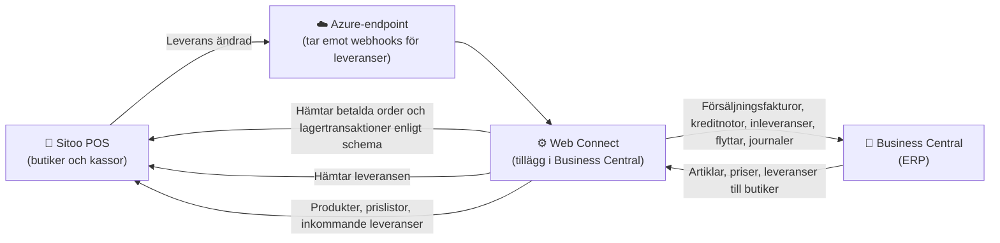
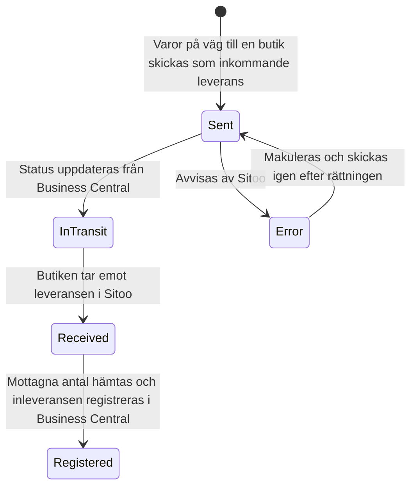
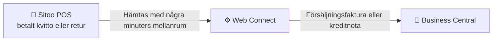
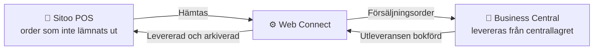
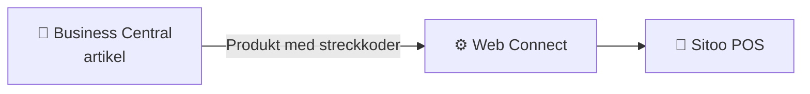
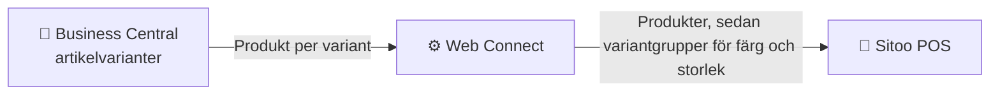
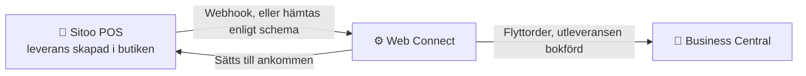
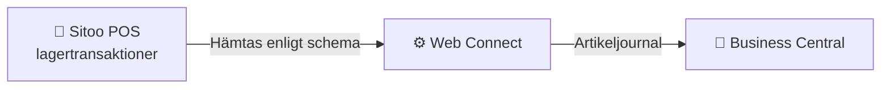
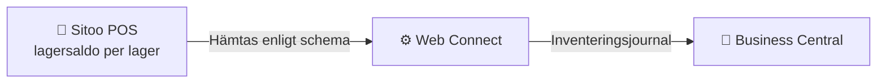

# Business Central och Sitoo POS: integration

Web Connect från CombineIT kopplar Microsoft Dynamics 365 Business Central till Sitoo POS, kassa- och butiksplattformen. Försäljning och returer i butikerna blir försäljningsfakturor och kreditnotor i Business Central, artiklar och priser kan skickas till Sitoo, och leveranser till butiker, returer från butiker och lagerförändringar går mellan de två systemen. Alla mappningar och regler finns i ditt eget Business Central, där du själv kan se och ändra dem.

## I korthet

| | |
|---|---|
| **System** | Sitoo POS (kassa- och butiksplattform) |
| **Integrationsprodukt** | Web Connect för Microsoft Dynamics 365 Business Central |
| **Körs i** | Din egen Business Central-miljö, som ett tillägg. Web Connect hämtar försäljning, lagertransaktioner och lagersaldon från Sitoo enligt schema. Händelser för leveranser skickar Sitoo som webhooks: en Azure-endpoint tar emot dem och skickar dem vidare till Web Connect, som sedan hämtar leveransen från Sitoo. All bearbetning och konfiguration stannar i Business Central. |
| **Konfigureras av** | Dig, i Business Central: mappningar, villkor, triggers och flöden. Du kan göra allt själv. Om du vill är CombineIT med i vilket steg som helst, som bollplank eller genom att göra jobbet. |
| **Koppling** | REST API med JSON: Sitoo REST API för försäljning, artiklar, priser och lager, och Sitoo Shipments API för leveranser. Basic authentication. Webhooks för leveranshändelser |
| **Sitoo API** | [Sitoos API-referens](https://developer.sitoo.com/api-reference/overview) |
| **Dataflöden** | 10: försäljning, butiksorder som levereras från centrallagret, artikeldata, priser, leveranser till butiker, inleveranser i butik, returer från butiker, lagerjusteringar, lagersaldon och webborder för returer i butik |
| **Business Central-utgåvor** | Alla utgåvor, Essentials och Premium, även den senaste versionen |
| **Finns på** | [Web Connect på Microsoft AppSource](https://marketplace.microsoft.com/sv-se/product/PUBID.martitab1633951001710%7CAID.webconnect%7CPAPPID.9f3a7223-19db-4ac7-832f-cf8e4699186f?tab=Overview). Integrationen med Sitoo POS ingår i appen Web Connect Ready Integrations |

## Det här kan synkas

Web Connect har tio dataflöden mellan Business Central och Sitoo POS.

| Data | Riktning | Vad som händer |
|---|---|---|
| [Försäljning](flows/sales-inbound.md) | Sitoo POS → Business Central | Betalda kvitton blir försäljningsfakturor och returer blir kreditnotor, på butikens kund och lagerställe, med betalningar och rabatter |
| [Butiksorder som levereras från centrallagret](flows/store-order-delivery.md) | Sitoo POS ↔ Business Central | En order som tas i butiken men inte lämnas ut blir en försäljningsorder. När den levereras från Business Central markeras ordern som levererad och arkiveras i Sitoo |
| [Artikeldata](flows/product-data.md) | Business Central → Sitoo POS | Artiklar, eller artiklar med varianter, skapas eller uppdateras som produkter med streckkoder, momsgrupp, kategori, tillverkare och bild |
| [Priser](flows/prices.md) | Business Central → Sitoo POS | Prislistor och aktiva prislisterader skickas som prislistor i Sitoo |
| [Leveranser till butiker](flows/shipment-to-store.md) | Business Central → Sitoo POS | När en flytt till en butik har levererats från det avsändande lagret skickas den som en inkommande leverans, så att butiken kan ta emot den i Sitoo |
| [Inleveranser i butik](flows/store-receipt.md) | Sitoo POS → Business Central | När butiken har tagit emot en leverans kommer de mottagna antalen tillbaka och inleveransen registreras i Business Central |
| [Returer från butiker](flows/returns-from-store.md) | Sitoo POS → Business Central | En leverans som skapas i en butik blir en flyttorder från butikens lagerställe, och utleveransen bokförs |
| [Lagerjusteringar](flows/stock-adjustment.md) | Sitoo POS → Business Central | Lagertransaktioner som görs i butikerna skrivs till en artikeljournal |
| [Lagersaldon](flows/stock-balance.md) | Sitoo POS → Business Central | Lagersaldot per butikslager läses enligt schema och läggs i en inventeringsjournal |
| [Webborder för returer i butik](flows/online-orders-for-store-returns.md) | Business Central → Sitoo POS | Bokförda fakturor för webborder skapas som levererade order i Sitoo, så att en kund kan köpa på webben och returnera i butik. Finns, men är inte aktiverat hos någon kund än |

Försäljningen från butikerna ingår i varje integration med Sitoo POS. De andra flödena väljs vid uppsättningen, se [Välj upplägg](#choose-your-setup).

## Så fungerar det

Sitoo POS har butikerna, kassorna och lagret i varje butikslager. Web Connect frågar Sitoo REST API med några minuters mellanrum efter nya betalda order och skapar försäljningsdokument i Business Central. Varje lager i Sitoo är kopplat till ett lagerställe i Business Central, och varje butik till en kund. Leveranser till och från butikerna går via Sitoo Shipments API och [WMS-dokumenten](../../general/wms-documents.md) i Business Central, på samma sätt som med ett lagersystem. Sitoo meddelar Web Connect om ändringar i en leverans med en webhook, och Web Connect hämtar sedan leveransen. Varje meddelande i båda riktningarna loggas i Web Connect [Entries](../../general/entries.md), där det går att granska och skicka igen.

### Leveransstatus mellan Business Central och Sitoo

## Välj upplägg

Varje flöde måste passa hur din verksamhet fungerar: vilket system som äger datan, var folk gör sitt arbete och vad bokföringen behöver. Därför bestämmer vi flödena tillsammans när en ny integration sätts upp. Alternativen nedan är de som Web Connect-kunder använder i dag. **Vanligt upplägg** markerar det alternativ som flest Web Connect-kunder med Sitoo POS använder. **Rekommenderas** markerar CombineIT:s bästa praxis, där det finns en.

Alternativen nedan kommer från konfigurationerna hos fyra Web Connect-kunder med Sitoo POS.

### Försäljning

| Alternativ | Så fungerar det | När det passar |
|---|---|---|
| **Kvitton som försäljningsfakturor och kreditnotor** (vanligt upplägg) | Varje betald order från Sitoo blir en försäljningsfaktura. En negativ order, alltså en retur, blir en kreditnota. Butiken avgör kunden och lagret i Sitoo avgör lagerstället | All försäljning lämnas ut i butiken. Alla fyra kunderna använder det här |
| **Kvitton plus butiksorder som levereras från centrallagret** | Försäljning som lämnats ut blir fakturor som ovan. En order som tagits i butiken men inte lämnats ut blir en försäljningsorder på centrallagrets lagerställe, och Sitoo får veta när den har levererats | Butiken säljer varor den inte har på hyllan, och centrallagret skickar dem. Två av fyra kunder använder det här |

#### Försäljning som försäljningsfakturor och kreditnotor

#### Försäljning med butiksorder som levereras från centrallagret

### Artikeldata

| Alternativ | Så fungerar det | När det passar |
|---|---|---|
| **En produkt per artikel** | Varje artikel blir en produkt i Sitoo, med sina streckkoder som streckkodsalias | Artiklar utan varianter. Två av fyra kunder har det så |
| **Produkter med varianter** | Varje artikelvariant blir en produkt i Sitoo, och varianterna grupperas efter färg och storlek under artikeln | Mode och andra sortiment med varianter. Två av fyra kunder har det så |

När artikeldata skickas väljer du själv, som i alla integrationer med Web Connect. Du sätter triggern själv, till exempel när artikeln, dess streckkoder eller dess pris ändras.

#### Artikeldata som en produkt per artikel

#### Artikeldata som produkter med varianter

### Returer från butiker

| Alternativ | Så fungerar det | När det passar |
|---|---|---|
| **Flyttorder skapas från butikens leverans** (vanligt upplägg) | När en butik skapar en leverans i Sitoo skapar Web Connect en flyttorder från butikens lagerställe, bokför utleveransen från butiken och sätter leveransen till ankommen i Sitoo. Flytten tas sedan emot på det mottagande lagerstället i Business Central | Butikerna skickar tillbaka varor till centrallagret. Tre av fyra kunder använder det här |

#### Returer från butiker som flyttorder

### Lager från butikerna

| Alternativ | Så fungerar det | När det passar |
|---|---|---|
| **Lagertransaktioner till en artikeljournal** | Lagertransaktioner som görs i Sitoo, av de typer som valts i konfigurationen, skrivs till artikeljournalen för justeringar | Lagerförändringar i butikerna, utöver försäljning och leveranser, ska nå Business Central |
| **Lagersaldo till en inventeringsjournal** | Lagersaldot per butikslager läses enligt schema och läggs i en inventeringsjournal | Du vill stämma av Business Central mot butikslagret i Sitoo |

Båda alternativen går att använda samtidigt. Två av fyra kunder hämtar lagertransaktioner, och tre av fyra har lagersaldot schemalagt.

#### Lagertransaktioner till en artikeljournal

#### Lagersaldo till en inventeringsjournal

Köp på webben och returnera i butik finns inte med här, eftersom ingen kund har aktiverat det än. Se [Webborder för returer i butik](flows/online-orders-for-store-returns.md).

Butiker, kassor, personal och lagret i varje butikslager sköts alltid i Sitoo POS.

## Det här behöver du

- Microsoft Dynamics 365 Business Central, valfri utgåva (Essentials eller Premium), även den senaste versionen
- Web Connect installerat från Microsoft AppSource, med en aktiverad Web Connect-licens
- Appen Web Connect Ready Integrations installerad i samma Business Central-miljö. Integrationen med Sitoo POS ingår i den
- Ditt godkännande av att Web Connect installeras och agerar i din Business Central-miljö
- API-uppgifter för Sitoo, skapade i Sitoo
- Tillgång till Sitoo Shipments API och en webhook i Sitoo för leveranshändelser, om leveranser till och från butikerna används
- En kund i Business Central för varje butik, och ett lagerställe för varje lager i Sitoo
- Betalningssätt i Business Central för de betaltyper som används i Sitoo
- Ett journalnamn i artikeljournalen för lagerjusteringar och ett journalnamn i inventeringsjournalen för lagersaldon, om de flödena används

## Så kommer du igång

1. Bestäm vilka flöden som ska användas och vilket alternativ du väljer för varje, se [Välj upplägg](#choose-your-setup).
2. Installera Web Connect i Business Central, aktivera licensen och ge ditt godkännande.
3. Installera appen Web Connect Ready Integrations i samma miljö och aktivera integrationen med Sitoo POS, med integrationen avstängd tills mappningarna är klara.
4. Spara API-uppgifterna för Sitoo i [Secret Value Storage](../../general/secret-value-storage.md).
5. Mappa varje butik i Sitoo till en kund, varje lager i Sitoo till ett lagerställe, betaltyperna i Sitoo till betalningssätt och momsgrupperna till Sitoos momsgrupper.
6. Sätt upp webhooken för leveranser i Sitoo och [logistikinställningarna](../../general/logistics-setup.md) för butikernas lagerställen.
7. Ange från vilket datum försäljningen ska hämtas, och hur ofta försäljning och lager ska hämtas.
8. Testa försäljning, returer och leveranser i en sandlåda innan ni går i produktion.

## Konfigurera själv i Business Central

All konfiguration och logik i integrationen går att se och ändra i Business Central. Det finns ingen extern integrationsplattform där logiken är dold. Azure-endpointen som tar emot webhooks skickar bara vidare anropet till Web Connect.

| Det här kan du ändra | Var i Web Connect | Exempel |
|---|---|---|
| Vilken butik som är vilken kund, och vilket lager som är vilket lagerställe | [Text Mapping](../../general/text-mapping.md) | Lägg till en ny butik och dess lager innan den öppnar |
| Hur betalningar bokförs | [Text Mapping](../../general/text-mapping.md) | Översätt en betaltyp i Sitoo till ett betalningssätt, eller [dela upp kontanter per butik](../../../../how-to/web-connect/split-cash-payment-per-store.md) |
| Vad som blir faktura, kreditnota eller order | [Condition List](../../general/condition-list.md) | Gör negativa order till kreditnotor, och order som inte lämnats ut till försäljningsorder |
| Fältmappning | [Incoming Data mapping](../../general/incoming-data/mapping.md) och [Outgoing Mapping](../../general/outgoing-mapping/README.md) | Lägg kvitto-ID:t från Sitoo i External Document No., eller lägg till ett fält på produkten |
| Triggers | [Outgoing Sync Triggers](../../general/outgoing-mapping/outgoing-sync-triggers.md) | Skicka produkten när artikeln ändras, priset när ett pris uppdateras och bilden när bilden på artikeln ändras |
| Hur ofta data hämtas | [Objects](../../general/objects.md) | Hämta försäljning varannan minut och lagersaldon en gång i timmen |
| Vilka leveranser och flyttar som integreras | [Logistics Setup](../../general/logistics-setup.md) | Integrera flyttorder till butikernas lagerställen, och bokför inleveranser automatiskt |
| Övervakning och omsändning | [Entries](../../general/entries.md) | Se varje meddelande om kvitton och leveranser, och [skicka ett meddelande igen](../../../../how-to/web-connect/resend-outgoing-message.md) |

## Val i konfigurationen

- **Butiker och kunder:** vilken kund i Business Central varje butik i Sitoo säljer till.
- **Lager och lagerställen:** vilket lagerställe varje lager i Sitoo motsvarar, för försäljning, leveranser, returer och lager.
- **Vilka order som hämtas:** försäljningen hämtas från ett startdatum, filtreras på ordertyp och betalstatus, och vid behov på orderstatus eller lager.
- **Betalningssätt:** hur varje betaltyp i Sitoo översätts, och om order som betalats med flera betaltyper får ett eget betalningssätt.
- **Bokföring:** om försäljningsfakturor och kreditnotor från Sitoo bokförs automatiskt eller av dig.
- **Säljare:** om personalen på kvittot sätts som säljare.
- **Produktstruktur:** en produkt per artikel, eller en produkt per variant grupperad efter färg och storlek.
- **Momsgrupper:** hur varje produktbokföringsmall för moms översätts till en momsgrupp i Sitoo.
- **Prislistor:** vilka prislistor och vilka rader som skickas, och vad som startar utskicket, ofta ett uppdaterat pris.
- **Triggers för produkter:** när artikeldata skickas, till exempel när artikeln, dess streckkoder eller dess pris ändras.
- **Scheman:** hur ofta försäljning, lagertransaktioner, lagersaldon och returer från butiker hämtas, efter dina behov.
- **Typer av lagertransaktioner:** vilka transaktionstyper i Sitoo som hämtas som lagerjusteringar.
- **Leveranser:** vilka butikers lagerställen som får inkommande leveranser i Sitoo, och om inleveranser bokförs automatiskt.

## Begränsningar

- **Försäljningen hämtas enligt schema.** Web Connect frågar Sitoo efter nya betalda order med några minuters mellanrum, så försäljningen når inte Business Central i realtid.
- **Lagersaldon skickas inte från Business Central till Sitoo.** Ingen av de Sitoo-konfigurationer som används skickar lagersaldon till Sitoo. Butikslagret finns i Sitoo och ändras med försäljning, leveranser och lagertransaktioner där.
- **En inkommande leverans kan inte uppdateras i Sitoo när den väl är skapad.** Ändras dokumentet i Business Central makulerar du det mot Sitoo och skickar det igen, se [WMS request not sent](../../../../how-to/web-connect/wms-request-not-sent-error.md).
- **Lagerjusteringar och lagersaldon skrivs till journaler.** De ändrar lagret i Business Central först när journalen bokförs, om inte automatisk bokföring är inställd i logistikinställningarna.
- **Produktbilder kräver att produkten redan finns i Sitoo.** Bilden skickas bara när artikeln redan har ett produkt-ID från Sitoo.

## Vanliga frågor

### Går det att integrera Business Central med Sitoo POS?

Ja. Web Connect kopplar Business Central till Sitoo POS via Sitoo REST API och Sitoo Shipments API. Försäljning och returer i butikerna blir försäljningsfakturor och kreditnotor i Business Central, artiklar och priser kan skickas till Sitoo, och leveranser till butiker, returer från butiker och lagerförändringar går mellan systemen.

### Minskar lagersaldot i Business Central när butiken säljer något?

Ja. Varje försäljning skapas som en försäljningsfaktura på det lagerställe som hör till butikens lager i Sitoo, så lagersaldot på lagerstället minskar när fakturan bokförs. En retur i butiken blir en kreditnota på samma lagerställe.

### Kan butiken ta emot varor från centrallagret i Sitoo?

Ja. Varor på väg till en butik skickas till Sitoo som en inkommande leverans. När butiken har tagit emot leveransen i Sitoo hämtar Web Connect de mottagna antalen och inleveransen registreras i Business Central.

### Kan en butik skicka tillbaka varor till centrallagret?

Ja. När en butik skapar en leverans i Sitoo, till exempel en retur till centrallagret, skapar Web Connect en flyttorder i Business Central från butikens lagerställe till det mottagande lagerstället och bokför utleveransen från butiken.

## Relaterat

- Flöden: [Försäljning](flows/sales-inbound.md) · [Butiksorder som levereras från centrallagret](flows/store-order-delivery.md) · [Artikeldata](flows/product-data.md) · [Priser](flows/prices.md) · [Leveranser till butiker](flows/shipment-to-store.md) · [Inleveranser i butik](flows/store-receipt.md) · [Returer från butiker](flows/returns-from-store.md) · [Lagerjusteringar](flows/stock-adjustment.md) · [Lagersaldon](flows/stock-balance.md) · [Webborder för returer i butik](flows/online-orders-for-store-returns.md)
- Instruktioner: [Dela upp kontantbetalningar per butik](../../../../how-to/web-connect/split-cash-payment-per-store.md) · [WMS request not sent](../../../../how-to/web-connect/wms-request-not-sent-error.md) · [Skicka ett utgående meddelande igen](../../../../how-to/web-connect/resend-outgoing-message.md) · [Ingenting hämtas till Business Central](../../../../how-to/web-connect/nothing-downloads-to-business-central.md)
- Web Connect: [Logistics Setup](../../general/logistics-setup.md) · [WMS-dokument](../../general/wms-documents.md) · [Webhooks](../../general/webhooks.md) · [Secret Value Storage](../../general/secret-value-storage.md)
- [Allmän dokumentation för Web Connect](../../general/README.md)
- [Sitoos utvecklardokumentation](https://developer.sitoo.com/api-reference/overview)

## Om Web Connect

Web Connect är en integrationsplattform för Microsoft Dynamics 365 Business Central, utvecklad av CombineIT. Den installeras i ditt eget Business Central och kopplar det till e-handelsplattformar, lagersystem, kassasystem, returer, marknadsplatser och EDI. Varje flöde, mappning och regel konfigureras i Business Central, där du själv kan se och ändra dem, utan specialkod för varje integration. [Web Connect på Microsoft AppSource](https://marketplace.microsoft.com/sv-se/product/PUBID.martitab1633951001710%7CAID.webconnect%7CPAPPID.9f3a7223-19db-4ac7-832f-cf8e4699186f?tab=Overview) · [Kontakta CombineIT](https://www.combineit.se/contact/)
