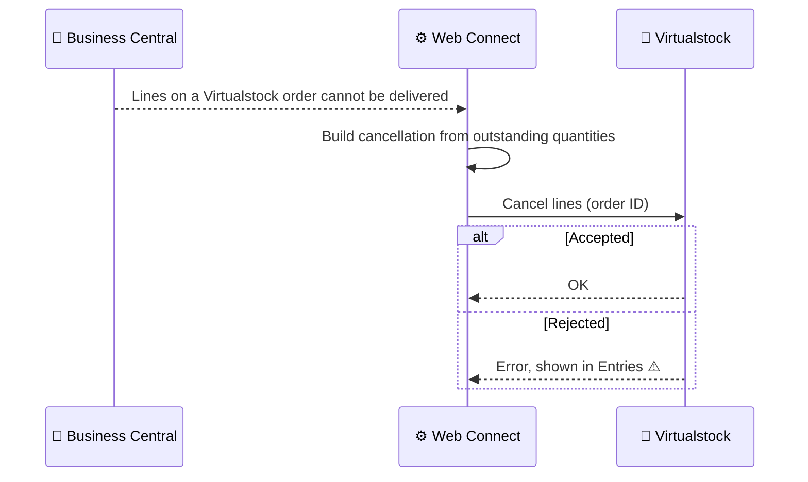

# Business Central to Virtualstock: cancellation

When order lines from Virtualstock cannot be delivered, for example back-ordered lines, Web Connect reports them as cancelled to Virtualstock. Each line is sent with its part number, Virtualstock line reference and the quantity that will not be delivered.

| | |
|---|---|
| **Direction** | Business Central → Virtualstock |
| **Trigger** | Outgoing sync triggers, set per integration when the flow is used. Usually the fields that are sent to Virtualstock are the trigger fields, so a change in one of them sends the record again |
| **Result** | The lines are registered as cancelled in Virtualstock |
| **Part of** | [Business Central and Virtualstock integration](../overview.md) |

## Step by step

1. Some or all lines on a Virtualstock sales order cannot be delivered.
2. The outgoing sync trigger set up for the integration fires for the sales order.
3. Web Connect builds the message from the sales lines of type Item, with the quantity that is still outstanding.
4. The cancellation is sent to Virtualstock for the stored Virtualstock order ID.

## Data mapping

| Business Central field | Virtualstock field | Note |
|---|---|---|
| Web Connect external ID on the sales order | Order ID in the address of the call | The Virtualstock order ID |
| Sales Line: No. | `items[].part_number` | |
| Web Connect external ID on the line | `items[].line_ref` | The Virtualstock line reference |
| Sales Line: Outstanding Quantity | `items[].quantity` | The quantity that will not be delivered |
| None by default | `items[].comment` | Left out when empty |

## Web Connect objects

| Object | Role |
|---|---|
| `VS_CANCELLATION` | Sends the cancellation for the sales order |
| `VS_CANCELLED_ITEMS` | One entry per sales line of type Item |
| `VS_URL` | Puts the Virtualstock order ID into the address of the call |

## Error handling

| Situation | What happens | What to do |
|---|---|---|
| Virtualstock rejects the cancellation | The entry gets an error in Web Connect Entries | Check the order status in Virtualstock, for example that the lines have not already been dispatched |
| Calls fail with 401 Unauthorized | The token could not be fetched | Check the API password in Secret Value Storage |

## Frequently asked questions

### Can a whole order be cancelled, or only lines?

The message is built from the order lines, so it can contain one line or all lines of the order. Each line is sent with the quantity that will not be delivered.

## Related

- [Business Central and Virtualstock integration](../overview.md)
- [Order inbound](order-inbound.md) · [Order confirmation](order-confirmation.md)
- [Entries](../../../general/entries.md)
