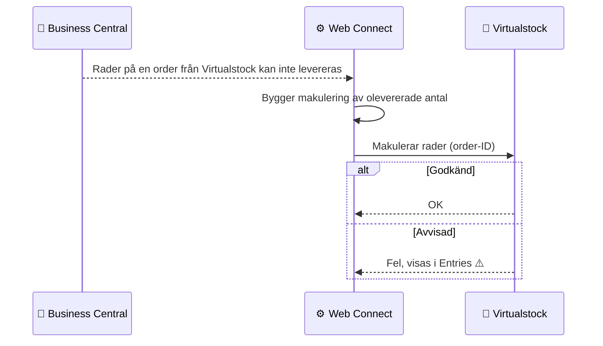

# Från Business Central till Virtualstock: makulering

När orderrader från Virtualstock inte kan levereras, till exempel restnoterade rader, rapporterar Web Connect dem som makulerade till Virtualstock. Varje rad skickas med sitt artikelnummer, Virtualstocks radreferens och det antal som inte kommer att levereras.

| | |
|---|---|
| **Riktning** | Business Central → Virtualstock |
| **Startas av** | Utgående synktriggers, inställda per integration när flödet används. Oftast är fälten som skickas till Virtualstock också triggerfälten, så en ändring i något av dem skickar posten igen |
| **Resultat** | Raderna registreras som makulerade i Virtualstock |
| **Del av** | [Business Central och Virtualstock: integration](../overview.md) |

## Steg för steg

1. Några eller alla rader på en försäljningsorder från Virtualstock kan inte levereras.
2. Den utgående synktrigger som är uppsatt för integrationen startar för försäljningsordern.
3. Web Connect bygger meddelandet från försäljningsraderna av typen Item, med det antal som fortfarande är olevererat.
4. Makuleringen skickas till Virtualstock för det sparade order-ID:t från Virtualstock.

## Mappning av data

| Fält i Business Central | Fält i Virtualstock | Kommentar |
|---|---|---|
| Externt ID i Web Connect på försäljningsordern | Order-ID i anropets adress | Virtualstocks order-ID |
| Sales Line: No. | `items[].part_number` | |
| Externt ID i Web Connect på raden | `items[].line_ref` | Virtualstocks radreferens |
| Sales Line: Outstanding Quantity | `items[].quantity` | Det antal som inte kommer att levereras |
| Inget som standard | `items[].comment` | Utelämnas när det är tomt |

## Objekt i Web Connect

| Objekt | Roll |
|---|---|
| `VS_CANCELLATION` | Skickar makuleringen för försäljningsordern |
| `VS_CANCELLED_ITEMS` | En post per försäljningsrad av typen Item |
| `VS_URL` | Lägger in Virtualstocks order-ID i anropets adress |

## Felhantering

| Situation | Vad som händer | Vad du gör |
|---|---|---|
| Virtualstock avvisar makuleringen | Posten får ett fel i Web Connect Entries | Kontrollera orderns status i Virtualstock, till exempel att raderna inte redan är skickade |
| Anropen misslyckas med 401 Unauthorized | Det gick inte att hämta en token | Kontrollera lösenordet till API:t i Secret Value Storage |

## Vanliga frågor

### Kan hela ordern makuleras, eller bara enskilda rader?

Meddelandet byggs från orderraderna, så det kan innehålla en rad eller alla rader på ordern. Varje rad skickas med det antal som inte kommer att levereras.

## Relaterat

- [Business Central och Virtualstock: integration](../overview.md)
- [Order in](order-inbound.md) · [Orderbekräftelse](order-confirmation.md)
- [Entries](../../../general/entries.md)
