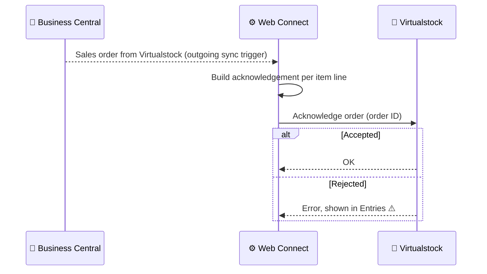

# Business Central to Virtualstock: order acknowledgement

When a Virtualstock order has been created as a sales order in Business Central, Web Connect acknowledges it in Virtualstock. Each line is acknowledged with its quantity and, when set, the promised delivery date, so the retailer can see that the supplier has accepted the order.

| | |
|---|---|
| **Direction** | Business Central → Virtualstock |
| **Trigger** | Outgoing sync trigger on the sales order, set per integration. Usually the fields that are sent to Virtualstock are the trigger fields, so a change in one of them sends the record again |
| **Result** | The order is acknowledged in Virtualstock and is no longer fetched as a new order |
| **Part of** | [Business Central and Virtualstock integration](../overview.md) |

## Step by step

1. A sales order is created from a Virtualstock order, see [Order inbound](order-inbound.md).
2. The outgoing sync trigger fires for the sales order. Only orders with a Virtualstock source are included.
3. Web Connect builds the acknowledgement with one entry per sales line of type Item.
4. The acknowledgement is sent to Virtualstock for the stored Virtualstock order ID.
5. Virtualstock registers the order as acknowledged.

## Data mapping

| Business Central field | Virtualstock field | Note |
|---|---|---|
| Web Connect external ID on the sales order | Order ID in the address of the call | The Virtualstock order ID stored when the order was fetched |
| Sales Line: Description 2 | `items[].part_number` | The part number received on the order |
| Web Connect external ID on the line | `items[].line_ref` | The Virtualstock line reference |
| Sales Line: Quantity | `items[].quantity` | |
| Sales Line: Promised Delivery Date | `items[].supplier_delivery_date` | Left out when empty |
| Fixed value | `items[].fulfillment_route` | `Direct to customer` |

## Web Connect objects

| Object | Role |
|---|---|
| `VS_ORDERCONFIRMATION` | Sends the acknowledgement for the sales order |
| `VS_CONFIRMATION_ITEM` | One entry per sales line of type Item |
| `VS_URL` | Puts the Virtualstock order ID into the address of the call |

## Error handling

| Situation | What happens | What to do |
|---|---|---|
| Virtualstock rejects or does not answer | The entry gets an error in Web Connect Entries, and the order stays unacknowledged in Virtualstock | Correct the cause and [resend the message](../../../../../how-to/web-connect/resend-outgoing-message.md) |
| Calls fail with 401 Unauthorized | The token could not be fetched | Check the API password in Secret Value Storage |
| The order is not acknowledged at all | The order has no Virtualstock source, or the trigger is not active | Check that the order came from Virtualstock and that the outgoing sync trigger is enabled |

## Frequently asked questions

### Are orders from other sales channels acknowledged in Virtualstock?

No. Only sales orders that came from Virtualstock, and therefore have a Virtualstock source and order ID stored, are acknowledged.

## Related

- [Business Central and Virtualstock integration](../overview.md)
- [Order inbound](order-inbound.md) · [Shipment](shipment.md)
- [Outgoing Sync Triggers](../../../general/outgoing-mapping/outgoing-sync-triggers.md) · [Entries](../../../general/entries.md)
