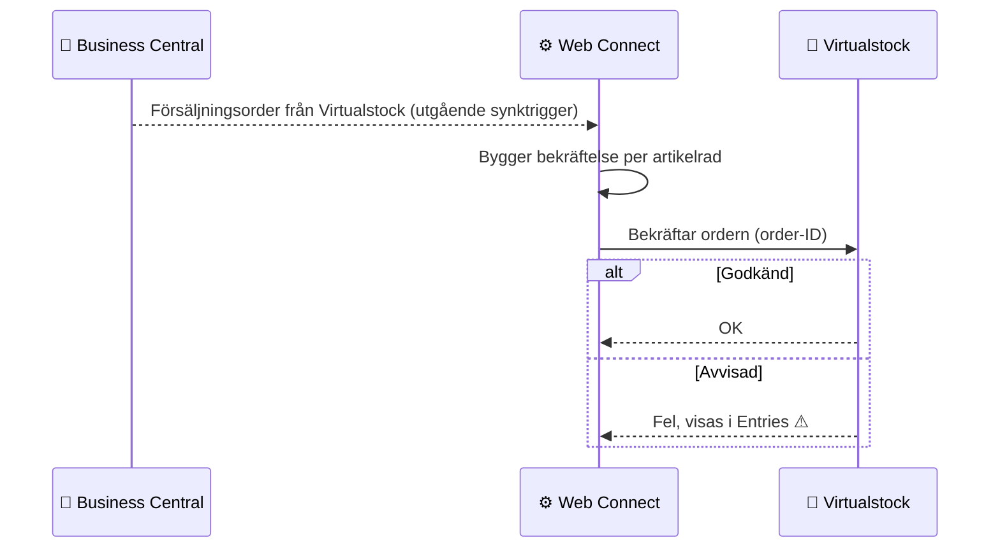

# Från Business Central till Virtualstock: orderbekräftelse

När en order från Virtualstock har skapats som försäljningsorder i Business Central bekräftar Web Connect den i Virtualstock. Varje rad bekräftas med sitt antal och, när det är ifyllt, det utlovade leveransdatumet, så att återförsäljaren ser att leverantören har accepterat ordern.

| | |
|---|---|
| **Riktning** | Business Central → Virtualstock |
| **Startas av** | Utgående synktrigger på försäljningsordern, inställd per integration. Oftast är fälten som skickas till Virtualstock också triggerfälten, så en ändring i något av dem skickar posten igen |
| **Resultat** | Ordern är bekräftad i Virtualstock och hämtas inte längre som en ny order |
| **Del av** | [Business Central och Virtualstock: integration](../overview.md) |

## Steg för steg

1. En försäljningsorder skapas från en order i Virtualstock, se [Order in](order-inbound.md).
2. Den utgående synktriggern startar för försäljningsordern. Bara order med Virtualstock som källa tas med.
3. Web Connect bygger bekräftelsen med en post per försäljningsrad av typen Item.
4. Bekräftelsen skickas till Virtualstock för det sparade order-ID:t från Virtualstock.
5. Virtualstock registrerar ordern som bekräftad.

## Mappning av data

| Fält i Business Central | Fält i Virtualstock | Kommentar |
|---|---|---|
| Externt ID i Web Connect på försäljningsordern | Order-ID i anropets adress | Virtualstocks order-ID som sparades när ordern hämtades |
| Sales Line: Description 2 | `items[].part_number` | Artikelnumret (part number) som kom med ordern |
| Externt ID i Web Connect på raden | `items[].line_ref` | Virtualstocks radreferens |
| Sales Line: Quantity | `items[].quantity` | |
| Sales Line: Promised Delivery Date | `items[].supplier_delivery_date` | Utelämnas när det är tomt |
| Fast värde | `items[].fulfillment_route` | `Direct to customer` |

## Objekt i Web Connect

| Objekt | Roll |
|---|---|
| `VS_ORDERCONFIRMATION` | Skickar bekräftelsen för försäljningsordern |
| `VS_CONFIRMATION_ITEM` | En post per försäljningsrad av typen Item |
| `VS_URL` | Lägger in Virtualstocks order-ID i anropets adress |

## Felhantering

| Situation | Vad som händer | Vad du gör |
|---|---|---|
| Virtualstock avvisar eller svarar inte | Posten får ett fel i Web Connect Entries, och ordern förblir obekräftad i Virtualstock | Rätta orsaken och [skicka om meddelandet](../../../../../how-to/web-connect/resend-outgoing-message.md) |
| Anropen misslyckas med 401 Unauthorized | Det gick inte att hämta en token | Kontrollera lösenordet till API:t i Secret Value Storage |
| Ordern bekräftas inte alls | Ordern har inte Virtualstock som källa, eller så är triggern inte aktiv | Kontrollera att ordern kom från Virtualstock och att den utgående synktriggern är aktiverad |

## Vanliga frågor

### Bekräftas order från andra försäljningskanaler också i Virtualstock?

Nej. Bara försäljningsorder som kom från Virtualstock, och som därför har Virtualstock som källa och ett sparat order-ID, bekräftas.

## Relaterat

- [Business Central och Virtualstock: integration](../overview.md)
- [Order in](order-inbound.md) · [Leverans](shipment.md)
- [Outgoing Sync Triggers](../../../general/outgoing-mapping/outgoing-sync-triggers.md) · [Entries](../../../general/entries.md)
