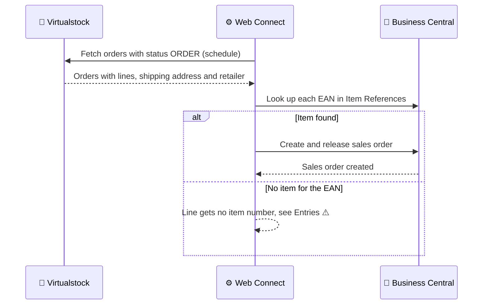

# Virtualstock to Business Central: orders

Web Connect fetches new retailer orders from Virtualstock on a schedule and creates each one as a released sales order in Business Central. Items are matched by the EAN on each order line, and the Virtualstock order ID is stored on the order so that the acknowledgement and the dispatch reach the right order.

| | |
|---|---|
| **Direction** | Virtualstock → Business Central |
| **Trigger** | Schedule in the Business Central job queue |
| **Result** | A released sales order in Business Central, with the Virtualstock order ID and line references stored |
| **Part of** | [Business Central and Virtualstock integration](../overview.md) |

## Step by step

1. The retailer places an order. It is available in Virtualstock with status `ORDER`.
2. On its next scheduled run, Web Connect fetches all orders with status `ORDER` from Virtualstock, ten per page, following the link to the next page.
3. For each order, Web Connect reads the order header, the order lines, the shipping address and the retailer.
4. Each order line's EAN is looked up in Item References in Business Central to find the item.
5. The sales order is created on the customer set up for the retailer, with the order reference as order number, and released.
6. The order is acknowledged in Virtualstock, see [Order confirmation](order-confirmation.md).

## Data mapping

| Virtualstock field | Business Central field | Note |
|---|---|---|
| `order_reference` | Sales Header: No. | The sales order gets the Virtualstock order reference as its number |
| `url` | Web Connect external ID | The Virtualstock order ID is taken from the order URL and used by the acknowledgement, dispatch and cancellation |
| `retailer_data.name` | Web Connect source on the sales order | Shows which retailer the order came from |
| `end_user_purchase_order_reference` | Your Reference | |
| `currency_code` | Currency Code | |
| `delivery_service_code` | Shipping Agent Service Code | Through a text mapping. A default value is used for codes that are not listed |
| `comment` | Work Description | |
| `shipping_address.full_name` | Ship-to Name | |
| `shipping_address.line_1`, `line_2` | Ship-to Address, Ship-to Address 2 | |
| `shipping_address.postal_code`, `city`, `country` | Ship-to Post Code, Ship-to City, Ship-to Country/Region Code | |
| `shipping_address.email` | Sell-to E-Mail | |
| `shipping_address.phone` | Ship-to Phone No. and Sell-to Phone No. | |
| `items[].retailer_additional_reference` | Sales Line: No. | The EAN, looked up in Item References. Type is always Item |
| `items[].line_reference` | Web Connect external ID on the line | Sent back on acknowledgement, dispatch and cancellation |
| `items[].name` | Description | |
| `items[].part_number` | Description 2 | Sent back as the part number on acknowledgement and dispatch |
| `items[].quantity` | Quantity | |
| `items[].unit_cost_price` | Unit Price | |
| `items[].promised_date` | Promised Delivery Date | |

The customer the order is created on is set per retailer in the mapping.

## Web Connect objects

| Object | Role |
|---|---|
| `VS_ORDER` | Fetches orders with status `ORDER` and creates the sales header |
| `VS_ORDERITEMS` | Order lines |
| `VS_SHIPPING_ADDRESS` | Shipping address on the sales header |
| `VS_RETAILER_DATA` | Retailer details on the order. Read, but not downloaded as a record of its own |
| `VS_ADDRESS` | The retailer's address |
| `VS_OAUTH` | Gets the access token used by all calls to Virtualstock |

## Error handling

| Situation | What happens | What to do |
|---|---|---|
| The EAN on a line has no match in Item References | The lookup returns no item number, and the line cannot be created as an item line | Add the EAN as an Item Reference on the item, then run the record again from [Entries](../../../general/entries.md). [ATT FYLLA I: confirm that the whole order stops, not only the line] |
| Nothing is fetched | The job queue entry is not running, or the token cannot be fetched | See [Integrations not running](../../../../../how-to/web-connect/integration-not-running.md) and [Nothing downloads to Business Central](../../../../../how-to/web-connect/nothing-downloads-to-business-central.md) |
| Calls fail with 401 Unauthorized | The API password has changed or the token has expired | Update the password in Secret Value Storage. See [401 after job queue stopped](../../../../../how-to/web-connect/unauthorized-after-job-queue-stopped.md) |
| The sales order fails validation in Business Central | The error is shown on the entry in Web Connect Entries | Correct the setup, for example the customer or a shipping agent service, and run the record again |

## Frequently asked questions

### Which Virtualstock orders are fetched?

Orders with status `ORDER`, which are new orders the supplier has not yet acknowledged. Once an order is acknowledged, it is no longer fetched.

### What number does the sales order get in Business Central?

The order reference from Virtualstock becomes the sales order number, so the same number is used in both systems.

## Related

- [Business Central and Virtualstock integration](../overview.md)
- [Order confirmation](order-confirmation.md) · [Shipment](shipment.md) · [Cancellation](cancellation.md)
- [Incoming Data mapping](../../../general/incoming-data/mapping.md) · [Text Mapping](../../../general/text-mapping.md) · [Entries](../../../general/entries.md)
