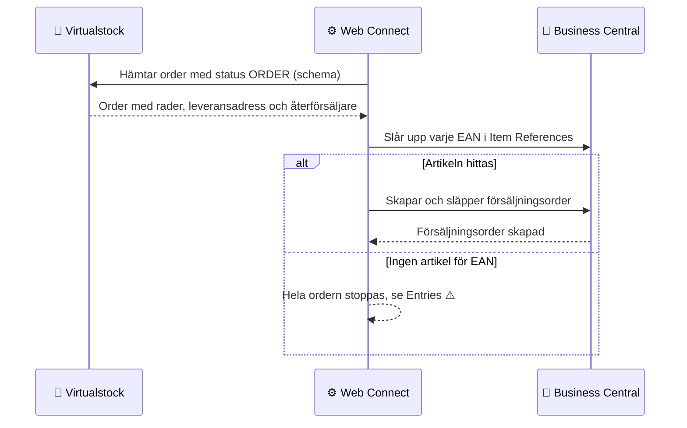

# Från Virtualstock till Business Central: order

Web Connect hämtar nya order från återförsäljarna i Virtualstock enligt schema och skapar var och en som en släppt försäljningsorder i Business Central. Artiklarna matchas med EAN på varje orderrad, och Virtualstocks order-ID sparas på ordern så att bekräftelsen och leveransen når rätt order.

| | |
|---|---|
| **Riktning** | Virtualstock → Business Central |
| **Startas av** | Schema i jobbkön i Business Central |
| **Resultat** | En släppt försäljningsorder i Business Central, med Virtualstocks order-ID och radreferenser sparade |
| **Del av** | [Business Central och Virtualstock: integration](../overview.md) |

## Steg för steg

1. Återförsäljaren lägger en order. Den finns i Virtualstock med status `ORDER`.
2. Vid nästa schemalagda körning hämtar Web Connect alla order med status `ORDER` från Virtualstock, tio per sida, och följer länken till nästa sida.
3. För varje order läser Web Connect orderhuvudet, orderraderna, leveransadressen och återförsäljaren.
4. EAN på varje orderrad slås upp i Item References i Business Central för att hitta artikeln.
5. Försäljningsordern skapas på den kund som är uppsatt för återförsäljaren, med orderreferensen som ordernummer, och släpps.
6. Ordern bekräftas i Virtualstock, se [Orderbekräftelse](order-confirmation.md).

## Mappning av data

| Fält i Virtualstock | Fält i Business Central | Kommentar |
|---|---|---|
| `order_reference` | Sales Header: No. | Försäljningsordern får Virtualstocks orderreferens som nummer |
| `url` | Externt ID i Web Connect | Virtualstocks order-ID tas från orderns URL och används av bekräftelsen, leveransen och makuleringen |
| `retailer_data.name` | Källa i Web Connect på försäljningsordern | Visar vilken återförsäljare ordern kom från |
| `end_user_purchase_order_reference` | Your Reference | |
| `currency_code` | Currency Code | |
| `delivery_service_code` | Shipping Agent Service Code | Via en textmappning. Ett standardvärde används för koder som inte finns i listan |
| `comment` | Work Description | |
| `shipping_address.full_name` | Ship-to Name | |
| `shipping_address.line_1`, `line_2` | Ship-to Address, Ship-to Address 2 | |
| `shipping_address.postal_code`, `city`, `country` | Ship-to Post Code, Ship-to City, Ship-to Country/Region Code | |
| `shipping_address.email` | Sell-to E-Mail | |
| `shipping_address.phone` | Ship-to Phone No. och Sell-to Phone No. | |
| `items[].retailer_additional_reference` | Sales Line: No. | EAN, som slås upp i Item References. Type är alltid Item |
| `items[].line_reference` | Externt ID i Web Connect på raden | Skickas tillbaka vid bekräftelse, leverans och makulering |
| `items[].name` | Description | |
| `items[].part_number` | Description 2 | Skickas tillbaka som artikelnummer (part number) vid bekräftelse och leverans |
| `items[].quantity` | Quantity | |
| `items[].unit_cost_price` | Unit Price | |
| `items[].promised_date` | Promised Delivery Date | |

Kunden som ordern skapas på ställs in per återförsäljare i mappningen.

## Objekt i Web Connect

| Objekt | Roll |
|---|---|
| `VS_ORDER` | Hämtar order med status `ORDER` och skapar försäljningshuvudet |
| `VS_ORDERITEMS` | Orderrader |
| `VS_SHIPPING_ADDRESS` | Leveransadress på försäljningshuvudet |
| `VS_RETAILER_DATA` | Uppgifter om återförsäljaren på ordern. Läses, men laddas inte ner som en egen post |
| `VS_ADDRESS` | Återförsäljarens adress |
| `VS_OAUTH` | Hämtar den åtkomsttoken som alla anrop till Virtualstock använder |

## Felhantering

| Situation | Vad som händer | Vad du gör |
|---|---|---|
| EAN på en rad saknar träff i Item References | Hela ordern stoppas och skapas inte, så att ingen order skapas med rader som fattas. Felet visas i Web Connect Entries | Lägg till EAN som Item Reference på artikeln och kör sedan posten igen från [Entries](../../../general/entries.md) |
| Ingenting hämtas | Posten i jobbkön körs inte, eller så går det inte att hämta en token | Se [Integrationer som inte körs](../../../../../how-to/web-connect/integration-not-running.md) och [Inget laddas ner till Business Central](../../../../../how-to/web-connect/nothing-downloads-to-business-central.md) |
| Anropen misslyckas med 401 Unauthorized | Lösenordet till API:t har ändrats eller token har gått ut | Uppdatera lösenordet i Secret Value Storage. Se [401 efter att jobbkön stoppats](../../../../../how-to/web-connect/unauthorized-after-job-queue-stopped.md) |
| Försäljningsordern går inte igenom valideringen i Business Central | Felet visas på posten i Web Connect Entries | Rätta inställningarna, till exempel kunden eller en speditörstjänst, och kör posten igen |

## Vanliga frågor

### Vilka order hämtas från Virtualstock?

Order med status `ORDER`, alltså nya order som leverantören ännu inte har bekräftat. När en order väl är bekräftad hämtas den inte längre.

### Vilket nummer får försäljningsordern i Business Central?

Orderreferensen från Virtualstock blir försäljningsorderns nummer, så samma nummer används i båda systemen.

## Relaterat

- [Business Central och Virtualstock: integration](../overview.md)
- [Orderbekräftelse](order-confirmation.md) · [Leverans](shipment.md) · [Makulering](cancellation.md)
- [Incoming Data mapping](../../../general/incoming-data/mapping.md) · [Text Mapping](../../../general/text-mapping.md) · [Entries](../../../general/entries.md)
