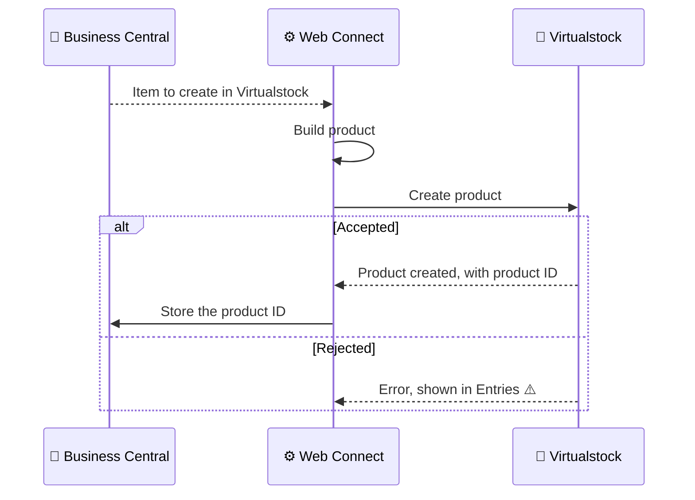

# Business Central to Virtualstock: product data

The standard Web Connect configuration for Virtualstock contains a product object that creates items from Business Central as products in Virtualstock, with item number as part number and the base unit of measure. No Web Connect customer uses it in production today. Instead, the supplier creates the products in Virtualstock and links them manually by registering the Virtualstock product ID on the item card or as an item reference in Business Central.

| | |
|---|---|
| **Direction** | Business Central → Virtualstock |
| **Trigger** | Outgoing sync triggers, set per integration when the flow is used. Usually the fields that are sent to Virtualstock are the trigger fields, so a change in one of them sends the record again |
| **Result** | The item exists as a product in Virtualstock |
| **Part of** | [Business Central and Virtualstock integration](../overview.md) |

## Step by step

1. An item that should be sold through Virtualstock is selected in Business Central.
2. Web Connect builds the product with the item number, the base unit of measure and the links to the Virtualstock category, client and supplier.
3. The product is created in Virtualstock.
4. Virtualstock answers with the new product ID, and Web Connect stores it, so that stock updates reach the product.

## Data mapping

| Business Central field | Virtualstock field | Note |
|---|---|---|
| Item: No. | `part_number` and `data.supplier_part_number` | |
| Item: Base Unit of Measure | `data.uom` | |
| Set per integration | `category`, `client`, `supplier` | Links to the Virtualstock category, client and supplier, given by Virtualstock |
| Fixed value | `data.low_stock` | The low stock level in Virtualstock |

## Web Connect objects

| Object | Role |
|---|---|
| `VS_PRODUCT` | Creates the product in Virtualstock |
| `VS_ITEM-DATA` | The product data block: supplier part number, unit of measure and low stock level |

## Error handling

| Situation | What happens | What to do |
|---|---|---|
| Virtualstock rejects the product | The entry gets an error in Web Connect Entries | Check the category, client and supplier links and the required fields for the retailer |
| Calls fail with 401 Unauthorized | The token could not be fetched | Check the API password in Secret Value Storage |

## Frequently asked questions

### Do we have to create products in Virtualstock from Business Central?

No. The supplier can create the products in Virtualstock and register each Virtualstock product ID on the item card or as an item reference in Business Central, which is how Web Connect customers work today. Orders and stock work the same either way, as long as each item has its EAN and Virtualstock product ID.

## Related

- [Business Central and Virtualstock integration](../overview.md)
- [Stock update](stock-update.md)
- [Entries](../../../general/entries.md)
