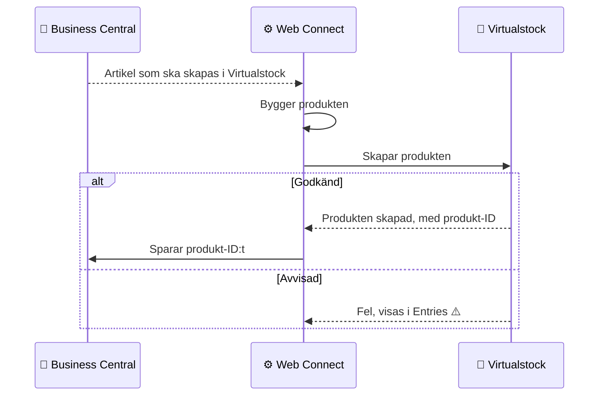

# Från Business Central till Virtualstock: produktdata

Standardkonfigurationen i Web Connect för Virtualstock har ett produktobjekt som skapar artiklar från Business Central som produkter i Virtualstock, med artikelnumret som part number och basenheten. Ingen kund med Web Connect använder det i produktion i dag. I stället skapar leverantören produkterna i Virtualstock och kopplar dem manuellt genom att registrera Virtualstocks produkt-ID på artikelkortet eller som en artikelreferens i Business Central.

| | |
|---|---|
| **Riktning** | Business Central → Virtualstock |
| **Startas av** | Utgående synktriggers, inställda per integration när flödet används. Oftast är fälten som skickas till Virtualstock också triggerfälten, så en ändring i något av dem skickar posten igen |
| **Resultat** | Artikeln finns som produkt i Virtualstock |
| **Del av** | [Business Central och Virtualstock: integration](../overview.md) |

## Steg för steg

1. En artikel som ska säljas via Virtualstock väljs i Business Central.
2. Web Connect bygger produkten med artikelnumret, basenheten och kopplingarna till kategori, klient och leverantör i Virtualstock.
3. Produkten skapas i Virtualstock.
4. Virtualstock svarar med det nya produkt-ID:t, och Web Connect sparar det så att uppdateringar av lagersaldot når produkten.

## Mappning av data

| Fält i Business Central | Fält i Virtualstock | Kommentar |
|---|---|---|
| Item: No. | `part_number` och `data.supplier_part_number` | |
| Item: Base Unit of Measure | `data.uom` | |
| Ställs in per integration | `category`, `client`, `supplier` | Kopplingar till kategori, klient och leverantör i Virtualstock, som Virtualstock lämnar |
| Fast värde | `data.low_stock` | Gränsen för lågt lagersaldo i Virtualstock |

## Objekt i Web Connect

| Objekt | Roll |
|---|---|
| `VS_PRODUCT` | Skapar produkten i Virtualstock |
| `VS_ITEM-DATA` | Blocket med produktdata: leverantörens artikelnummer, enhet och gränsen för lågt lagersaldo |

## Felhantering

| Situation | Vad som händer | Vad du gör |
|---|---|---|
| Virtualstock avvisar produkten | Posten får ett fel i Web Connect Entries | Kontrollera kopplingarna till kategori, klient och leverantör och de fält som återförsäljaren kräver |
| Anropen misslyckas med 401 Unauthorized | Det gick inte att hämta en token | Kontrollera lösenordet till API:t i Secret Value Storage |

## Vanliga frågor

### Måste vi skapa produkterna i Virtualstock från Business Central?

Nej. Leverantören kan skapa produkterna i Virtualstock och registrera varje produkt-ID från Virtualstock på artikelkortet eller som en artikelreferens i Business Central. Det är så kunder med Web Connect arbetar i dag. Order och lagersaldo fungerar likadant i båda fallen, så länge varje artikel har sin EAN och sitt produkt-ID från Virtualstock.

## Relaterat

- [Business Central och Virtualstock: integration](../overview.md)
- [Lagersaldo](stock-update.md)
- [Entries](../../../general/entries.md)
