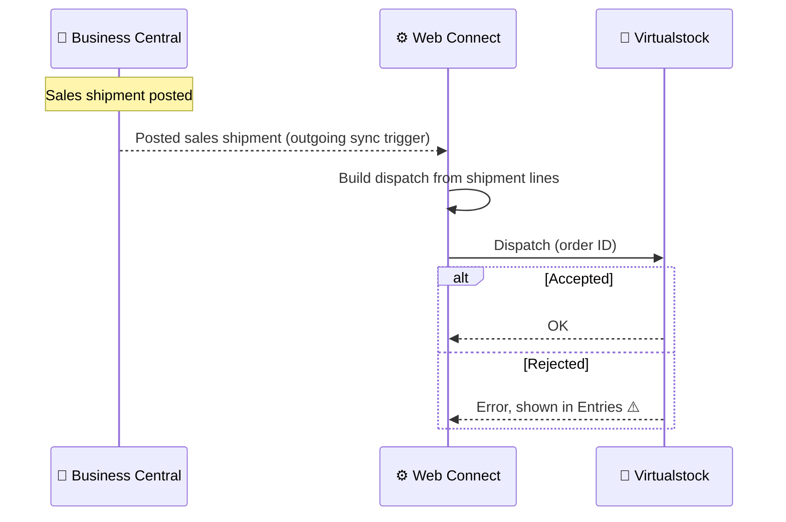

# Business Central to Virtualstock: dispatch

When a sales shipment is posted in Business Central for a Virtualstock order, Web Connect sends a dispatch to Virtualstock. It contains the shipped lines and quantities, the carrier, the tracking number and the dispatch date, so the retailer can follow the delivery.

| | |
|---|---|
| **Direction** | Business Central → Virtualstock |
| **Trigger** | A sales shipment is posted in Business Central |
| **Result** | The shipped lines are registered as dispatched in Virtualstock, with carrier and tracking number |
| **Part of** | [Business Central and Virtualstock integration](../overview.md) |

## Step by step

1. The order is picked, packed and shipped, and the sales shipment is posted in Business Central.
2. The outgoing sync trigger fires for the posted sales shipment. Only shipments for orders with a Virtualstock source are included.
3. Web Connect builds the dispatch from the shipment lines, with carrier, tracking number and dispatch date from the shipment header.
4. The dispatch is sent to Virtualstock for the stored Virtualstock order ID.

## Data mapping

| Business Central field | Virtualstock field | Note |
|---|---|---|
| Web Connect external ID on the shipment | Order ID in the address of the call | The Virtualstock order ID |
| Sales Shipment Line: Description 2 | `items[].part_number` | The part number received on the order |
| Web Connect external ID on the line | `items[].line_ref` | The Virtualstock line reference |
| Sales Shipment Line: Quantity | `items[].quantity` | |
| Sales Shipment Header: Shipment Date | `items[].supplier_dispatch_date` | |
| Sales Shipment Line: Promised Delivery Date | `items[].supplier_delivery_date` | Left out when empty |
| Sales Shipment Header: Package Tracking No. | `items[].tracking_number` | |
| Sales Shipment Header: Shipping Agent Code | `items[].carrier` | |

The carrier is sent as the shipping agent code in Business Central. On incoming orders, the Virtualstock delivery code is mapped to a shipping agent service with a [text mapping](../../../general/text-mapping.md). The carrier must be a code Virtualstock recognises. If your shipping agent codes differ, they can be mapped to the Virtualstock codes with a text mapping in Web Connect.

## Web Connect objects

| Object | Role |
|---|---|
| `VS_SHIPMENT` | Sends the dispatch for the posted sales shipment |
| `VS_SHIPPED_ITEMS` | One entry per shipment line |
| `VS_SHIPMENTDATA_FROM_LINE` | Reads carrier, tracking number and dispatch date from the shipment header for each line |
| `VS_URL` | Puts the Virtualstock order ID into the address of the call |

## Error handling

| Situation | What happens | What to do |
|---|---|---|
| Virtualstock rejects or does not answer | The entry gets an error in Web Connect Entries, and the lines stay undispatched in Virtualstock | Correct the cause and [resend the message](../../../../../how-to/web-connect/resend-outgoing-message.md) |
| No tracking number on the shipment | The dispatch is sent without a usable tracking number | Make sure the package tracking number is set before the shipment is posted |
| Calls fail with 401 Unauthorized | The token could not be fetched | Check the API password in Secret Value Storage |

## Frequently asked questions

### Are partial shipments supported?

Yes. The dispatch is built from each posted sales shipment, with the lines and quantities on that shipment. Each posted shipment for the order sends its own dispatch.

### Where do the carrier and tracking number come from?

From the posted sales shipment in Business Central: the shipping agent code is sent as the carrier and the package tracking number as the tracking number.

## Related

- [Business Central and Virtualstock integration](../overview.md)
- [Order inbound](order-inbound.md) · [Order confirmation](order-confirmation.md)
- [Outgoing Sync Triggers](../../../general/outgoing-mapping/outgoing-sync-triggers.md) · [Entries](../../../general/entries.md)
