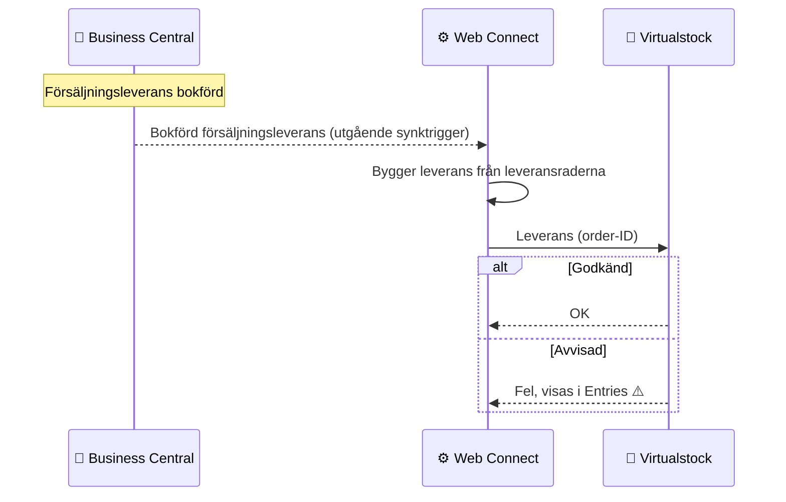

# Från Business Central till Virtualstock: leveranser

När en försäljningsleverans bokförs i Business Central för en order från Virtualstock skickar Web Connect en leverans (dispatch) till Virtualstock. Den innehåller de levererade raderna och antalen, transportören, spårningsnumret och leveransdatumet, så att återförsäljaren kan följa leveransen.

| | |
|---|---|
| **Riktning** | Business Central → Virtualstock |
| **Startas av** | En försäljningsleverans bokförs i Business Central |
| **Resultat** | De levererade raderna registreras som skickade i Virtualstock, med transportör och spårningsnummer |
| **Del av** | [Business Central och Virtualstock: integration](../overview.md) |

## Steg för steg

1. Ordern plockas, packas och skickas, och försäljningsleveransen bokförs i Business Central.
2. Den utgående synktriggern startar för den bokförda försäljningsleveransen. Bara leveranser för order med Virtualstock som källa tas med.
3. Web Connect bygger leveransen från leveransraderna, med transportör, spårningsnummer och leveransdatum från leveranshuvudet.
4. Leveransen skickas till Virtualstock för det sparade order-ID:t från Virtualstock.

## Mappning av data

| Fält i Business Central | Fält i Virtualstock | Kommentar |
|---|---|---|
| Externt ID i Web Connect på leveransen | Order-ID i anropets adress | Virtualstocks order-ID |
| Sales Shipment Line: Description 2 | `items[].part_number` | Artikelnumret (part number) som kom med ordern |
| Externt ID i Web Connect på raden | `items[].line_ref` | Virtualstocks radreferens |
| Sales Shipment Line: Quantity | `items[].quantity` | |
| Sales Shipment Header: Shipment Date | `items[].supplier_dispatch_date` | |
| Sales Shipment Line: Promised Delivery Date | `items[].supplier_delivery_date` | Utelämnas när det är tomt |
| Sales Shipment Header: Package Tracking No. | `items[].tracking_number` | |
| Sales Shipment Header: Shipping Agent Code | `items[].carrier` | |

Transportören skickas som speditörskoden i Business Central. På inkommande order mappas Virtualstocks leveranskod till en speditörstjänst med en [textmappning](../../../general/text-mapping.md). Transportören måste vara en kod som Virtualstock känner igen. Om dina speditörskoder skiljer sig kan de mappas till Virtualstocks koder med en textmappning i Web Connect.

## Objekt i Web Connect

| Objekt | Roll |
|---|---|
| `VS_SHIPMENT` | Skickar leveransen för den bokförda försäljningsleveransen |
| `VS_SHIPPED_ITEMS` | En post per leveransrad |
| `VS_SHIPMENTDATA_FROM_LINE` | Läser transportör, spårningsnummer och leveransdatum från leveranshuvudet för varje rad |
| `VS_URL` | Lägger in Virtualstocks order-ID i anropets adress |

## Felhantering

| Situation | Vad som händer | Vad du gör |
|---|---|---|
| Virtualstock avvisar eller svarar inte | Posten får ett fel i Web Connect Entries, och raderna förblir oskickade i Virtualstock | Rätta orsaken och [skicka om meddelandet](../../../../../how-to/web-connect/resend-outgoing-message.md) |
| Inget spårningsnummer på leveransen | Leveransen skickas utan ett användbart spårningsnummer | Se till att kollits spårningsnummer är ifyllt innan leveransen bokförs |
| Anropen misslyckas med 401 Unauthorized | Det gick inte att hämta en token | Kontrollera lösenordet till API:t i Secret Value Storage |

## Vanliga frågor

### Fungerar delleveranser?

Ja. Leveransen byggs från varje bokförd försäljningsleverans, med raderna och antalen på just den leveransen. Varje bokförd leverans för ordern skickar en egen leverans till Virtualstock.

### Var kommer transportören och spårningsnumret ifrån?

Från den bokförda försäljningsleveransen i Business Central: speditörskoden skickas som transportör och kollits spårningsnummer som spårningsnummer.

## Relaterat

- [Business Central och Virtualstock: integration](../overview.md)
- [Order in](order-inbound.md) · [Orderbekräftelse](order-confirmation.md)
- [Outgoing Sync Triggers](../../../general/outgoing-mapping/outgoing-sync-triggers.md) · [Entries](../../../general/entries.md)
