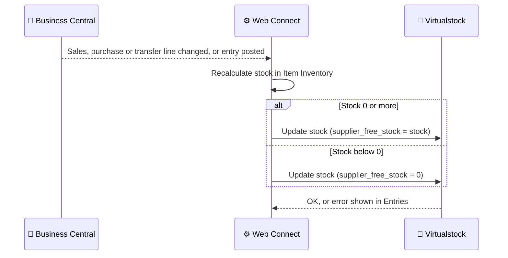

# Business Central to Virtualstock: stock

Web Connect sends the free stock for each item from Business Central to Virtualstock, so the retailer only sells what the supplier can deliver. Stock is calculated in Web Connect Item Inventory and sent when sales, purchase or transfer lines change or an item ledger entry is posted. Negative stock is sent as 0.

| | |
|---|---|
| **Direction** | Business Central → Virtualstock |
| **Trigger** | Outgoing sync triggers on sales lines, purchase lines, transfer lines, item ledger entries and the calculated stock |
| **Result** | The supplier free stock for the product is updated in Virtualstock |
| **Part of** | [Business Central and Virtualstock integration](../overview.md) |

## Step by step

1. Stock changes in Business Central: a sales, purchase or transfer line is created or changed, or an item ledger entry is posted.
2. Web Connect recalculates the stock for the item in [Item Inventory](../../../general/item-inventory.md).
3. When the calculated stock changes, the outgoing sync trigger fires for the item. Only items included by the filter on the stock object are sent.
4. If the stock is below zero, 0 is used instead.
5. The free stock is sent to the Virtualstock product.

## What triggers an update

| Source in Business Central | Fields watched |
|---|---|
| Sales Line | No., Quantity |
| Purchase Line | No., Quantity |
| Transfer Line | Item No., Quantity |
| Item Ledger Entry | When an entry is posted |
| Web Connect Item Inventory | The calculated stock values |

You can add or remove triggers yourself in [Outgoing Sync Triggers](../../../general/outgoing-mapping/outgoing-sync-triggers.md).

## Data mapping

| Business Central field | Virtualstock field | Note |
|---|---|---|
| Item Inventory: calculated stock | `supplier_free_stock` | Sent as 0 when the value is below zero |
| Virtualstock product ID for the item | Product ID in the address of the call | [ATT FYLLA I: where the Virtualstock product ID for each item is stored in Business Central or Web Connect] |

## Web Connect objects

| Object | Role |
|---|---|
| `VS_STOCKUPDATE` | Sends the free stock for an item to Virtualstock |
| `VS_URL` | Puts the Virtualstock product ID into the address of the call |
| `STOCK-IS-NEGATIVE` | Condition that sends 0 instead of a negative value |

## Error handling

| Situation | What happens | What to do |
|---|---|---|
| The item has no Virtualstock product ID | The update cannot reach a product in Virtualstock | Register the product ID for the item. [ATT FYLLA I: where and how] |
| Stock shows 0 in Virtualstock | The calculated stock in Business Central is 0 or negative | Check the item's stock and the locations included in Item Inventory |
| Stock does not update at all | The item is outside the filter on the stock object, or the job queue is not running | Check the filter and see [Send inventory to external systems](../../../../../how-to/web-connect/outgoing-inventory-to-external-systems.md) |
| Virtualstock rejects or does not answer | The entry gets an error in Web Connect Entries | Correct the cause and [resend the message](../../../../../how-to/web-connect/resend-outgoing-message.md) |

## Frequently asked questions

### Is negative stock sent to Virtualstock?

No. A condition in Web Connect checks the calculated stock, and when it is below zero, 0 is sent as the free stock.

### Which items get stock updates?

The items included by the filter on the stock object in Web Connect, usually the items sold through Virtualstock. Each item also needs its Virtualstock product ID.

## Related

- [Business Central and Virtualstock integration](../overview.md)
- [Product data](product-data.md)
- [Item Inventory](../../../general/item-inventory.md) · [Destinations](../../../general/destinations.md) · [Condition List](../../../general/condition-list.md)
