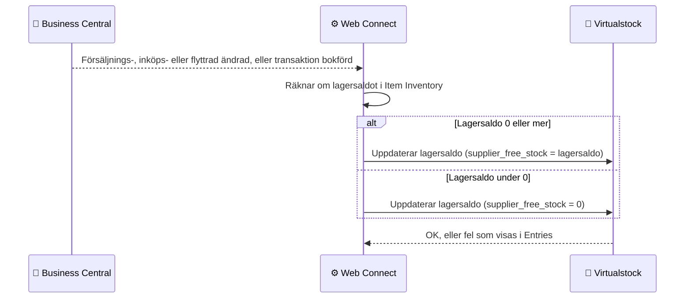

# Från Business Central till Virtualstock: lagersaldo

Web Connect skickar det fria lagersaldot för varje artikel från Business Central till Virtualstock, så att återförsäljaren bara säljer det som leverantören kan leverera. Lagersaldot beräknas i Web Connect Item Inventory och skickas när försäljnings-, inköps- eller flyttrader ändras eller när en artikeltransaktion bokförs. Negativt saldo skickas som 0.

| | |
|---|---|
| **Riktning** | Business Central → Virtualstock |
| **Startas av** | Utgående synktriggers på försäljningsrader, inköpsrader, flyttrader, artikeltransaktioner och det beräknade lagersaldot |
| **Resultat** | Leverantörens fria lagersaldo för produkten uppdateras i Virtualstock |
| **Del av** | [Business Central och Virtualstock: integration](../overview.md) |

## Steg för steg

1. Lagersaldot ändras i Business Central: en försäljnings-, inköps- eller flyttrad skapas eller ändras, eller en artikeltransaktion bokförs.
2. Web Connect räknar om lagersaldot för artikeln i [Item Inventory](../../../general/item-inventory.md).
3. När det beräknade lagersaldot ändras startar den utgående synktriggern för artikeln. Bara artiklar som tas med av filtret på lagerobjektet skickas.
4. Om lagersaldot är under noll används 0 i stället.
5. Det fria lagersaldot skickas till produkten i Virtualstock.

## Vad som startar en uppdatering

| Källa i Business Central | Fält som bevakas |
|---|---|
| Sales Line | No., Quantity |
| Purchase Line | No., Quantity |
| Transfer Line | Item No., Quantity |
| Item Ledger Entry | När en transaktion bokförs |
| Web Connect Item Inventory | De beräknade lagervärdena |

Du kan själv lägga till eller ta bort triggers i [Outgoing Sync Triggers](../../../general/outgoing-mapping/outgoing-sync-triggers.md).

## Mappning av data

| Fält i Business Central | Fält i Virtualstock | Kommentar |
|---|---|---|
| Item Inventory: beräknat lagersaldo | `supplier_free_stock` | Skickas som 0 när värdet är under noll |
| Virtualstocks produkt-ID för artikeln | Produkt-ID i anropets adress | Sparas på artikelkortet eller som en artikelreferens i Business Central |

## Objekt i Web Connect

| Objekt | Roll |
|---|---|
| `VS_STOCKUPDATE` | Skickar det fria lagersaldot för en artikel till Virtualstock |
| `VS_URL` | Lägger in Virtualstocks produkt-ID i anropets adress |
| `STOCK-IS-NEGATIVE` | Villkor som skickar 0 i stället för ett negativt värde |

## Felhantering

| Situation | Vad som händer | Vad du gör |
|---|---|---|
| Artikeln saknar produkt-ID från Virtualstock | Uppdateringen når ingen produkt i Virtualstock | Registrera Virtualstocks produkt-ID på artikelkortet eller som en artikelreferens i Business Central |
| Lagersaldot visar 0 i Virtualstock | Det beräknade lagersaldot i Business Central är 0 eller negativt | Kontrollera artikelns lagersaldo och vilka lagerställen som räknas med i Item Inventory |
| Lagersaldot uppdateras inte alls | Artikeln ligger utanför filtret på lagerobjektet, eller så körs inte jobbkön | Kontrollera filtret och se [Skicka lagersaldo till externa system](../../../../../how-to/web-connect/outgoing-inventory-to-external-systems.md) |
| Virtualstock avvisar eller svarar inte | Posten får ett fel i Web Connect Entries | Rätta orsaken och [skicka om meddelandet](../../../../../how-to/web-connect/resend-outgoing-message.md) |

## Vanliga frågor

### Skickas negativt lagersaldo till Virtualstock?

Nej. Ett villkor i Web Connect kontrollerar det beräknade lagersaldot, och när det är under noll skickas 0 som fritt lagersaldo.

### Vilka artiklar får uppdateringar av lagersaldot?

De artiklar som tas med av filtret på lagerobjektet i Web Connect, oftast artiklarna som säljs via Virtualstock. Varje artikel behöver också sitt produkt-ID från Virtualstock.

## Relaterat

- [Business Central och Virtualstock: integration](../overview.md)
- [Produktdata](product-data.md)
- [Item Inventory](../../../general/item-inventory.md) · [Destinations](../../../general/destinations.md) · [Condition List](../../../general/condition-list.md)
