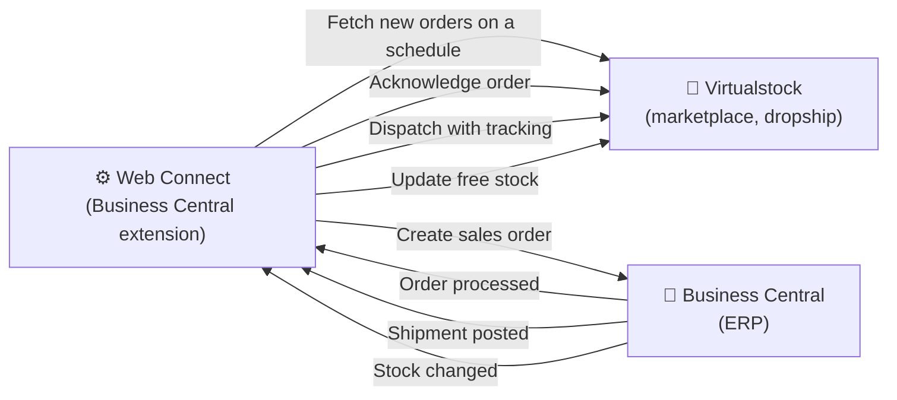
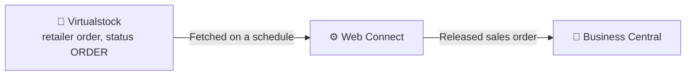
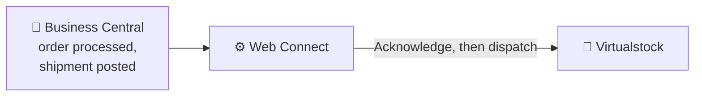
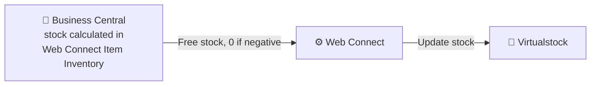
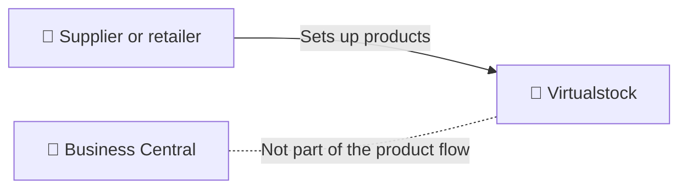

# Business Central and Virtualstock integration

Web Connect by CombineIT connects Microsoft Dynamics 365 Business Central with Virtualstock, the dropship platform between retailers and their suppliers. Retailer orders are fetched from Virtualstock into Business Central as sales orders, and order acknowledgements, dispatches with tracking and free stock are sent back to Virtualstock. All mappings and rules live in your own Business Central, where you can see and change them yourself.

## At a glance

| | |
|---|---|
| **System** | Virtualstock (marketplace (dropship)) |
| **Integration product** | Web Connect for Microsoft Dynamics 365 Business Central |
| **Runs in** | Your own Business Central environment, as an extension. Web Connect fetches new orders from Virtualstock on a schedule in the Business Central job queue and sends acknowledgements, dispatches and stock to Virtualstock when they happen in Business Central. No webhooks and no external integration platform are involved. |
| **Configured by** | You, in Business Central: mappings, conditions, triggers and flows. You can do all of it yourself. If you want, CombineIT takes part in any step, as a sounding board or by doing the work. |
| **Connection** | Virtualstock REST API (V4), JSON, with a token from the Virtualstock token endpoint |
| **Virtualstock API** | [Virtualstock API documentation](https://api-docs.virtualstock.com) |
| **Data flows** | 6: orders, order acknowledgements, dispatches, stock, cancellations and product data |
| **Business Central editions** | Essentials and Premium |
| **Available from** | [Web Connect on Microsoft AppSource](https://marketplace.microsoft.com/sv-se/product/PUBID.martitab1633951001710%7CAID.webconnect%7CPAPPID.9f3a7223-19db-4ac7-832f-cf8e4699186f?tab=Overview). [ATT FYLLA I: whether the Virtualstock integration is included in the Web Connect Ready Integrations app] |

## What can be synchronized

Web Connect has six data flows between Business Central and Virtualstock.

| Data | Direction | What happens |
|---|---|---|
| [Orders](flows/order-inbound.md) | Virtualstock → Business Central | New retailer orders are fetched and created as released sales orders |
| [Order acknowledgements](flows/order-confirmation.md) | Business Central → Virtualstock | The order is acknowledged in Virtualstock, line by line |
| [Dispatches](flows/shipment.md) | Business Central → Virtualstock | A posted sales shipment is sent as a dispatch with carrier, tracking number and dispatch date |
| [Stock](flows/stock-update.md) | Business Central → Virtualstock | Free stock per item is sent to Virtualstock. Negative stock is sent as 0 |
| [Cancellations](flows/cancellation.md) | Business Central → Virtualstock | Lines that cannot be delivered are reported as cancelled to Virtualstock |
| [Product data](flows/product-data.md) | Business Central → Virtualstock | Items are created in Virtualstock. Not in production use today, see the flow page |

Orders, acknowledgements, dispatches and stock make up the integration in production use today. Cancellations and product data are part of the standard configuration and are chosen when the integration is set up. See [Choose your setup](#choose-your-setup).

## How it works

Web Connect asks Virtualstock for orders with status `ORDER` (new orders the supplier has not acknowledged) on a schedule, ten orders per page, following Virtualstock's link to the next page. Each order is created as a sales order in Business Central, with the Virtualstock order ID and line references stored on the order. When something happens in Business Central (the order is processed, a shipment is posted, stock moves), an outgoing sync trigger in Web Connect sends it to Virtualstock, using the stored order ID. Only orders that came from Virtualstock are acknowledged and dispatched. Every message in both directions is logged in Web Connect Entries, where it can be inspected and resent.

## Choose your setup

Each flow has to fit how your business works: which system owns the data, where people do their work, and what the accounting needs. That is why the flows are decided together when a new integration is set up. The options below are the ones Web Connect customers use today. **Common setup** marks the option most Web Connect customers with Virtualstock use. It is verified from the configuration of the Web Connect customers who run Virtualstock in production.

### Orders

| Option | How it works | When it fits |
|---|---|---|
| **Virtualstock → Business Central** (common setup) | New orders are fetched from Virtualstock and created as released sales orders on one Business Central customer per retailer | Always. This is the core of the integration |

#### Orders from Virtualstock to Business Central

### Order acknowledgements and dispatches

| Option | How it works | When it fits |
|---|---|---|
| **Business Central → Virtualstock** (common setup) | Web Connect acknowledges the order in Virtualstock, and sends a dispatch with carrier and tracking number when the sales shipment is posted | When the warehouse work is registered in Business Central |

#### Acknowledgements and dispatches from Business Central

### Stock

| Option | How it works | When it fits |
|---|---|---|
| **Calculated in Business Central** (common setup) | Web Connect Item Inventory calculates stock for the chosen items and locations, and the free stock is sent to Virtualstock when it changes | Business Central has the correct stock |

#### Stock calculated in Business Central

### Products

| Option | How it works | When it fits |
|---|---|---|
| **Maintained in Virtualstock** (common setup) | Products are set up in Virtualstock outside the integration. [ATT FYLLA I: confirm how products are created in Virtualstock today, by the supplier or by the retailer] | The product range sold through the retailer is small or set up by the retailer |

#### Products maintained in Virtualstock

Retailer data, retailer prices and the order itself are always maintained in Virtualstock.

## What you need

- Microsoft Dynamics 365 Business Central, Essentials or Premium
- Web Connect installed from Microsoft AppSource, with an activated Web Connect license
- Your approval for Web Connect to be installed and to act in your Business Central environment
- An API user from Virtualstock (user name and password) for each retailer connection, for both the sandbox and production. [ATT FYLLA I: where the supplier gets the API user, from Virtualstock or from the retailer]
- An EAN for every item you sell through Virtualstock, registered as an Item Reference in Business Central
- The Virtualstock delivery codes the retailer uses, so they can be mapped to shipping agent services in Business Central

## Setting it up

1. Decide which flows to use and which option to choose for each, see [Choose your setup](#choose-your-setup).
2. Install Web Connect in Business Central, activate the license and give your approval. [ATT FYLLA I: how the Virtualstock integration is installed, from the Ready Integrations app or as an imported configuration]
3. Store the Virtualstock API password in Web Connect [Secret Value Storage](../../general/secret-value-storage.md) and set up the authentication with the user name and the Virtualstock token endpoint.
4. Set up the configuration choices below.
5. Test the whole order flow in a Business Central sandbox against the Virtualstock sandbox before going live.

## Configure it yourself in Business Central

All configuration and logic in the integration is visible and editable in Business Central. There is no external integration platform where the logic is hidden.

| What you can change | Where in Web Connect | Example |
|---|---|---|
| Field mapping on orders | [Incoming Data mapping](../../general/incoming-data/mapping.md) | Map the end customer's purchase order reference to Your Reference on the sales order |
| Item matching | Lookup Value on the order line mapping | Look up the EAN in Item References, limited to the items sold through one retailer |
| Delivery code to shipping agent service | [Text Mapping](../../general/text-mapping.md) | Map each Virtualstock delivery code to a shipping agent service, with a default for codes that are not listed |
| What triggers stock updates | [Outgoing Sync Triggers](../../general/outgoing-mapping/outgoing-sync-triggers.md) | Send stock when sales, purchase or transfer lines change, or when an item ledger entry is posted |
| Which stock is sent | [Item Inventory](../../general/item-inventory.md) and [Destinations](../../general/destinations.md) | Calculate stock for selected locations only |
| Never send negative stock | [Condition List](../../general/condition-list.md) | Send 0 when the calculated stock is below zero |
| Monitoring and resending | [Entries](../../general/entries.md) | See every order and update, and [resend a message](../../../../how-to/web-connect/resend-outgoing-message.md) |

## Configuration choices

- **Customer per retailer:** which Business Central customer the orders from each retailer are created on. The retailer name from Virtualstock is stored on each order.
- **Item matching:** which Item References the EAN lookup uses, and whether it is limited to some items.
- **Delivery services:** how the Virtualstock delivery codes map to shipping agent services in Business Central.
- **Stock calculation:** which items and locations are included. Negative stock is sent as 0.
- **Items in the stock flow:** stock can be limited to the items sold through Virtualstock with a filter on the stock object.
- **Cancellations and product data:** whether these flows are used, see their flow pages.

## Limitations

- **Every item needs an EAN in Item References.** An order line whose EAN has no match in Business Central gets no item number.
- **Each item needs its Virtualstock product ID** for stock updates to reach the right product. [ATT FYLLA I: where the Virtualstock product ID for each item is stored in Business Central or Web Connect]
- **Only orders with status `ORDER` are fetched.** Changes the retailer makes to an order after it has been acknowledged, for example a cancellation request, are not read by the integration. [ATT FYLLA I: confirm how retailer cancellations are handled]
- **Product data is not in production use.** The standard configuration contains a product object, but no Web Connect customer uses it in production today.
- **Retailer prices are not changed from Business Central.** The unit cost price on the order comes from Virtualstock.

## Frequently asked questions

### Can Business Central be integrated with Virtualstock?

Yes. Web Connect connects Business Central with the Virtualstock REST API. Retailer orders are created as sales orders in Business Central, and order acknowledgements, dispatches with carrier and tracking number, and free stock are sent back to Virtualstock.

### How are the items on a Virtualstock order matched to items in Business Central?

By the EAN the retailer sends on each order line. Web Connect looks up the EAN in Item References in Business Central and uses the item it belongs to. The lookup can be limited with a filter, for example to the items you sell through one retailer.

### Is negative stock sent to Virtualstock?

No. When the calculated stock for an item is below zero, Web Connect sends 0 as the free stock.

### Can we change what is sent between Business Central and Virtualstock ourselves?

Yes. Field mappings, lookups, conditions, triggers and which flows are active are configured in Web Connect inside your own Business Central. You can see and change them without asking a supplier to change an external platform.

## Related

- Flows: [Order inbound](flows/order-inbound.md) · [Order confirmation](flows/order-confirmation.md) · [Shipment](flows/shipment.md) · [Stock update](flows/stock-update.md) · [Cancellation](flows/cancellation.md) · [Product data](flows/product-data.md)
- How-to: [Resend an outgoing message](../../../../how-to/web-connect/resend-outgoing-message.md) · [Integrations not running](../../../../how-to/web-connect/integration-not-running.md) · [Nothing downloads to Business Central](../../../../how-to/web-connect/nothing-downloads-to-business-central.md) · [Send inventory to external systems](../../../../how-to/web-connect/outgoing-inventory-to-external-systems.md)
- [Web Connect general documentation](../../general/README.md)
- [Virtualstock API documentation](https://api-docs.virtualstock.com)

## About Web Connect

Web Connect is an integration platform for Microsoft Dynamics 365 Business Central, developed by CombineIT. It is installed in your own Business Central and connects it with e-commerce platforms, warehouse systems, POS, returns, marketplaces and EDI. Every flow, mapping and rule is configured in Business Central, where you can see and change it yourself, without custom code for each integration. [Web Connect on Microsoft AppSource](https://marketplace.microsoft.com/sv-se/product/PUBID.martitab1633951001710%7CAID.webconnect%7CPAPPID.9f3a7223-19db-4ac7-832f-cf8e4699186f?tab=Overview) · [Contact CombineIT](https://www.combineit.se/contact/)
