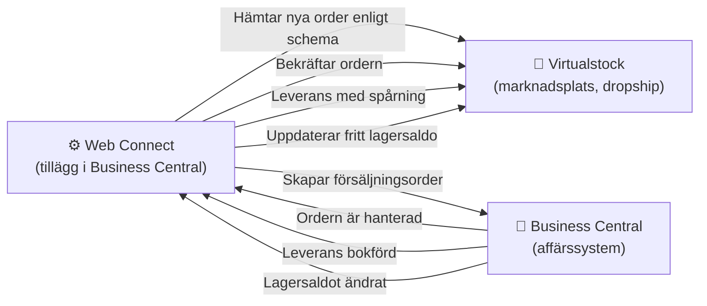
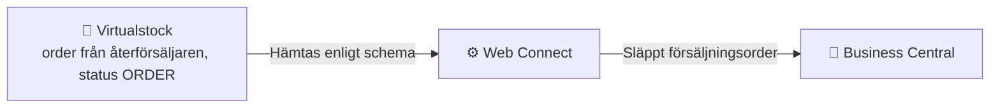
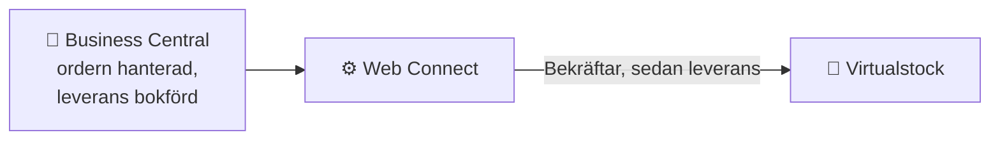
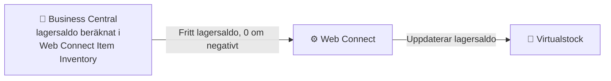
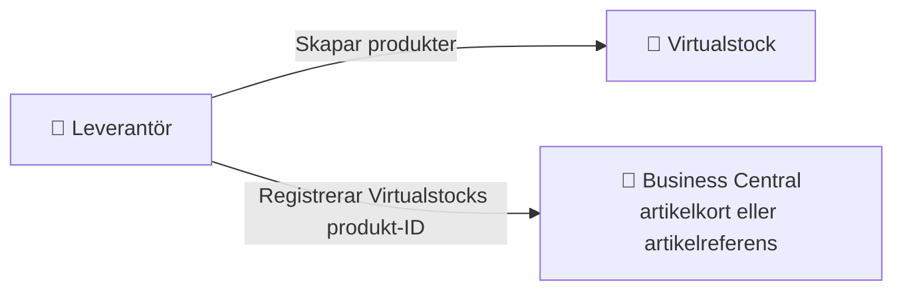

# Business Central och Virtualstock: integration

Web Connect från CombineIT kopplar Microsoft Dynamics 365 Business Central till Virtualstock, dropshipplattformen mellan återförsäljare och deras leverantörer. Återförsäljarnas order hämtas från Virtualstock till Business Central som försäljningsorder, och orderbekräftelser, leveranser med spårning och fritt lagersaldo skickas tillbaka till Virtualstock. Alla mappningar och regler finns i ditt eget Business Central, där du kan se och ändra dem själv.

## I korthet

| | |
|---|---|
| **System** | Virtualstock (marknadsplats, dropship) |
| **Integrationsprodukt** | Web Connect för Microsoft Dynamics 365 Business Central |
| **Körs i** | Din egen Business Central-miljö, som ett tillägg. Web Connect hämtar nya order från Virtualstock enligt schema i jobbkön i Business Central och skickar bekräftelser, leveranser och lagersaldo till Virtualstock när de händer i Business Central. Inga webhooks och ingen extern integrationsplattform används. |
| **Konfigureras av** | Dig, i Business Central: mappningar, villkor, triggers och flöden. Du kan göra allt själv. Om du vill är CombineIT med i vilket steg som helst, som bollplank eller genom att göra jobbet. |
| **Koppling** | Virtualstocks REST API (V4), JSON, med en token från Virtualstocks tokenendpoint |
| **Virtualstocks API** | [Virtualstocks API-dokumentation](https://api-docs.virtualstock.com) |
| **Dataflöden** | 6: order, orderbekräftelser, leveranser, lagersaldo, makuleringar och produktdata |
| **Business Central-utgåvor** | Alla utgåvor, Essentials och Premium, även den senaste versionen |
| **Finns på** | [Web Connect på Microsoft AppSource](https://marketplace.microsoft.com/sv-se/product/PUBID.martitab1633951001710%7CAID.webconnect%7CPAPPID.9f3a7223-19db-4ac7-832f-cf8e4699186f?tab=Overview). Integrationen med Virtualstock ingår inte i appen Web Connect Ready Integrations |

## Det här kan synkas

Web Connect har sex dataflöden mellan Business Central och Virtualstock.

| Data | Riktning | Vad som händer |
|---|---|---|
| [Order](flows/order-inbound.md) | Virtualstock → Business Central | Nya order från återförsäljarna hämtas och skapas som släppta försäljningsorder |
| [Orderbekräftelser](flows/order-confirmation.md) | Business Central → Virtualstock | Ordern bekräftas i Virtualstock, rad för rad |
| [Leveranser](flows/shipment.md) | Business Central → Virtualstock | En bokförd försäljningsleverans skickas som en leverans (dispatch) med transportör, spårningsnummer och leveransdatum |
| [Lagersaldo](flows/stock-update.md) | Business Central → Virtualstock | Fritt lagersaldo per artikel skickas till Virtualstock. Negativt saldo skickas som 0 |
| [Makuleringar](flows/cancellation.md) | Business Central → Virtualstock | Rader som inte kan levereras rapporteras som makulerade till Virtualstock |
| [Produktdata](flows/product-data.md) | Business Central → Virtualstock | Artiklar skapas i Virtualstock. Används inte i produktion i dag, se flödessidan |

Order, bekräftelser, leveranser och lagersaldo är den del av integrationen som används i produktion i dag. Makuleringar och produktdata ingår i standardkonfigurationen och väljs när integrationen sätts upp. Se [Välj upplägg](#choose-your-setup).

## Så fungerar det

Web Connect frågar Virtualstock enligt schema efter order med status `ORDER` (nya order som leverantören inte har bekräftat), tio order per sida, och följer Virtualstocks länk till nästa sida. Varje order skapas som en försäljningsorder i Business Central, och Virtualstocks order-ID och radreferenser sparas på ordern. När något händer i Business Central (ordern hanteras, en leverans bokförs, lagersaldot ändras) skickar en utgående synktrigger i Web Connect det till Virtualstock med det sparade order-ID:t. Bara order som kom från Virtualstock bekräftas och levereras. Varje meddelande åt båda hållen loggas i Web Connect Entries, där det kan granskas och skickas om.

## Välj upplägg

Varje flöde måste passa hur ditt företag arbetar: vilket system som äger datan, var personalen gör sitt arbete och vad bokföringen behöver. Därför bestäms flödena tillsammans när en ny integration sätts upp. Alternativen nedan är de som kunder med Web Connect använder i dag. **Vanligt upplägg** markerar det alternativ som flest kunder med Web Connect och Virtualstock använder. Det är verifierat i konfigurationen hos de kunder med Web Connect som kör Virtualstock i produktion.

### Order

| Alternativ | Så fungerar det | När det passar |
|---|---|---|
| **Virtualstock → Business Central** (vanligt upplägg) | Nya order hämtas från Virtualstock och skapas som släppta försäljningsorder på en kund i Business Central per återförsäljare | Alltid. Det här är kärnan i integrationen |

#### Order från Virtualstock till Business Central

### Orderbekräftelser och leveranser

| Alternativ | Så fungerar det | När det passar |
|---|---|---|
| **Business Central → Virtualstock** (vanligt upplägg) | Web Connect bekräftar ordern i Virtualstock och skickar en leverans med transportör och spårningsnummer när försäljningsleveransen bokförs | När lagerarbetet registreras i Business Central |

#### Bekräftelser och leveranser från Business Central

### Lagersaldo

| Alternativ | Så fungerar det | När det passar |
|---|---|---|
| **Beräknas i Business Central** (vanligt upplägg) | Web Connect Item Inventory beräknar lagersaldot för valda artiklar och lagerställen, och det fria lagersaldot skickas till Virtualstock när det ändras | Business Central har rätt lagersaldo |

#### Lagersaldo beräknat i Business Central

### Produkter

| Alternativ | Så fungerar det | När det passar |
|---|---|---|
| **Skapas i Virtualstock** (vanligt upplägg) | Leverantören skapar produkterna i Virtualstock och kopplar sedan var och en till sin artikel i Business Central genom att registrera Virtualstocks produkt-ID på artikelkortet eller som en artikelreferens i Business Central | Sortimentet som säljs via återförsäljaren är litet, eller du vill ha full kontroll över produktdatan i Virtualstock |

#### Produkter som skapas i Virtualstock

Uppgifter om återförsäljaren, återförsäljarens priser och själva ordern hanteras alltid i Virtualstock.

## Det här behöver du

- Microsoft Dynamics 365 Business Central, valfri utgåva (Essentials eller Premium), även den senaste versionen
- Web Connect installerat från Microsoft AppSource, med en aktiverad licens för Web Connect
- Ditt godkännande av att Web Connect installeras och agerar i din Business Central-miljö
- API-uppgifter (användarnamn och lösenord) från Virtualstock. Virtualstock lämnar dem när du sätts upp som leverantör, först som testleverantör
- En EAN för varje artikel du säljer via Virtualstock, registrerad som Item Reference i Business Central
- De leveranskoder i Virtualstock som återförsäljaren använder, så att de kan mappas till speditörstjänster i Business Central

## Så kommer du igång

1. Bestäm vilka flöden du ska använda och vilket alternativ du väljer för vart och ett, se [Välj upplägg](#choose-your-setup).
2. Installera Web Connect i Business Central, aktivera licensen och ge ditt godkännande. Integrationen med Virtualstock ingår inte i appen Ready Integrations. Den sätts upp som en konfiguration i Web Connect i ditt Business Central.
3. Spara lösenordet till Virtualstocks API i Web Connect [Secret Value Storage](../../general/secret-value-storage.md) och sätt upp autentiseringen med användarnamnet och Virtualstocks tokenendpoint.
4. Gör valen i konfigurationen nedan.
5. Testa hela orderflödet i en sandlåda i Business Central mot Virtualstocks sandlåda innan ni går live.

## Konfigurera själv i Business Central

All konfiguration och logik i integrationen går att se och ändra i Business Central. Det finns ingen extern integrationsplattform där logiken är dold.

| Det här kan du ändra | Var i Web Connect | Exempel |
|---|---|---|
| Fältmappning på order | [Incoming Data mapping](../../general/incoming-data/mapping.md) | Mappa slutkundens inköpsorderreferens till Your Reference på försäljningsordern |
| Matchning av artiklar | Lookup Value i mappningen av orderrader | Slå upp EAN i Item References, begränsat till artiklarna som säljs via en viss återförsäljare |
| Leveranskod till speditörstjänst | [Text Mapping](../../general/text-mapping.md) | Mappa varje leveranskod i Virtualstock till en speditörstjänst, med ett standardvärde för koder som inte finns i listan |
| Vad som startar uppdateringar av lagersaldot | [Outgoing Sync Triggers](../../general/outgoing-mapping/outgoing-sync-triggers.md) | Skicka lagersaldo när försäljnings-, inköps- eller flyttrader ändras, eller när en artikeltransaktion bokförs |
| Vilket lagersaldo som skickas | [Item Inventory](../../general/item-inventory.md) och [Destinations](../../general/destinations.md) | Beräkna lagersaldo bara för valda lagerställen |
| Skicka aldrig negativt lagersaldo | [Condition List](../../general/condition-list.md) | Skicka 0 när det beräknade lagersaldot är under noll |
| Övervakning och omsändning | [Entries](../../general/entries.md) | Se varje order och uppdatering, och [skicka om ett meddelande](../../../../how-to/web-connect/resend-outgoing-message.md) |

## Val i konfigurationen

- **Kund per återförsäljare:** vilken kund i Business Central som order från varje återförsäljare skapas på. Återförsäljarens namn från Virtualstock sparas på varje order.
- **Matchning av artiklar:** vilka Item References som uppslaget av EAN använder, och om det är begränsat till vissa artiklar.
- **Leveranstjänster och transportörer:** hur leveranskoderna i Virtualstock mappas till speditörstjänster i Business Central, och, om dina speditörskoder skiljer sig från de transportörskoder som Virtualstock känner igen, hur de mappas på vägen ut med en textmappning.
- **Beräkning av lagersaldo:** vilka artiklar och lagerställen som räknas med. Negativt saldo skickas som 0.
- **Artiklar i lagerflödet:** lagersaldot kan begränsas till artiklarna som säljs via Virtualstock med ett filter på lagerobjektet.
- **Makuleringar och produktdata:** om de här flödena används, se deras flödessidor.

## Begränsningar

- **Varje artikel behöver en EAN i Item References.** Om EAN på någon rad saknar träff i Business Central stoppas hela ordern, så att ingen order skapas med rader som fattas.
- **Varje artikel behöver sitt produkt-ID från Virtualstock** för att uppdateringar av lagersaldot ska nå rätt produkt. Det sparas på artikelkortet eller som en artikelreferens i Business Central.
- **Bara order med status `ORDER` hämtas.** Ändringar som återförsäljaren gör i en order efter att den har bekräftats, till exempel en begäran om makulering, läses inte av integrationen i dag. Det kan byggas om Virtualstock stöder det.
- **Produktdata från Business Central används inte i produktion.** Standardkonfigurationen kan skapa produkter i Virtualstock och spara produkt-ID:t som kommer tillbaka, men kunder med Web Connect skapar i dag sina produkter i Virtualstock.
- **Virtualstock tillåter 250 API-anrop per minut.** Anrop över gränsen avvisas med status 429 tills nästa minut.
- **Återförsäljarens priser ändras inte från Business Central.** Inköpspriset per enhet på ordern kommer från Virtualstock.

## Vanliga frågor

### Går det att integrera Business Central med Virtualstock?

Ja. Web Connect kopplar Business Central till Virtualstocks REST API. Återförsäljarnas order skapas som försäljningsorder i Business Central, och orderbekräftelser, leveranser med transportör och spårningsnummer samt fritt lagersaldo skickas tillbaka till Virtualstock.

### Hur matchas artiklarna på en order från Virtualstock mot artiklarna i Business Central?

Med den EAN som återförsäljaren skickar på varje orderrad. Web Connect slår upp EAN i Item References i Business Central och använder artikeln som den hör till. Uppslaget kan begränsas med ett filter, till exempel till de artiklar du säljer via en viss återförsäljare.

### Skickas negativt lagersaldo till Virtualstock?

Nej. När det beräknade lagersaldot för en artikel är under noll skickar Web Connect 0 som fritt lagersaldo.

### Kan vi själva ändra vad som skickas mellan Business Central och Virtualstock?

Ja. Fältmappningar, uppslag, villkor, triggers och vilka flöden som är aktiva konfigureras i Web Connect i ditt eget Business Central. Du kan se och ändra dem utan att be en leverantör ändra i en extern plattform.

## Relaterat

- Flöden: [Order in](flows/order-inbound.md) · [Orderbekräftelse](flows/order-confirmation.md) · [Leverans](flows/shipment.md) · [Lagersaldo](flows/stock-update.md) · [Makulering](flows/cancellation.md) · [Produktdata](flows/product-data.md)
- Instruktioner: [Skicka om ett utgående meddelande](../../../../how-to/web-connect/resend-outgoing-message.md) · [Integrationer som inte körs](../../../../how-to/web-connect/integration-not-running.md) · [Inget laddas ner till Business Central](../../../../how-to/web-connect/nothing-downloads-to-business-central.md) · [Skicka lagersaldo till externa system](../../../../how-to/web-connect/outgoing-inventory-to-external-systems.md)
- [Allmän dokumentation om Web Connect](../../general/README.md)
- [Virtualstocks API-dokumentation](https://api-docs.virtualstock.com)

## Om Web Connect

Web Connect är en integrationsplattform för Microsoft Dynamics 365 Business Central, utvecklad av CombineIT. Den installeras i ditt eget Business Central och kopplar det till e-handelsplattformar, lagersystem, kassasystem, returer, marknadsplatser och EDI. Varje flöde, mappning och regel konfigureras i Business Central, där du kan se och ändra dem själv, utan specialkod för varje integration. [Web Connect på Microsoft AppSource](https://marketplace.microsoft.com/sv-se/product/PUBID.martitab1633951001710%7CAID.webconnect%7CPAPPID.9f3a7223-19db-4ac7-832f-cf8e4699186f?tab=Overview) · [Kontakta CombineIT](https://www.combineit.se/contact/)
