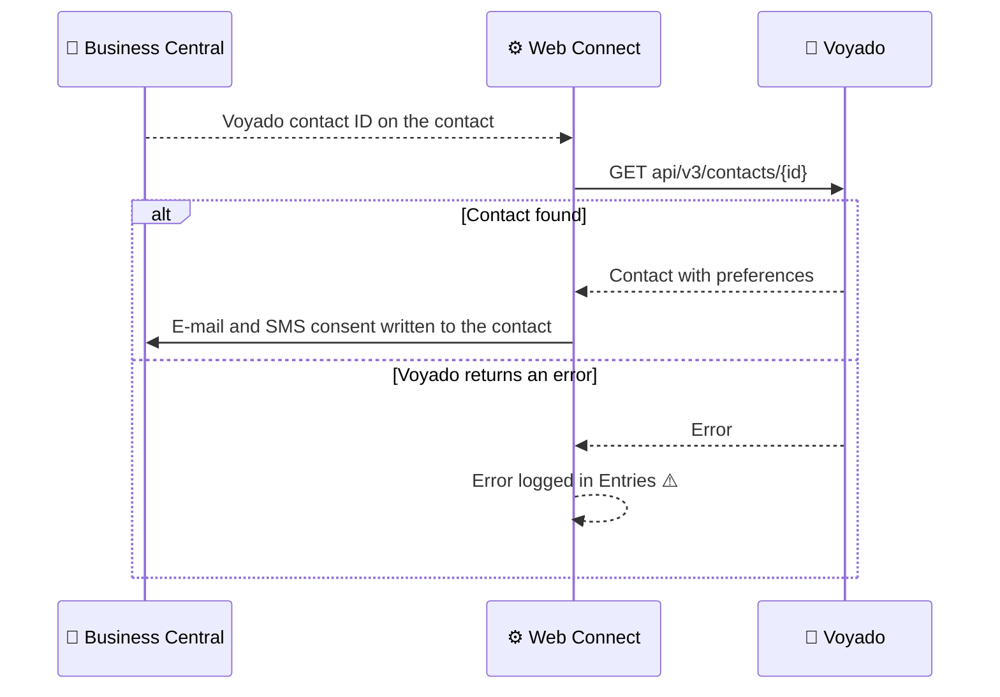

# Voyado to Business Central: contact consent

Web Connect fetches a contact from Voyado by the Voyado contact ID stored on the contact in Business Central. The e-mail and SMS preferences in the response are written to the consent fields on the contact, so Business Central shows the consent the member has in Voyado.

| | |
|---|---|
| **Direction** | Voyado → Business Central |
| **Trigger** | Set up per implementation. The standard configuration has no fixed schedule or trigger for the fetch |
| **Result** | The e-mail and SMS consent fields on the contact have the values from Voyado |
| **Part of** | [Business Central and Voyado loyalty and CRM integration](../overview.md) |

## Step by step

1. Web Connect reads the Voyado contact ID from the contact in Business Central.
2. The contact is fetched from Voyado with `GET` to `api/v3/contacts/{id}`.
3. Web Connect writes `preferences.acceptsEmail` and `preferences.acceptsSms` from the response to the consent fields on the contact.
4. The rest of the response, such as attributes, consents and meta data, is kept in Entries.

## Data mapping

| Voyado field | Business Central field | Note |
|---|---|---|
| `id` (request) | Voyado contact ID field | Added to the URL. A field from an extension |
| `preferences.acceptsEmail` | E-mail consent field | A field from an extension |
| `preferences.acceptsSms` | SMS consent field | A field from an extension |

## Web Connect objects

| Object | Role |
|---|---|
| `VOYADO_GET_CONTACT` | Fetches the contact with `GET` on `api/v3/contacts/{id}` and writes the preferences to the contact |
| `VOYADO_PREFERENCES1`, `VOYADO_ATTRIBUTES1`, `VOYADO_CONSENTS1`, `VOYADO_META1` and their child objects | Split the response into its parts and keep them in Entries |

## Error handling

| Situation | What happens | What to do |
|---|---|---|
| The contact has no Voyado contact ID | There is no contact to fetch | Send the contact to Voyado first, see [Contacts](contacts.md) |
| Voyado returns an error | The call is logged with the response from Voyado | Read the response in [Entries](../../../general/entries.md) and check that the Voyado contact ID on the contact is correct |

## Frequently asked questions

### Which data is written back from Voyado?

Only the e-mail and SMS preferences, `acceptsEmail` and `acceptsSms`. The rest of the Voyado contact, such as attributes and store data, is kept in Web Connect Entries but not written to the contact.

## Related

- [Business Central and Voyado loyalty and CRM integration](../overview.md)
- [Contacts](contacts.md)
- [Entries](../../../general/entries.md)
