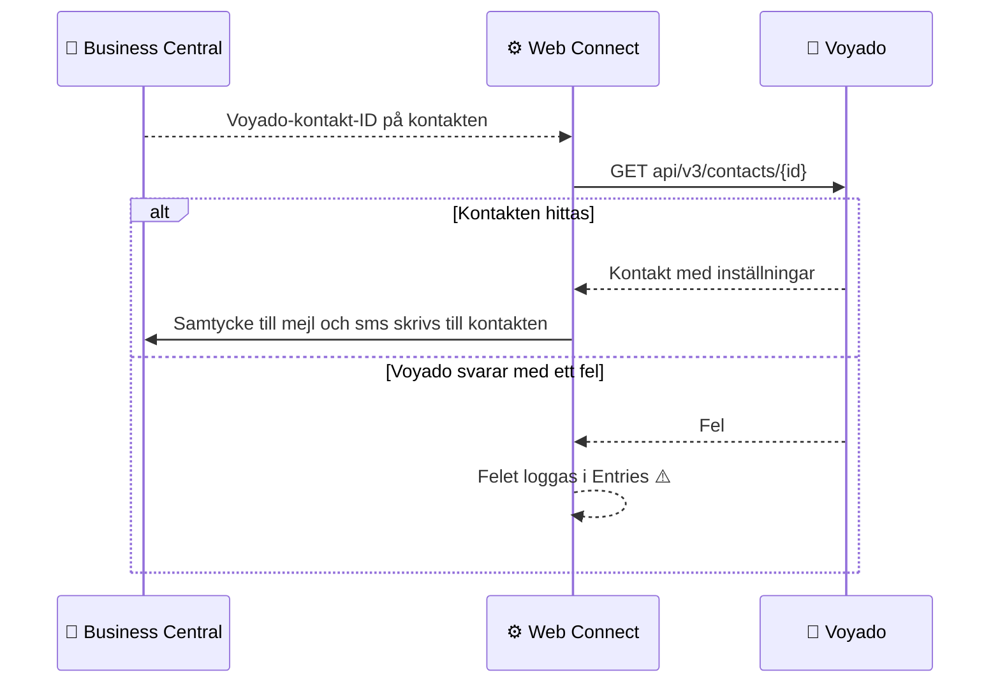

# Från Voyado till Business Central: kontaktens samtycke

Web Connect hämtar en kontakt från Voyado med det Voyado-kontakt-ID som är sparat på kontakten i Business Central. Inställningarna för mejl och sms i svaret skrivs till samtyckesfälten på kontakten, så att Business Central visar det samtycke medlemmen har i Voyado.

| | |
|---|---|
| **Riktning** | Voyado → Business Central |
| **Startas av** | Bestäms per implementation. Standardkonfigurationen har inget fast schema eller någon fast trigger för hämtningen |
| **Resultat** | Samtyckesfälten för mejl och sms på kontakten har värdena från Voyado |
| **Del av** | [Business Central och Voyado: integration](../overview.md) |

## Steg för steg

1. Web Connect läser Voyado-kontakt-ID:t från kontakten i Business Central.
2. Kontakten hämtas från Voyado med `GET` till `api/v3/contacts/{id}`.
3. Web Connect skriver `preferences.acceptsEmail` och `preferences.acceptsSms` från svaret till samtyckesfälten på kontakten.
4. Resten av svaret, som attribut, samtycken och metadata, sparas i Entries.

## Mappning av data

| Fält i Voyado | Fält i Business Central | Kommentar |
|---|---|---|
| `id` (anrop) | Fält för Voyado-kontakt-ID | Läggs till i URL:en. Ett fält från ett tillägg |
| `preferences.acceptsEmail` | Fält för samtycke till mejl | Ett fält från ett tillägg |
| `preferences.acceptsSms` | Fält för samtycke till sms | Ett fält från ett tillägg |

## Objekt i Web Connect

| Objekt | Roll |
|---|---|
| `VOYADO_GET_CONTACT` | Hämtar kontakten med `GET` på `api/v3/contacts/{id}` och skriver inställningarna till kontakten |
| `VOYADO_PREFERENCES1`, `VOYADO_ATTRIBUTES1`, `VOYADO_CONSENTS1`, `VOYADO_META1` och deras underobjekt | Delar upp svaret i sina delar och sparar dem i Entries |

## Felhantering

| Situation | Vad som händer | Gör så här |
|---|---|---|
| Kontakten har inget Voyado-kontakt-ID | Det finns ingen kontakt att hämta | Skicka först kontakten till Voyado, se [Kontakter](contacts.md) |
| Voyado svarar med ett fel | Anropet loggas med svaret från Voyado | Läs svaret i [Entries](../../../general/entries.md) och kontrollera att Voyado-kontakt-ID:t på kontakten stämmer |

## Vanliga frågor

### Vilken data skrivs tillbaka från Voyado?

Bara inställningarna för mejl och sms, `acceptsEmail` och `acceptsSms`. Resten av kontakten i Voyado, som attribut och butiksdata, sparas i Web Connect Entries men skrivs inte till kontakten.

## Relaterat

- [Business Central och Voyado: integration](../overview.md)
- [Kontakter](contacts.md)
- [Entries](../../../general/entries.md)
