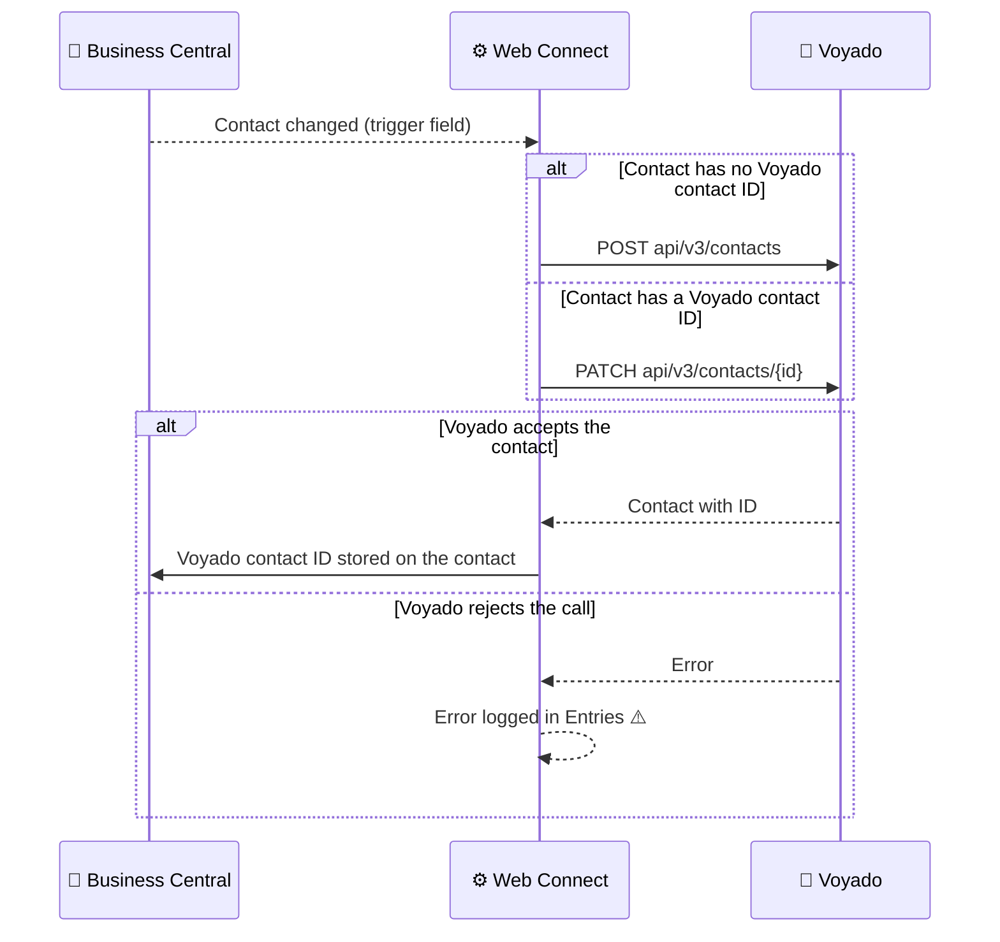

# Business Central to Voyado: contacts

When a contact changes in Business Central, Web Connect sends it to Voyado. A new contact is created as a Voyado contact and an existing one is updated, with name, address, e-mail, mobile phone, language, e-mail and SMS preferences and a member consent. The Voyado contact ID is stored on the contact, so later changes update the same member and orders can be linked to it.

| | |
|---|---|
| **Direction** | Business Central → Voyado |
| **Trigger** | Outgoing sync trigger in Business Central: a change to one of the trigger fields on the contact. The message is sent by the Web Connect job queue |
| **Result** | The contact exists in Voyado with the Business Central contact number as external ID. The Voyado contact ID is stored on the contact |
| **Part of** | [Business Central and Voyado loyalty and CRM integration](../overview.md) |

## Step by step

1. A contact field that is set as a trigger field changes in Business Central.
2. The outgoing sync trigger creates a contact message in Web Connect.
3. Web Connect checks whether the contact has a Voyado contact ID. Without one, the contact is created with `POST` to `api/v3/contacts`. With one, the contact is updated with `PATCH` to `api/v3/contacts/{id}`.
4. The message carries the contact data, the language translated with a text mapping, the e-mail and SMS preferences and a member consent with the current date and time.
5. Voyado returns the contact. Web Connect stores the Voyado contact ID on the contact and keeps the response in Entries.

## Data mapping

| Voyado field | Business Central field | Note |
|---|---|---|
| `externalId` | No. | The contact number |
| `firstName` | First Name | |
| `lastName` | Surname, or Name | A condition sends Name when Surname is empty |
| `street` | Address | |
| `zipCode` | Post Code | |
| `city` | City | |
| `countryCode` | Country/Region Code | |
| `email` | E-Mail | |
| `mobilePhone` | Mobile Phone No. | |
| `lang` | Language Code | Translated with a text mapping, for example SVE to `sv`, DAN to `da`, FIN to `fi`, NOR to `no` and ENU to `en`. A default language is sent when the field is empty |
| `preferences.acceptsEmail` | E-mail consent field | A field from an extension |
| `preferences.acceptsSms` | SMS consent field | A field from an extension |
| `preferences.acceptsPostal` | Fixed value | `true` in the standard setup |
| `consents` | Fixed values | A member consent set to `true`, with the current date and time, a source and a comment |
| `id` (response) | Voyado contact ID field | Stored on the contact as Web Connect External ID and in a field from an extension |

## Web Connect objects

| Object | Role |
|---|---|
| `VOYADO_CONTACT` | The contact. Posted to `api/v3/contacts` on create and patched on `api/v3/contacts/{id}` on update |
| `VOYADO_PREFERENCES` | The `preferences` object inside the contact, with the e-mail, SMS and postal preferences |
| `VOYADO_CONSENTS` | The `consents` array inside the contact, with the member consent |
| `VOYADO_ATTRIBUTES` and `VOYADO_META` | Store the `attributes` and `meta` parts of the response in Entries |

## Error handling

| Situation | What happens | What to do |
|---|---|---|
| Voyado rejects the contact | The message is logged with the response from Voyado | Read the response in [Entries](../../../general/entries.md), correct the contact or the mapping and [resend](../../../../../how-to/web-connect/resend-outgoing-message.md) |
| The contact is created twice in Voyado | The contact had no Voyado contact ID when it was sent, although the member already existed | Store the existing Voyado contact ID on the contact, see ["Entity already exists"](../../../../../how-to/web-connect/entity-already-exists-update-with-external-id.md) |
| The contact is not sent | No trigger field changed, or the trigger is not set up for the field that changed | Check the trigger fields in [Outgoing Sync Triggers](../../../general/outgoing-mapping/outgoing-sync-triggers.md) |

## Frequently asked questions

### Which changes to a contact send it to Voyado?

The fields set as trigger fields on the contact, for example name, address, phone, country, e-mail and the e-mail and SMS consent fields. You choose the fields in the outgoing sync trigger.

### What happens when the contact has no surname?

A condition sends the contact name as the last name instead, so Voyado always gets a last name.

## Related

- [Business Central and Voyado loyalty and CRM integration](../overview.md)
- [Contact consent](contact-preferences.md)
- [Orders](orders.md)
- [Outgoing Sync Triggers](../../../general/outgoing-mapping/outgoing-sync-triggers.md)
- [Text Mapping](../../../general/text-mapping.md)
