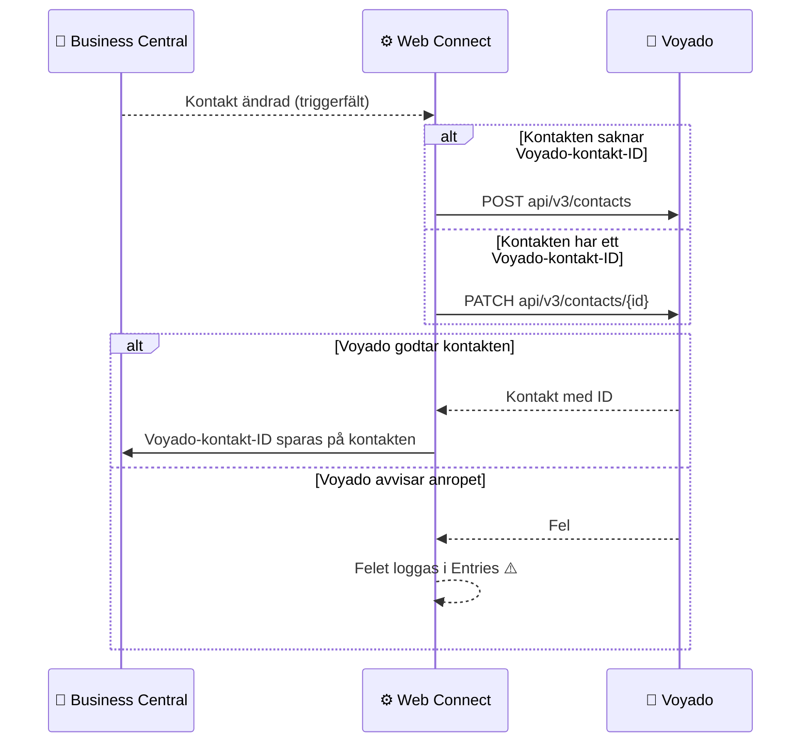

# Från Business Central till Voyado: kontakter

När en kontakt ändras i Business Central skickar Web Connect den till Voyado. En ny kontakt skapas som kontakt i Voyado och en befintlig uppdateras, med namn, adress, mejl, mobilnummer, språk, inställningar för mejl och sms och ett medlemssamtycke. Voyado-kontakt-ID:t sparas på kontakten, så att senare ändringar uppdaterar samma medlem och order kan kopplas till den.

| | |
|---|---|
| **Riktning** | Business Central → Voyado |
| **Startas av** | Utgående synktrigger i Business Central: en ändring i något av triggerfälten på kontakten. Meddelandet skickas av jobbkön i Web Connect |
| **Resultat** | Kontakten finns i Voyado med kontaktnumret från Business Central som externt ID. Voyado-kontakt-ID:t sparas på kontakten |
| **Del av** | [Business Central och Voyado: integration](../overview.md) |

## Steg för steg

1. Ett kontaktfält som är inställt som triggerfält ändras i Business Central.
2. Den utgående synktriggern skapar ett kontaktmeddelande i Web Connect.
3. Web Connect kontrollerar om kontakten har ett Voyado-kontakt-ID. Saknas det skapas kontakten med `POST` till `api/v3/contacts`. Finns det uppdateras kontakten med `PATCH` till `api/v3/contacts/{id}`.
4. Meddelandet innehåller kontaktuppgifterna, språket översatt med en textmappning, inställningarna för mejl och sms och ett medlemssamtycke med aktuellt datum och klockslag.
5. Voyado skickar tillbaka kontakten. Web Connect sparar Voyado-kontakt-ID:t på kontakten och svaret i Entries.

## Mappning av data

| Fält i Voyado | Fält i Business Central | Kommentar |
|---|---|---|
| `externalId` | No. | Kontaktnumret |
| `firstName` | First Name | |
| `lastName` | Surname, eller Name | Ett villkor skickar Name när Surname är tomt |
| `street` | Address | |
| `zipCode` | Post Code | |
| `city` | City | |
| `countryCode` | Country/Region Code | |
| `email` | E-Mail | |
| `mobilePhone` | Mobile Phone No. | |
| `lang` | Language Code | Översätts med en textmappning, till exempel SVE till `sv`, DAN till `da`, FIN till `fi`, NOR till `no` och ENU till `en`. Ett standardspråk skickas när fältet är tomt |
| `preferences.acceptsEmail` | Fält för samtycke till mejl | Ett fält från ett tillägg |
| `preferences.acceptsSms` | Fält för samtycke till sms | Ett fält från ett tillägg |
| `preferences.acceptsPostal` | Fast värde | `true` i standardupplägget |
| `consents` | Fasta värden | Ett medlemssamtycke satt till `true`, med aktuellt datum och klockslag, en källa och en kommentar |
| `id` (svar) | Fält för Voyado-kontakt-ID | Sparas på kontakten som External ID i Web Connect och i ett fält från ett tillägg |

## Objekt i Web Connect

| Objekt | Roll |
|---|---|
| `VOYADO_CONTACT` | Kontakten. Skickas med POST till `api/v3/contacts` när den skapas och med PATCH på `api/v3/contacts/{id}` när den uppdateras |
| `VOYADO_PREFERENCES` | Objektet `preferences` i kontakten, med inställningarna för mejl, sms och post |
| `VOYADO_CONSENTS` | Listan `consents` i kontakten, med medlemssamtycket |
| `VOYADO_ATTRIBUTES` och `VOYADO_META` | Sparar delarna `attributes` och `meta` i svaret i Entries |

## Felhantering

| Situation | Vad som händer | Gör så här |
|---|---|---|
| Voyado avvisar kontakten | Meddelandet loggas med svaret från Voyado | Läs svaret i [Entries](../../../general/entries.md), rätta kontakten eller mappningen och [skicka om](../../../../../how-to/web-connect/resend-outgoing-message.md) |
| Kontakten skapas två gånger i Voyado | Kontakten hade inget Voyado-kontakt-ID när den skickades, fast medlemmen redan fanns | Spara det befintliga Voyado-kontakt-ID:t på kontakten, se ["Entity already exists"](../../../../../how-to/web-connect/entity-already-exists-update-with-external-id.md) |
| Kontakten skickas inte | Inget triggerfält ändrades, eller så är triggern inte inställd för fältet som ändrades | Kontrollera triggerfälten i [Outgoing Sync Triggers](../../../general/outgoing-mapping/outgoing-sync-triggers.md) |

## Vanliga frågor

### Vilka ändringar på en kontakt gör att den skickas till Voyado?

Fälten som är inställda som triggerfält på kontakten, till exempel namn, adress, telefon, land, mejl och samtyckesfälten för mejl och sms. Du väljer fälten i den utgående synktriggern.

### Vad händer när kontakten saknar efternamn?

Ett villkor skickar då kontaktens namn som efternamn, så att Voyado alltid får ett efternamn.

## Relaterat

- [Business Central och Voyado: integration](../overview.md)
- [Kontaktens samtycke](contact-preferences.md)
- [Order](orders.md)
- [Outgoing Sync Triggers](../../../general/outgoing-mapping/outgoing-sync-triggers.md)
- [Text Mapping](../../../general/text-mapping.md)
