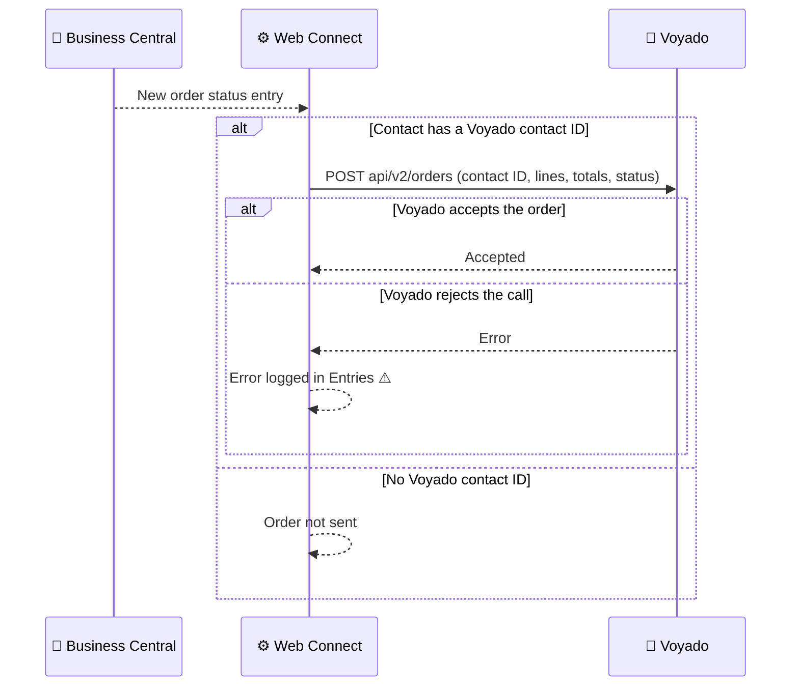

# Business Central to Voyado: orders

When the Web Connect order status of a sales order changes to confirmed, processing or shipped, Web Connect sends the order to Voyado. The order is linked to the member by the Voyado contact ID and carries the order lines, freight, totals, store, currency and status, so Voyado can use the purchase for points, offers and segmentation.

| | |
|---|---|
| **Direction** | Business Central → Voyado |
| **Trigger** | Outgoing sync trigger in Business Central: a Web Connect order status entry is created or changed for the sales order. The message is sent by the Web Connect job queue |
| **Result** | The order exists in Voyado on the member, with the Business Central order number and the current status |
| **Part of** | [Business Central and Voyado loyalty and CRM integration](../overview.md) |

## Step by step

1. Web Connect writes an order status entry when the sales order moves on in Business Central.
2. The outgoing sync trigger checks the order against the filter on the order object: the document type is order, the order belongs to the sales channels or stores that are sent, and the last Web Connect order status is confirmed, processing or shipped.
3. A condition checks that a Voyado contact ID exists for the order's customer. Orders without one are not sent.
4. Web Connect builds the order: the contact ID, the order lines without freight, the freight fee, the totals, the store, the currency, the language and the status.
5. The order is sent with `POST` to `api/v2/orders`. The response from Voyado is kept in Entries.

## Data mapping

### Order

| Voyado field | Business Central field | Note |
|---|---|---|
| `orderNumber` | No. | The sales order number |
| `contact.matchKey` | Voyado contact ID on the contact | Looked up from the contact that belongs to the order. `matchKeyType` is `contactId` |
| `orderStatus` | Web Connect last order status | Translated with a text mapping, for example confirmed and processing to `Confirmed` and shipped to `SENT` |
| `paymentStatus` | Fixed value | `NA` in the standard setup |
| `language` | Language Code | |
| `currency` | Currency Code | An empty code, meaning the local currency, is translated to the currency code with a text mapping |
| `storeId` | Shortcut Dimension 2 Code | Translated to the Voyado store ID with a text mapping. You choose the dimension in the mapping |
| `createdDate` | Created date and time of the order | Sent as date and time |
| `lastChangedAt` | Last modified date and time of the order | Sent as date and time |
| `totalGrossPrice` | Amount Including VAT | |
| `totalTax` | Amount Including VAT minus Amount | A dynamic flow field |
| `freightFee.value` | Amount Including VAT on the freight line | Freight lines are found by item number |
| `extraData` | Sell-to Customer No., Order Date, Payment Method Code, Shipping Agent Code, Ship-to name, address, post code, city and country, phone, e-mail and the total VAT | Free data on the order that Voyado stores with the purchase |

### Order lines

| Voyado field | Business Central field | Note |
|---|---|---|
| `type` | Fixed value | `PURCHASE` |
| `sku` | No. | The item number |
| `quantity` | Quantity | |
| `grossPaidPrice` | Amount Including VAT | The amount paid for the line, after line discounts |
| `taxAmount` | Amount Including VAT minus Amount | A dynamic flow field |
| `taxPercent` | VAT % | |
| `description` | Description | |
| `imageUrl` | Image reference on the item | Inserted in a URL template to your image service |

Lines with the freight item numbers are left out of `items` and sent as `freightFee` instead.

## Web Connect objects

| Object | Role |
|---|---|
| `VOYADO_ORDER` | The order. Posted to `api/v2/orders` |
| `VOYADO_ORDERCONTACT` | The `contact` object with the Voyado contact ID |
| `VOYADO_LINEITEMS` | The order lines, without freight |
| `VOYADO_FREIGHTFEE` | The freight fee, from the freight lines |
| `VOYADO_EXTRADATA1` | The `extraData` object on the order |
| `HAS-VOYADO-ID` | The condition that stops orders whose contact has no Voyado contact ID |

## Error handling

| Situation | What happens | What to do |
|---|---|---|
| The contact has no Voyado contact ID | The order is not sent | Send the contact to Voyado, see [Contacts](contacts.md), and then [resend](../../../../../how-to/web-connect/resend-outgoing-message.md) the order |
| Voyado rejects the order | The message is logged with the response from Voyado | Read the response in [Entries](../../../general/entries.md), correct the order or the mapping and [resend](../../../../../how-to/web-connect/resend-outgoing-message.md) |
| The wrong store or currency in Voyado | The text mapping has no line for the value on the order | Add the value in [Text Mapping](../../../general/text-mapping.md) |

## Frequently asked questions

### Why is an order not sent to Voyado?

The order is only sent when its contact has a Voyado contact ID, when it matches the filter on the order object and when its Web Connect order status changes to confirmed, processing or shipped. Check the contact first, then the filter and the status.

### Is the order sent again when it is shipped?

Yes. Every new Web Connect order status entry sends the order again, with the status translated to the Voyado order status. Shipped is sent as `SENT`.

## Related

- [Business Central and Voyado loyalty and CRM integration](../overview.md)
- [Contacts](contacts.md)
- [Dynamic Flow Fields](../../../general/dynamic-flow-fields.md)
- [Text Mapping](../../../general/text-mapping.md)
