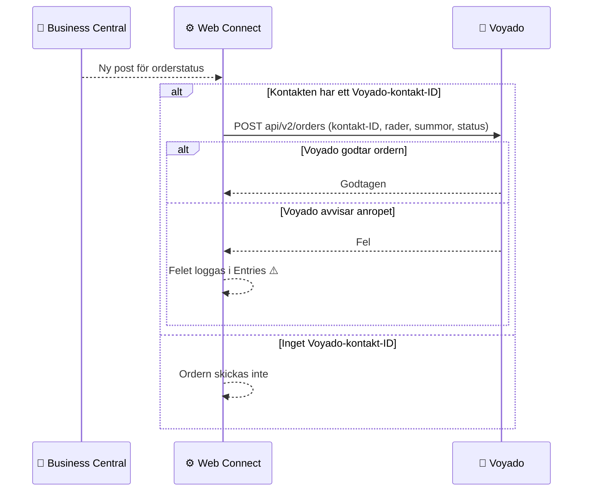

# Från Business Central till Voyado: order

När orderstatusen i Web Connect för en försäljningsorder ändras till bekräftad, under behandling eller levererad skickar Web Connect ordern till Voyado. Ordern kopplas till medlemmen via Voyado-kontakt-ID:t och innehåller orderrader, frakt, summor, butik, valuta och status, så att Voyado kan använda köpet för poäng, erbjudanden och segmentering.

| | |
|---|---|
| **Riktning** | Business Central → Voyado |
| **Startas av** | Utgående synktrigger i Business Central: en post för orderstatus i Web Connect skapas eller ändras för försäljningsordern. Meddelandet skickas av jobbkön i Web Connect |
| **Resultat** | Ordern finns i Voyado på medlemmen, med ordernumret från Business Central och aktuell status |
| **Del av** | [Business Central och Voyado: integration](../overview.md) |

## Steg för steg

1. Web Connect skriver en post för orderstatus när försäljningsordern går vidare i Business Central.
2. Den utgående synktriggern stämmer av ordern mot filtret på orderobjektet: dokumenttypen är order, ordern hör till de försäljningskanaler eller butiker som skickas, och den senaste orderstatusen i Web Connect är bekräftad, under behandling eller levererad.
3. Ett villkor kontrollerar att det finns ett Voyado-kontakt-ID för orderns kund. Order utan ID skickas inte.
4. Web Connect bygger ordern: kontakt-ID, orderraderna utan frakt, fraktavgiften, summorna, butiken, valutan, språket och statusen.
5. Ordern skickas med `POST` till `api/v2/orders`. Svaret från Voyado sparas i Entries.

## Mappning av data

### Order

| Fält i Voyado | Fält i Business Central | Kommentar |
|---|---|---|
| `orderNumber` | No. | Försäljningsorderns nummer |
| `contact.matchKey` | Voyado-kontakt-ID på kontakten | Slås upp från kontakten som hör till ordern. `matchKeyType` är `contactId` |
| `orderStatus` | Senaste orderstatus i Web Connect | Översätts med en textmappning, till exempel bekräftad och under behandling till `Confirmed` och levererad till `SENT` |
| `paymentStatus` | Fast värde | `NA` i standardupplägget |
| `language` | Language Code | |
| `currency` | Currency Code | En tom kod, som betyder lokal valuta, översätts till valutakoden med en textmappning |
| `storeId` | Shortcut Dimension 2 Code | Översätts till butiks-ID:t i Voyado med en textmappning. Du väljer dimension i mappningen |
| `createdDate` | Datum och klockslag när ordern skapades | Skickas som datum och klockslag |
| `lastChangedAt` | Datum och klockslag när ordern senast ändrades | Skickas som datum och klockslag |
| `totalGrossPrice` | Amount Including VAT | |
| `totalTax` | Amount Including VAT minus Amount | Ett dynamiskt flödesfält |
| `freightFee.value` | Amount Including VAT på fraktraden | Fraktrader känns igen på artikelnumret |
| `extraData` | Sell-to Customer No., Order Date, Payment Method Code, Shipping Agent Code, Ship-to namn, adress, postnummer, ort och land, telefon, mejl och total moms | Fri data på ordern som Voyado sparar tillsammans med köpet |

### Orderrader

| Fält i Voyado | Fält i Business Central | Kommentar |
|---|---|---|
| `type` | Fast värde | `PURCHASE` |
| `sku` | No. | Artikelnumret |
| `quantity` | Quantity | |
| `grossPaidPrice` | Amount Including VAT | Det betalda beloppet för raden, efter radrabatter |
| `taxAmount` | Amount Including VAT minus Amount | Ett dynamiskt flödesfält |
| `taxPercent` | VAT % | |
| `description` | Description | |
| `imageUrl` | Bildreferens på artikeln | Infogas i en URL-mall till er bildtjänst |

Rader med artikelnumren för frakt tas inte med i `items` utan skickas som `freightFee`.

## Objekt i Web Connect

| Objekt | Roll |
|---|---|
| `VOYADO_ORDER` | Ordern. Skickas med POST till `api/v2/orders` |
| `VOYADO_ORDERCONTACT` | Objektet `contact` med Voyado-kontakt-ID:t |
| `VOYADO_LINEITEMS` | Orderraderna, utan frakt |
| `VOYADO_FREIGHTFEE` | Fraktavgiften, från fraktraderna |
| `VOYADO_EXTRADATA1` | Objektet `extraData` på ordern |
| `HAS-VOYADO-ID` | Villkoret som stoppar order vars kontakt saknar Voyado-kontakt-ID |

## Felhantering

| Situation | Vad som händer | Gör så här |
|---|---|---|
| Kontakten saknar Voyado-kontakt-ID | Ordern skickas inte | Skicka kontakten till Voyado, se [Kontakter](contacts.md), och [skicka](../../../../../how-to/web-connect/resend-outgoing-message.md) sedan om ordern |
| Voyado avvisar ordern | Meddelandet loggas med svaret från Voyado | Läs svaret i [Entries](../../../general/entries.md), rätta ordern eller mappningen och [skicka om](../../../../../how-to/web-connect/resend-outgoing-message.md) |
| Fel butik eller valuta i Voyado | Textmappningen saknar en rad för värdet på ordern | Lägg till värdet i [Text Mapping](../../../general/text-mapping.md) |

## Vanliga frågor

### Varför skickas inte en order till Voyado?

Ordern skickas bara när dess kontakt har ett Voyado-kontakt-ID, när den matchar filtret på orderobjektet och när dess orderstatus i Web Connect ändras till bekräftad, under behandling eller levererad. Kontrollera kontakten först, sedan filtret och statusen.

### Skickas ordern igen när den levereras?

Ja. Varje ny post för orderstatus i Web Connect skickar ordern igen, med statusen översatt till Voyados orderstatus. Levererad skickas som `SENT`.

## Relaterat

- [Business Central och Voyado: integration](../overview.md)
- [Kontakter](contacts.md)
- [Dynamic Flow Fields](../../../general/dynamic-flow-fields.md)
- [Text Mapping](../../../general/text-mapping.md)
