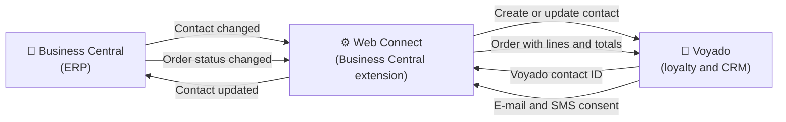
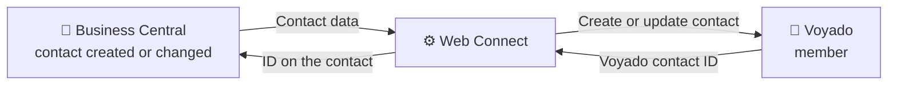
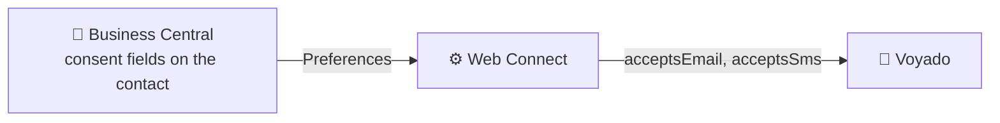
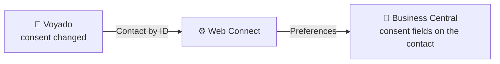
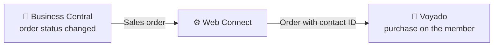

# Business Central and Voyado loyalty and CRM integration

Web Connect by CombineIT connects Microsoft Dynamics 365 Business Central with Voyado, the loyalty and CRM platform. Contacts are created and updated in Voyado when they change in Business Central, orders are sent to Voyado when their status changes, and e-mail and SMS consent can be read back from Voyado. All mappings and rules live in your own Business Central, where you can see and change them yourself.

## At a glance

| | |
|---|---|
| **System** | Voyado (loyalty and CRM) |
| **Integration product** | Web Connect for Microsoft Dynamics 365 Business Central |
| **Runs in** | Your own Business Central environment, as an extension. Web Connect sends a contact when it changes in Business Central and an order when its Web Connect order status changes. The messages are sent by the Web Connect job queue. No webhooks and no external integration platform are involved. All processing and configuration stays in Business Central. |
| **Configured by** | You, in Business Central: mappings, conditions, triggers and flows. You can do all of it yourself. If you want, CombineIT takes part in any step, as a sounding board or by doing the work. |
| **Connection** | Voyado REST API (JSON), with an API key in the `apikey` header |
| **Voyado API** | [Voyado developer documentation](https://developer.voyado.com/) |
| **Data flows** | 3: contacts, contact consent and orders |
| **Business Central editions** | All editions, Essentials and Premium, including the latest version |
| **Available from** | [Web Connect on Microsoft AppSource](https://marketplace.microsoft.com/sv-se/product/PUBID.martitab1633951001710%7CAID.webconnect%7CPAPPID.9f3a7223-19db-4ac7-832f-cf8e4699186f?tab=Overview). The Voyado integration is not part of the Web Connect Ready Integrations app. It is set up as a configuration in Web Connect |

## What can be synchronized

Web Connect has three data flows between Business Central and Voyado.

| Data | Direction | What happens |
|---|---|---|
| [Contacts](flows/contacts.md) | Business Central → Voyado | The contact is created or updated in Voyado with name, address, e-mail, mobile phone, language, e-mail and SMS preferences and a member consent. The Voyado contact ID is stored on the contact |
| [Contact consent](flows/contact-preferences.md) | Voyado → Business Central | The contact is fetched from Voyado by its Voyado contact ID, and the e-mail and SMS preferences are written to the contact in Business Central |
| [Orders](flows/orders.md) | Business Central → Voyado | The sales order is sent to Voyado as a purchase on the member, with order lines, freight, totals, store and status, when its Web Connect order status changes |

Contacts are the core of the integration, since an order is only sent when its contact has a Voyado contact ID. Which flows to use is decided at setup, see [Choose your setup](#choose-your-setup).

## How it works

Web Connect watches the contact in Business Central. When a mapped field on the contact changes, Web Connect sends the contact to Voyado. A contact without a Voyado contact ID is created with `POST` to `api/v3/contacts`. A contact that already has one is updated with `PATCH` on `api/v3/contacts/{id}`. The ID that Voyado returns is stored on the contact.

Orders are sent when Web Connect writes a new order status entry for the sales order. Web Connect checks that the order's contact has a Voyado contact ID, builds the order with lines, freight and totals, and sends it to `api/v2/orders` with the status translated to the Voyado order status.

Every message, and the response from Voyado, is kept in Web Connect [Entries](../../general/entries.md). Web Connect authenticates with an API key that is created in Voyado and sent in the `apikey` header.

## Choose your setup

Each flow has to fit how your business works: which system owns the data, where people do their work, and what the accounting needs. That is why the flows are decided together when a new integration is set up. The options below are the ones Web Connect customers use today. **Common setup** marks the option most Web Connect customers with Voyado use. **Recommended** marks CombineIT's best practice, where there is one.

The Voyado integration is in use with one Web Connect customer today. That is too few to say what is common, so no option below is marked as common setup.

### Member contacts

| Option | How it works | When it fits |
|---|---|---|
| **Contacts created in Business Central** | The contact is created or changed in Business Central and sent to Voyado, with a member consent and the e-mail and SMS preferences. Voyado returns the contact ID, which is stored on the contact | Customers become members through a channel that creates the contact in Business Central, for example a webshop or a store whose orders are created in Business Central |

#### Member contacts created in Business Central

### E-mail and SMS consent

| Option | How it works | When it fits |
|---|---|---|
| **Consent sent from Business Central** | The e-mail and SMS preferences are kept in fields on the contact and sent to Voyado with the contact | Consent is given where the contact is created, for example in checkout |
| **Consent read back from Voyado** | Web Connect fetches the contact from Voyado and writes the e-mail and SMS preferences back to the contact | The member can change consent in Voyado, for example by unsubscribing from a mail, and Business Central must show the current value |

The two options are used together: consent is sent with the contact and read back when it may have changed in Voyado.

#### E-mail and SMS consent sent from Business Central

#### E-mail and SMS consent read back from Voyado

### Purchases on the member

| Option | How it works | When it fits |
|---|---|---|
| **Orders sent at status changes** | When the Web Connect order status of a sales order changes to confirmed, processing or shipped, the order is sent to Voyado with the member's contact ID, lines, freight, totals, store and status | Purchases are registered in Business Central and Voyado needs them for points, offers and segmentation |

#### Purchases sent at order status changes

Points, offers, vouchers and member levels are always maintained in Voyado.

## What you need

- Microsoft Dynamics 365 Business Central, any edition (Essentials or Premium), including the latest version
- Web Connect installed from Microsoft AppSource, with an activated Web Connect license
- Your approval for Web Connect to be installed and to act in your Business Central environment
- An API key for the Voyado REST API, created in Voyado
- The address of your Voyado environment
- Fields on the contact for the Voyado contact ID and for the e-mail and SMS preferences. They are not standard fields in Business Central and come from an extension
- The store IDs in Voyado that the orders are registered on

## Setting it up

1. Decide which flows to use, see [Choose your setup](#choose-your-setup).
2. Install Web Connect in Business Central, activate the license and give your approval. The Voyado integration is not part of the Ready Integrations app. CombineIT goes through your needs, and when another Web Connect customer already uses the same flows, their setup is imported as a configuration file and adjusted to your Business Central. Flows that no other customer uses yet are set up for you, as far as the Voyado API supports them.
3. Store the Voyado API key in Web Connect [Secret Value Storage](../../general/secret-value-storage.md) and set up the authentication with the `apikey` header.
4. Map the contact fields, the language codes, the store IDs and the order statuses, see [Configuration choices](#configuration-choices).
5. Test with a few contacts and orders, with a Business Central sandbox against a Voyado test environment, before going live.

## Configure it yourself in Business Central

All configuration and logic in the integration is visible and editable in Business Central. There is no external integration platform where the logic is hidden.

| What you can change | Where in Web Connect | Example |
|---|---|---|
| Field mapping to Voyado | [Outgoing Data](../../general/outgoing-mapping/outgoing-data-web.md) | Send another contact field to Voyado, or add order data to `extraData`, for example the shipping agent or payment method |
| Values from related records | [Dynamic Flow Fields](../../general/dynamic-flow-fields.md) | Send the VAT amount of the order or of each line, calculated from the amounts on the sales document |
| Conditions | [Condition List](../../general/condition-list.md) | Only send orders whose contact has a Voyado contact ID, or send the contact name as last name when the surname is empty |
| Value mapping | [Text Mapping](../../general/text-mapping.md) | Translate Business Central language codes to Voyado languages, a dimension value to a Voyado store ID, and the Web Connect order status to the Voyado order status |
| What triggers an update | [Outgoing Sync Triggers](../../general/outgoing-mapping/outgoing-sync-triggers.md) | Choose which contact fields send the contact to Voyado when they change |
| Monitoring and resending | [Entries](../../general/entries.md) | See every contact and order sent and the response from Voyado, and [resend a message](../../../../how-to/web-connect/resend-outgoing-message.md) |

## Configuration choices

- **Contact fields:** which contact fields are sent. Standard fields such as first name, surname, name, address, post code, city, country, e-mail, mobile phone and language code can be sent, as well as fields from your own extensions.
- **Last name:** a condition sends the surname, or the contact name when the surname is empty.
- **Language:** a text mapping translates the Business Central language code to the Voyado language, for example SVE to `sv`. A default language is set for contacts without a language code.
- **Consent:** which contact fields hold the e-mail and SMS preferences, and the source and comment sent with the member consent.
- **Trigger fields:** which contact fields send the contact to Voyado when they change.
- **Which orders are sent:** a filter on the order object, for example on a dimension for the sales channel or store, together with the order statuses that send the order.
- **Order status:** a text mapping translates the Web Connect order status to the Voyado order status, for example confirmed and processing to `Confirmed` and shipped to `SENT`.
- **Store:** a text mapping translates a dimension value on the sales order to the store ID in Voyado.
- **Currency:** a text mapping translates an empty currency code, which means the local currency in Business Central, to the currency code sent to Voyado.
- **Freight:** which item numbers are freight. Freight lines are sent as the freight fee and left out of the order lines.
- **Product image:** the URL template for the image on each order line, filled in with the image reference on the item.

## Limitations

- **Contacts and orders go from Business Central to Voyado.** Only the e-mail and SMS preferences are read back. Other contact data in Voyado, such as attributes, store and recruitment data, is kept in Web Connect Entries but not written to the contact.
- **An order needs a Voyado contact ID.** Orders whose contact has not been sent to Voyado are not sent.
- **Discounts are not sent separately.** The order lines carry the amount paid including VAT. Discount codes and discount amounts are not sent as Voyado discounts in the standard setup.
- **Payment, delivery and tracking are not sent as Voyado objects.** The payment method, delivery address, shipping agent and contact details of the order are sent in `extraData`. Tracking numbers are not sent.
- **Returns and credit memos are not part of the integration.** Returns are not sent to Voyado in the standard setup.
- **Points, offers, vouchers and member levels are not synchronized.** They are maintained in Voyado.
- **The consent fields are not standard.** Business Central has no standard fields for e-mail and SMS consent or for the Voyado contact ID. They come from an extension.

## Frequently asked questions

### Can Business Central be integrated with Voyado?

Yes. Web Connect connects Business Central with Voyado through the Voyado REST API. Contacts are created and updated in Voyado when they change in Business Central, orders are sent to Voyado when their status changes, and e-mail and SMS consent can be read back from Voyado to the contact.

### Which orders are sent to Voyado?

Sales orders whose contact has a Voyado contact ID, and that match the filter set on the order object, for example which sales channel or store the order belongs to. The order is sent when its Web Connect order status changes to confirmed, processing or shipped.

### How is an order linked to the right member in Voyado?

Web Connect looks up the contact that belongs to the order and sends the Voyado contact ID that is stored on it. Voyado uses the ID to connect the purchase to the member.

### How does Web Connect log in to Voyado?

With an API key that is created in Voyado. Web Connect sends it in the `apikey` header on every call. The key is kept in Web Connect Secret Value Storage.

## Related

- Flows: [Contacts](flows/contacts.md) · [Contact consent](flows/contact-preferences.md) · [Orders](flows/orders.md)
- How-to: ["Entity already exists" when sending to an external API](../../../../how-to/web-connect/entity-already-exists-update-with-external-id.md) · [Resend an outgoing message](../../../../how-to/web-connect/resend-outgoing-message.md) · [Stop sending a value](../../../../how-to/web-connect/stop-sending-value-outgoing.md)
- [Web Connect general documentation](../../general/README.md)
- [Voyado developer documentation](https://developer.voyado.com/)

## About Web Connect

Web Connect is an integration platform for Microsoft Dynamics 365 Business Central, developed by CombineIT. It is installed in your own Business Central and connects it with e-commerce platforms, warehouse systems, POS, returns, marketplaces and EDI. Every flow, mapping and rule is configured in Business Central, where you can see and change it yourself, without custom code for each integration. [Web Connect on Microsoft AppSource](https://marketplace.microsoft.com/sv-se/product/PUBID.martitab1633951001710%7CAID.webconnect%7CPAPPID.9f3a7223-19db-4ac7-832f-cf8e4699186f?tab=Overview) · [Contact CombineIT](https://www.combineit.se/contact/)
