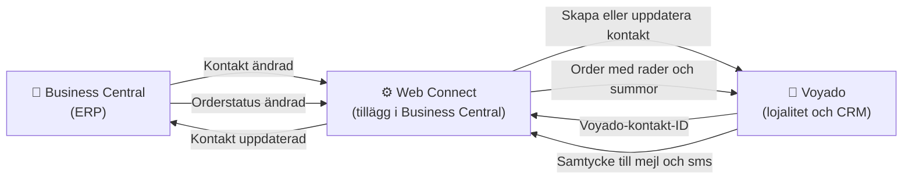
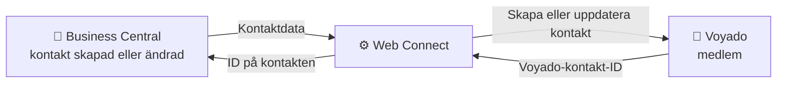
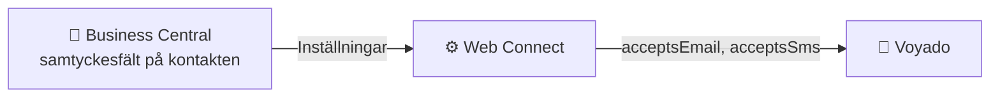
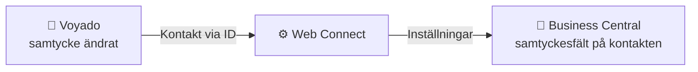
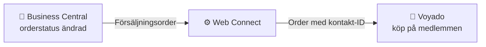

# Business Central och Voyado: integration

Web Connect från CombineIT kopplar ihop Microsoft Dynamics 365 Business Central med Voyado, plattformen för lojalitet och CRM. Kontakter skapas och uppdateras i Voyado när de ändras i Business Central, order skickas till Voyado när deras status ändras, och samtycke till mejl och sms kan läsas tillbaka från Voyado. Alla mappningar och regler finns i ditt eget Business Central, där du själv kan se och ändra dem.

## I korthet

| | |
|---|---|
| **System** | Voyado (lojalitet och CRM) |
| **Integrationsprodukt** | Web Connect för Microsoft Dynamics 365 Business Central |
| **Körs i** | Din egen Business Central-miljö, som ett tillägg. Web Connect skickar en kontakt när den ändras i Business Central och en order när dess orderstatus i Web Connect ändras. Meddelandena skickas av jobbkön i Web Connect. Inga webhooks och ingen extern integrationsplattform är inblandade. All bearbetning och konfiguration stannar i Business Central. |
| **Konfigureras av** | Dig, i Business Central: mappningar, villkor, triggers och flöden. Du kan göra allt själv. Om du vill är CombineIT med i vilket steg som helst, som bollplank eller genom att göra jobbet. |
| **Koppling** | Voyados REST API (JSON), med en API-nyckel i headern `apikey` |
| **Voyados API** | [Voyados utvecklardokumentation](https://developer.voyado.com/) |
| **Dataflöden** | 3: kontakter, kontaktens samtycke och order |
| **Business Central-utgåvor** | Alla utgåvor, Essentials och Premium, även den senaste versionen |
| **Finns på** | [Web Connect på Microsoft AppSource](https://marketplace.microsoft.com/sv-se/product/PUBID.martitab1633951001710%7CAID.webconnect%7CPAPPID.9f3a7223-19db-4ac7-832f-cf8e4699186f?tab=Overview). Voyado-integrationen ingår inte i appen Web Connect Ready Integrations. Den sätts upp som en konfiguration i Web Connect |

## Det här kan synkas

Web Connect har tre dataflöden mellan Business Central och Voyado.

| Data | Riktning | Vad som händer |
|---|---|---|
| [Kontakter](flows/contacts.md) | Business Central → Voyado | Kontakten skapas eller uppdateras i Voyado med namn, adress, mejl, mobilnummer, språk, inställningar för mejl och sms och ett medlemssamtycke. Voyado-kontakt-ID:t sparas på kontakten |
| [Kontaktens samtycke](flows/contact-preferences.md) | Voyado → Business Central | Kontakten hämtas från Voyado med sitt Voyado-kontakt-ID, och inställningarna för mejl och sms skrivs till kontakten i Business Central |
| [Order](flows/orders.md) | Business Central → Voyado | Försäljningsordern skickas till Voyado som ett köp på medlemmen, med orderrader, frakt, summor, butik och status, när dess orderstatus i Web Connect ändras |

Kontakterna är kärnan i integrationen, eftersom en order bara skickas när kontakten har ett Voyado-kontakt-ID. Vilka flöden som används bestäms vid uppstarten, se [Välj upplägg](#choose-your-setup).

## Så fungerar det

Web Connect bevakar kontakten i Business Central. När ett mappat fält på kontakten ändras skickar Web Connect kontakten till Voyado. En kontakt utan Voyado-kontakt-ID skapas med `POST` till `api/v3/contacts`. En kontakt som redan har ett uppdateras med `PATCH` på `api/v3/contacts/{id}`. ID:t som Voyado skickar tillbaka sparas på kontakten.

Order skickas när Web Connect skriver en ny post för orderstatus på försäljningsordern. Web Connect kontrollerar att orderns kontakt har ett Voyado-kontakt-ID, bygger ordern med rader, frakt och summor och skickar den till `api/v2/orders`, med statusen översatt till Voyados orderstatus.

Varje meddelande och svaret från Voyado sparas i Web Connect [Entries](../../general/entries.md). Web Connect autentiserar sig med en API-nyckel som skapas i Voyado och skickas i headern `apikey`.

## Välj upplägg

Varje flöde måste passa hur ditt företag arbetar: vilket system som äger datan, var personalen gör sitt arbete och vad bokföringen behöver. Därför bestäms flödena tillsammans när en ny integration sätts upp. Alternativen nedan är de som Web Connect-kunder använder i dag. **Vanligt upplägg** markerar det alternativ som flest Web Connect-kunder med Voyado använder. **Rekommenderas** markerar CombineIT:s bästa praxis, där det finns en.

Voyado-integrationen används i dag av en Web Connect-kund. Det är för få för att säga vad som är vanligt, så inget alternativ nedan är markerat som vanligt upplägg.

### Medlemskontakter

| Alternativ | Så fungerar det | När det passar |
|---|---|---|
| **Kontakter skapas i Business Central** | Kontakten skapas eller ändras i Business Central och skickas till Voyado, med ett medlemssamtycke och inställningarna för mejl och sms. Voyado skickar tillbaka kontakt-ID:t, som sparas på kontakten | Kunderna blir medlemmar via en kanal som skapar kontakten i Business Central, till exempel en webbshop eller en butik vars order skapas i Business Central |

#### Medlemskontakter som skapas i Business Central

### Samtycke till mejl och sms

| Alternativ | Så fungerar det | När det passar |
|---|---|---|
| **Samtycket skickas från Business Central** | Inställningarna för mejl och sms finns i fält på kontakten och skickas till Voyado tillsammans med kontakten | Samtycket ges där kontakten skapas, till exempel i kassan |
| **Samtycket läses tillbaka från Voyado** | Web Connect hämtar kontakten från Voyado och skriver tillbaka inställningarna för mejl och sms till kontakten | Medlemmen kan ändra sitt samtycke i Voyado, till exempel genom att avregistrera sig från ett utskick, och Business Central måste visa det aktuella värdet |

De två alternativen används tillsammans: samtycket skickas med kontakten och läses tillbaka när det kan ha ändrats i Voyado.

#### Samtycke till mejl och sms som skickas från Business Central

#### Samtycke till mejl och sms som läses tillbaka från Voyado

### Köp på medlemmen

| Alternativ | Så fungerar det | När det passar |
|---|---|---|
| **Order skickas när statusen ändras** | När orderstatusen i Web Connect för en försäljningsorder ändras till bekräftad, under behandling eller levererad skickas ordern till Voyado med medlemmens kontakt-ID, rader, frakt, summor, butik och status | Köpen registreras i Business Central och Voyado behöver dem för poäng, erbjudanden och segmentering |

#### Köp som skickas när orderstatusen ändras

Poäng, erbjudanden, värdecheckar och medlemsnivåer sköts alltid i Voyado.

## Det här behöver du

- Microsoft Dynamics 365 Business Central, valfri utgåva (Essentials eller Premium), även den senaste versionen
- Web Connect installerat från Microsoft AppSource, med en aktiverad Web Connect-licens
- Ditt godkännande av att Web Connect installeras och agerar i din Business Central-miljö
- En API-nyckel till Voyados REST API, skapad i Voyado
- Adressen till din Voyado-miljö
- Fält på kontakten för Voyado-kontakt-ID:t och för inställningarna för mejl och sms. De är inte standardfält i Business Central utan kommer från ett tillägg
- Butiks-ID:n i Voyado som orderna registreras på

## Så kommer du igång

1. Bestäm vilka flöden som ska användas, se [Välj upplägg](#choose-your-setup).
2. Installera Web Connect i Business Central, aktivera licensen och ge ditt godkännande. Voyado-integrationen ingår inte i appen Ready Integrations. CombineIT går igenom era behov, och när en annan Web Connect-kund redan använder samma flöden importeras deras upplägg som en konfigurationsfil och anpassas till ditt Business Central. Flöden som ingen annan kund använder än sätts upp åt dig, så långt Voyados API stöder dem.
3. Spara Voyados API-nyckel i Web Connect [Secret Value Storage](../../general/secret-value-storage.md) och ställ in autentiseringen med headern `apikey`.
4. Mappa kontaktfälten, språkkoderna, butiks-ID:na och orderstatusarna, se [Val i konfigurationen](#configuration-choices).
5. Testa med några kontakter och order, med en sandlåda i Business Central mot en testmiljö i Voyado, innan ni går live.

## Konfigurera själv i Business Central

All konfiguration och logik i integrationen syns och kan ändras i Business Central. Det finns ingen extern integrationsplattform där logiken är dold.

| Det här kan du ändra | Var i Web Connect | Exempel |
|---|---|---|
| Fältmappning till Voyado | [Outgoing Data](../../general/outgoing-mapping/outgoing-data-web.md) | Skicka ett annat kontaktfält till Voyado, eller lägg till orderdata i `extraData`, till exempel speditör eller betalningssätt |
| Värden från relaterade poster | [Dynamic Flow Fields](../../general/dynamic-flow-fields.md) | Skicka momsbeloppet för ordern eller för varje rad, beräknat från beloppen på försäljningsdokumentet |
| Villkor | [Condition List](../../general/condition-list.md) | Skicka bara order vars kontakt har ett Voyado-kontakt-ID, eller skicka kontaktens namn som efternamn när efternamnet är tomt |
| Värdemappning | [Text Mapping](../../general/text-mapping.md) | Översätt språkkoder i Business Central till språk i Voyado, ett dimensionsvärde till ett butiks-ID i Voyado och orderstatusen i Web Connect till orderstatusen i Voyado |
| Vad som startar en uppdatering | [Outgoing Sync Triggers](../../general/outgoing-mapping/outgoing-sync-triggers.md) | Välj vilka kontaktfält som skickar kontakten till Voyado när de ändras |
| Övervakning och omsändning | [Entries](../../general/entries.md) | Se varje kontakt och order som skickats och svaret från Voyado, och [skicka om ett meddelande](../../../../how-to/web-connect/resend-outgoing-message.md) |

## Val i konfigurationen

- **Kontaktfält:** vilka fält på kontakten som skickas. Standardfält som förnamn, efternamn, namn, adress, postnummer, ort, land, mejl, mobilnummer och språkkod kan skickas, liksom fält från era egna tillägg.
- **Efternamn:** ett villkor skickar efternamnet, eller kontaktens namn när efternamnet är tomt.
- **Språk:** en textmappning översätter språkkoden i Business Central till språket i Voyado, till exempel SVE till `sv`. Ett standardspråk anges för kontakter utan språkkod.
- **Samtycke:** vilka fält på kontakten som håller inställningarna för mejl och sms, och vilken källa och kommentar som skickas med medlemssamtycket.
- **Triggerfält:** vilka kontaktfält som skickar kontakten till Voyado när de ändras.
- **Vilka order som skickas:** ett filter på orderobjektet, till exempel på en dimension för försäljningskanal eller butik, tillsammans med de orderstatusar som skickar ordern.
- **Orderstatus:** en textmappning översätter orderstatusen i Web Connect till orderstatusen i Voyado, till exempel bekräftad och under behandling till `Confirmed` och levererad till `SENT`.
- **Butik:** en textmappning översätter ett dimensionsvärde på försäljningsordern till butiks-ID:t i Voyado.
- **Valuta:** en textmappning översätter en tom valutakod, som betyder lokal valuta i Business Central, till den valutakod som skickas till Voyado.
- **Frakt:** vilka artikelnummer som är frakt. Fraktrader skickas som fraktavgiften och tas inte med bland orderraderna.
- **Produktbild:** URL-mallen för bilden på varje orderrad, ifylld med bildreferensen på artikeln.

## Begränsningar

- **Kontakter och order går från Business Central till Voyado.** Bara inställningarna för mejl och sms läses tillbaka. Övrig kontaktdata i Voyado, som attribut, butik och rekryteringsdata, sparas i Web Connect Entries men skrivs inte till kontakten.
- **En order kräver ett Voyado-kontakt-ID.** Order vars kontakt inte har skickats till Voyado skickas inte.
- **Rabatter skickas inte separat.** Orderraderna har det betalda beloppet inklusive moms. Rabattkoder och rabattbelopp skickas inte som rabatter i Voyado i standardupplägget.
- **Betalning, leverans och spårning skickas inte som objekt i Voyado.** Orderns betalningssätt, leveransadress, speditör och kontaktuppgifter skickas i `extraData`. Spårningsnummer skickas inte.
- **Returer och kreditnotor ingår inte i integrationen.** Returer skickas inte till Voyado i standardupplägget.
- **Poäng, erbjudanden, värdecheckar och medlemsnivåer synkas inte.** De sköts i Voyado.
- **Samtyckesfälten är inte standard.** Business Central har inga standardfält för samtycke till mejl och sms eller för Voyado-kontakt-ID:t. De kommer från ett tillägg.

## Vanliga frågor

### Går det att integrera Business Central med Voyado?

Ja. Web Connect kopplar ihop Business Central med Voyado via Voyados REST API. Kontakter skapas och uppdateras i Voyado när de ändras i Business Central, order skickas till Voyado när deras status ändras, och samtycke till mejl och sms kan läsas tillbaka från Voyado till kontakten.

### Vilka order skickas till Voyado?

Försäljningsorder vars kontakt har ett Voyado-kontakt-ID och som matchar filtret på orderobjektet, till exempel vilken försäljningskanal eller butik ordern hör till. Ordern skickas när dess orderstatus i Web Connect ändras till bekräftad, under behandling eller levererad.

### Hur kopplas en order till rätt medlem i Voyado?

Web Connect slår upp kontakten som hör till ordern och skickar det Voyado-kontakt-ID som är sparat på den. Voyado använder ID:t för att koppla köpet till medlemmen.

### Hur loggar Web Connect in i Voyado?

Med en API-nyckel som skapas i Voyado. Web Connect skickar den i headern `apikey` i varje anrop. Nyckeln sparas i Web Connect Secret Value Storage.

## Relaterat

- Flöden: [Kontakter](flows/contacts.md) · [Kontaktens samtycke](flows/contact-preferences.md) · [Order](flows/orders.md)
- Instruktioner: ["Entity already exists" när du skickar till ett externt API](../../../../how-to/web-connect/entity-already-exists-update-with-external-id.md) · [Skicka om ett utgående meddelande](../../../../how-to/web-connect/resend-outgoing-message.md) · [Sluta skicka ett värde](../../../../how-to/web-connect/stop-sending-value-outgoing.md)
- [Allmän dokumentation för Web Connect](../../general/README.md)
- [Voyados utvecklardokumentation](https://developer.voyado.com/)

## Om Web Connect

Web Connect är en integrationsplattform för Microsoft Dynamics 365 Business Central, utvecklad av CombineIT. Den installeras i ditt eget Business Central och kopplar ihop det med e-handelsplattformar, lagersystem, kassasystem, returlösningar, marknadsplatser och EDI. Varje flöde, mappning och regel konfigureras i Business Central, där du själv kan se och ändra dem, utan specialkod för varje integration. [Web Connect på Microsoft AppSource](https://marketplace.microsoft.com/sv-se/product/PUBID.martitab1633951001710%7CAID.webconnect%7CPAPPID.9f3a7223-19db-4ac7-832f-cf8e4699186f?tab=Overview) · [Kontakta CombineIT](https://www.combineit.se/contact/)