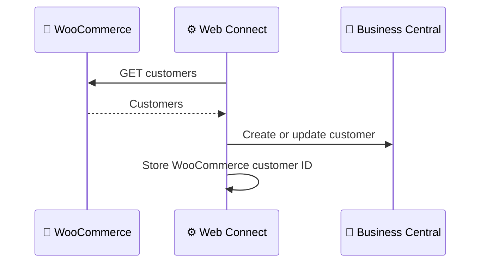

# WooCommerce to Business Central: customer inbound

Web Connect fetches customers from WooCommerce and creates or updates them in Business Central. The WooCommerce customer ID is stored, so incoming orders find the right customer.

| | |
|---|---|
| **Direction** | WooCommerce → Business Central |
| **Trigger** | Schedule in the Business Central job queue. How often the job runs can be adjusted to what your business needs |
| **Result** | A customer in Business Central, linked to the WooCommerce customer ID |
| **Part of** | [Business Central and WooCommerce integration](../overview.md) |

## Step by step

1. A customer registers an account in WooCommerce.
2. Web Connect fetches customers from WooCommerce, 100 at a time.
3. The Business Central customer number is read from a meta data field on the WooCommerce customer. An existing customer with that number is updated.
4. A new customer is created from a customer template.
5. The WooCommerce customer ID is stored as the external ID of the customer.

## Data mapping

| WooCommerce field | Business Central field | Note |
|---|---|---|
| `id` | External ID in Web Connect | Used by [Order inbound](order-inbound.md) to find the customer |
| Meta data field with the customer number | No. | Existing customer is updated |
| `email` | Customer template | Selects the template for new customers. [ATT FYLLA I: confirm] |

## Web Connect objects

| Object | Role |
|---|---|
| `WOC-CUSTOMER` | Fetches customers and creates or updates them |

## Related

- [Business Central and WooCommerce integration](../overview.md)
- [Order inbound](order-inbound.md)
- [WooCommerce REST API: customers](https://woocommerce.github.io/woocommerce-rest-api-docs/#customers)
