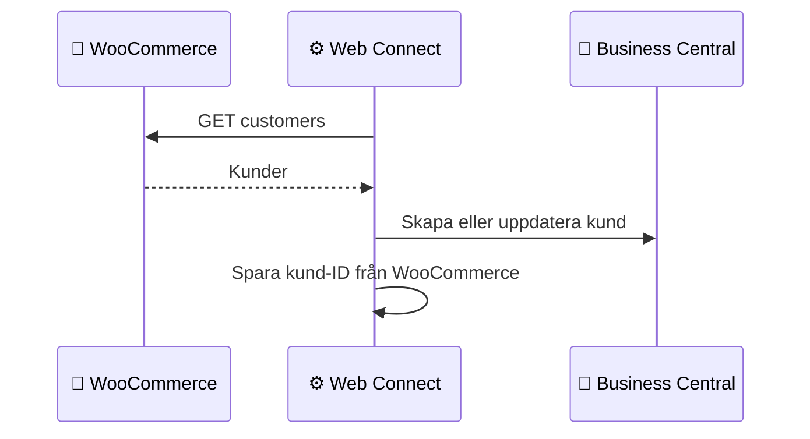

# Från WooCommerce till Business Central: kunder

Web Connect hämtar kunder från WooCommerce och skapar eller uppdaterar dem i Business Central. Kund-ID:t från WooCommerce sparas, så att inkommande order hittar rätt kund.

| | |
|---|---|
| **Riktning** | WooCommerce → Business Central |
| **Startas av** | Schema i jobbkön i Business Central. Hur ofta jobbet körs kan anpassas efter vad ditt företag behöver |
| **Resultat** | En kund i Business Central, kopplad till kund-ID:t i WooCommerce |
| **Del av** | [Business Central och WooCommerce: integration](../overview.md) |

## Steg för steg

1. En kund skapar ett konto i WooCommerce.
2. Web Connect hämtar kunder från WooCommerce, 100 åt gången.
3. Kundnumret i Business Central läses från ett metadatafält på kunden i WooCommerce. En befintlig kund med det numret uppdateras.
4. En ny kund skapas från en kundmall.
5. Kund-ID:t från WooCommerce sparas som kundens externa ID.

## Mappning av data

| Fält i WooCommerce | Fält i Business Central | Kommentar |
|---|---|---|
| `id` | Externt ID i Web Connect | Används av flödet [Order in](order-inbound.md) för att hitta kunden |
| Metadatafält med kundnumret | No. | En befintlig kund uppdateras |

## Objekt i Web Connect

| Objekt | Roll |
|---|---|
| `WOC-CUSTOMER` | Hämtar kunder och skapar eller uppdaterar dem |

## Relaterat

- [Business Central och WooCommerce: integration](../overview.md)
- [Order in](order-inbound.md)
- [WooCommerce REST API: kunder](https://woocommerce.github.io/woocommerce-rest-api-docs/#customers)
