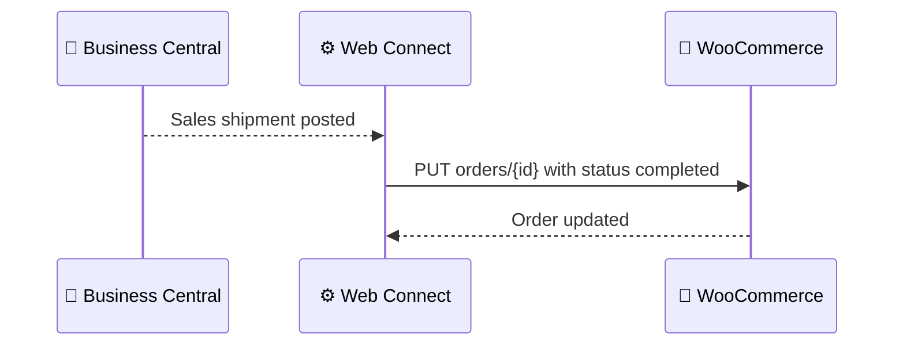

# Business Central to WooCommerce: order completion

When a sales shipment for a WooCommerce order is posted in Business Central, Web Connect sets the order to completed in WooCommerce. Only shipments for orders that came from WooCommerce are sent.

| | |
|---|---|
| **Direction** | Business Central → WooCommerce |
| **Trigger** | A posted sales shipment. [ATT FYLLA I: the outgoing sync trigger is not in the configuration export, confirm] |
| **Result** | The order has status completed in WooCommerce |
| **Part of** | [Business Central and WooCommerce integration](../overview.md) |

## Step by step

1. The order is shipped and the sales shipment is posted in Business Central.
2. Web Connect checks that the shipment belongs to an order from WooCommerce.
3. The order is updated in WooCommerce with status completed.

## Data mapping

| Business Central field | WooCommerce field | Note |
|---|---|---|
| Fixed value | `status` | Always `completed` |
| WooCommerce order ID on the shipment | Order in the URL | Shipments without it are not sent |

## Web Connect objects

| Object | Role |
|---|---|
| `WOC-UPDATE-ORDER-TO-SHIPPPED` | Sets the order to completed |

## Limitations

- No tracking number or carrier is sent, only the status.
- A partial shipment also sets the order to completed. [ATT FYLLA I: confirm]

## Related

- [Business Central and WooCommerce integration](../overview.md)
- [Order inbound](order-inbound.md)
